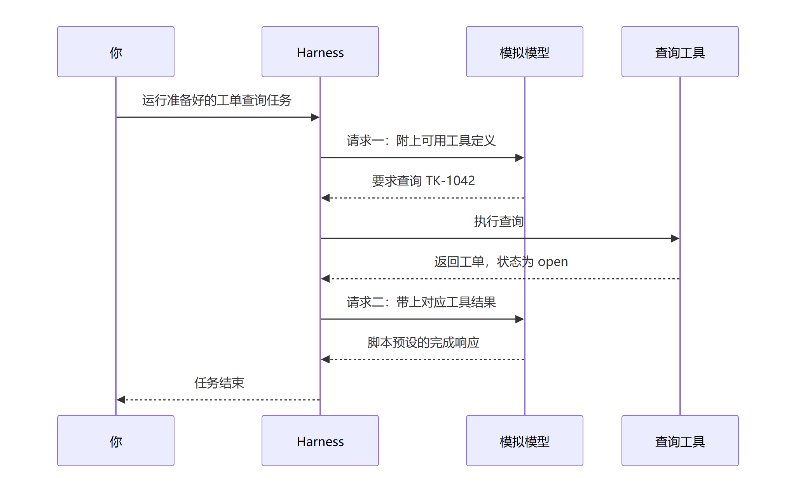

# 第一章 一句请求发出去以后

“帮我看看 TK-1042 处理到哪一步了。”

你收到这句话，打开工单系统，输入编号，看到了状态，然后把结果告诉对方。这件事很平常。现在把同一个问题交给一个智能助手，它会怎样完成？

如果你只看到屏幕上最后出现的一句话，很容易觉得：问题发给模型，模型回答，事情就结束了。可这里有一个值得追问的地方：工单的当前状态，到底是从哪里来的？

本章就从这张工单开始。你暂时不用写代码，也不用先记住框架里的各种名称。我们拿一次已经真实运行过的查询，逐步看清模型、工具和 Harness 分别做了什么。读完以后，你应该能够指出查询结果来自哪里，并说明为什么一句听起来正确的回答，还不足以证明任务做对了。

## 1.1 我们究竟想查到什么

先约定这张工单的三个信息。

| 信息 | 本例中的值 | 怎样理解 |
| --- | --- | --- |
| 编号 | `TK-1042` | 我们要查的那一张工单 |
| 状态 | `open` | 在本例中表示尚未关闭 |
| 标题 | `Invoice export failed` | 发票导出失败 |

这是一张为学习准备的虚构工单，存放在配套程序的固定数据中。我们没有连接企业的真实系统。后面学习写查询函数、接入工具和核对结果时，还会继续使用同一个编号。

假设助手最后回答：“查询完成。”你现在知道工单是否关闭了吗？

还不知道。它说完成的是“查询”，没有给出工单的状态。再假设它回答：“已经关闭。”这句话倒是很明确，但你仍然需要知道：它真的读过记录吗？读到的是不是 TK-1042？返回的状态究竟是什么？

我们的第一个目标因此很具体：**让程序按编号找到记录，再把这次查询得到的结果交给模型。**

这里已经有了三种不同的工作。模型接收消息，生成回答，也可以提出调用某项能力的请求。工具负责执行已经写好的操作，本例中的操作是按编号查询工单。Harness 则组织这段过程：把可用工具的信息交给模型，接住调用要求，安排工具执行，再把结果带进后续请求。

本书研究的 DeepSeek Harness，就是这样一套组织智能助手运行的程序。后文会逐渐使用“智能体”，也就是 Agent，描述围绕任务持续运行的程序；这一章先把眼前这次过程看明白。

先作三个预测，写在纸上就可以。

1. 工单的 `open` 状态，应当来自模型的回答，还是查询工具读到的记录？
2. 你只提交了一次任务，Harness 一定只请求模型一次吗？
3. 查询工具返回以后，模型还需要收到它的结果吗？

先保留你的答案。下面的运行记录会让这些问题变得具体。

## 1.2 跟着这次任务走一遍

为了让每个人先看到同一种过程，本次实验使用了一个本机模拟模型服务。它按我们预先安排的脚本回应：先要求调用工具，再返回一段完成响应。你可以把“模拟”理解为：回复顺序与内容事先确定，便于逐项检查程序有没有把事情接起来。

**预先编排的是模型的行为；工单查询仍由真实工具管线执行。** 模拟服务不负责提供那条工单记录，记录由配套查询函数返回。因而这次实验能够检验工具有没有接上、结果有没有继续传递，却不能评价真实模型是否能理解各种问法、选对工具或回答业务问题。

实际提交给 Harness 的任务文本是：

```text
Look up ticket TK-1042 with book_ticket_lookup.
```

它的意思是：“使用 book_ticket_lookup 查询工单 TK-1042。”其中 `book_ticket_lookup` 是准备好的工具名称，先把它读作“查询工单”即可。怎样给能力起名字、怎样接收编号，后面接入工具时再讲。

你没有准备开发环境，也可以先阅读下面的作者实测记录。已有源码与依赖的读者，可以按照[观察实验说明](../labs/observe-task/README.md#运行准备好的实验)亲自运行；没有运行过，就将自己的运行状态保留为“待复现”。下一章会专门解释文件、路径和命令，不要求你在这里猜懂启动过程。

下面是运行器输出的观察摘要节选。它在任务结束后依据捕获的请求和独立断言整理，**不是逐行实时日志，也不是模型对自己行为的描述**。完整输出保存在[本轮观察记录](../labs/observe-task/evidence/observation.txt)。

```text
1. 首次模型请求包含工具定义：book_ticket_lookup。
2. 调用参数与调用编号已由运行器核对：id=TK-1042。
3. 工具结果：id=TK-1042, status=open, title=Invoice export failed。
4. 后续模型请求已经携带与该调用对应的非错误工具结果。
5. 两次模型请求均完成；最终文字由模拟脚本预设。
6. 退出码=0；模拟服务关闭、直接子进程退出、临时目录删除。
```

先读第 1 行。Harness 请求模型时，不仅提交了任务，还提供了可用工具的说明。工具名称因此出现在这次请求里。模型发出的调用要求需要指出用哪个工具、传什么参数；本例中，参数就是 `id=TK-1042`，意思是“编号为 TK-1042”。第 2 行概述了运行器对调用参数及其关联编号的核查。

接着看第 3 行。真正执行查询后，程序得到了我们在 1.1 节列出的那张记录。现在才有依据说：“这次查询返回的状态是 open。”这个依据来自工具结果，而不是完成回答里的措辞。

第 4 行容易被略过，却很关键。工具返回，并不表示模型已经收到了结果。Harness 还要继续组织一次请求，把对应的工具结果带上。你只发出了一次任务，这个过程却已经请求了模型两次。



图 CH-OBS-01：从上往下读，横向箭头表示消息或调用的方向。模型提出查询要求，Harness 安排工具执行，再把结果带进第二次模型请求。本图只画本次正常路径，省略启动、等待、策略检查与记录存储；可编辑[图源](../diagrams/CH-OBS-01.mmd)随书提供。任务外侧的教材运行器负责采集和核查证据，图中不展开它的实现。

最后两行告诉我们，两次模型请求均完成，程序正常结束，实验创建的资源也已清理。退出码是程序结束时返回的数字，本例中 `0` 表示正常退出。不过，退出码与结果是否正确是两项不同的检查；“找到了错误的工单，但程序没有报错”也是可能出现的程序问题。

把图和记录放在一起，你应当能顺着过程说出：任务进入 Harness；Harness 把工具说明交给模型；模型提出调用要求；工具执行查询；Harness 带着结果再次请求模型；任务随后结束。

这里还有一个贯穿全书的设计选择：**DeepSeek Harness 中，这些能力通过插件共同组成。** 查询工具由插件注册，模型访问、工具服务和任务循环也各有负责的插件。本章把它们放在一张图里观察各自的工作；后面会拆开来看，一项业务能力怎样加入、怎样替换，以及停止使用时怎样释放资源。

如果你想先确认这并非一本书自行假设的结构，可以阅读固定源码版本中的[架构说明](https://github.com/goodtang/deepseek-harness-local/blob/fcc0ad462172522aaf5c93a7b2e01f6b9f0b0159/docs/architecture.md#cordis)。本次实验的应用启动入口则遵循 [dsh 的 profile 启动方式](https://github.com/goodtang/deepseek-harness-local/blob/fcc0ad462172522aaf5c93a7b2e01f6b9f0b0159/apps/cli/README.md)。暂时不用逐行精读这些实现；接下来先检查自己能不能读懂观察结果。

## 1.3 你怎样确认自己看懂了

回到开头的三个预测，先自己改正一次，再填写下面这张观察表。

| 要核对的事 | 教材作者本轮实测 | 你的判断与依据 | 你亲自运行的结果 |
| --- | --- | --- | --- |
| 查的是哪张工单 | 调用参数经核对为 TK-1042，结果编号也是 TK-1042 | 自己填写 | 待复现 |
| 状态来自哪里 | 非错误的工具结果中包含 open | 自己填写 | 待复现 |
| 模型请求了几次 | 此配置下严格为两次，模拟序列没有耗尽 | 自己填写 | 待复现 |
| 结果有没有送回模型 | 后续请求包含与该调用关联的工具结果 | 自己填写 | 待复现 |
| 怎样结束 | 退出码为 0；服务、直接子进程和临时目录的清理分别检查通过 | 自己填写 | 待复现 |

读记录能帮助你判断，亲自运行能帮助你复现，这两项进度分开保存。填写“我认为它应该这样”时，也请指出支持判断的是哪一行记录。

接着，合上前面的图，试着回答下面三个问题。

**问题一。** 假设工具记录仍然是 `open`，最后的文字却写着“已经关闭”，你该把工单记成什么状态？这里是假设的差异练习，本轮没有实际发生这种回答。

**问题二。** 同学说：“我只输入了一句话，所以日志里出现第二次模型请求一定是重复执行。”你能用本章这次过程解释，第二次请求为什么会存在吗？

**问题三。** 这次命令成功退出了。你能据此宣布“真实工单系统已经接通，助手也会处理所有查询”吗？请说出这次实验实际证明的范围。

<details>
<summary>先自己回答，再展开核对</summary>

问题一：现有查询记录支持“本次返回 open”。同时，最终文字与工具记录存在不一致，需要继续查明，不能用那句话把业务状态改成 closed。本例只有查询操作，也没有提供关闭工单的能力。

问题二：首次请求让模型提出工具调用，工具执行后，后续请求负责把结果交回模型。两次请求有不同内容与用途。本例核查了调用和结果的对应关系，没有把出现第二次模型请求直接判成重复执行工具。

问题三：本次支持“准备好的正常查询路径经真实工具管线运行，结果进入后续模型请求，退出及清理检查通过”。使用的是虚构数据和脚本化模型，没有接入真实工单系统，没有评价真实模型的业务判断，也没有测试断流、取消、权限或写操作。

</details>

如果你的判断与表格不同，先找出差异发生在哪一步。是读错了工单编号，把“查询完成”当成“工单关闭”，还是漏看了第二次请求？亲自运行时若出现技术差异，先对照配套说明中的源码版本与配置，再检查[运行证据](../labs/observe-task/evidence/run-evidence.json)；不要删掉多出的请求，也不要修改断言只为获得通过。

这次实验显式关闭了自动生成会话标题的模型调用，因此两次请求只对应本章主任务。换一种插件组合，可能会出现额外请求。我们还没有断开外网重新运行，所以“本机 mock、无需真实模型密钥”也不能写成“断网环境已经验证通过”。

完成本章的标志，是你能不用提示画出几位参与者，说清 `open` 从哪里来，解释第二次请求的用途，并为自己的结论指出一条实际证据。你现在还不需要写出那个查询函数。

下一章《第一次自己运行》，我们会亲手启动这份示例，解释文件在哪里、路径怎样写、命令由谁执行、错误出现时先看哪里。等你能自己启动并检查一次任务，再使用同一张 TK-1042 工单，逐步写出自己的查询函数。本章的观察表会继续跟着你：每增加一项能力，就多核对一项实际行为。
