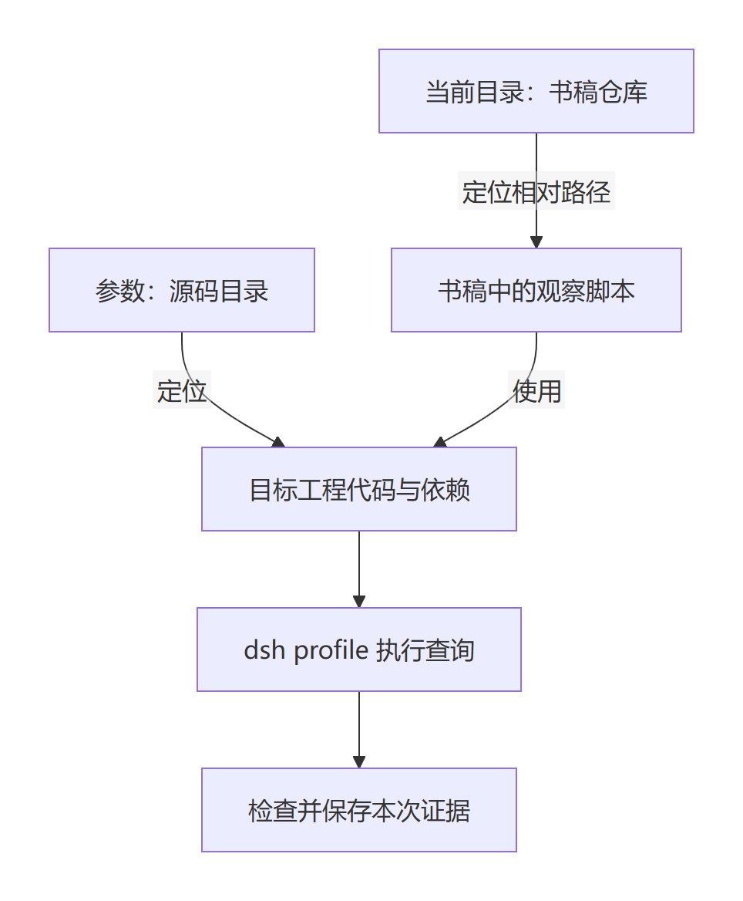

# 第二章 第一次自己运行

第一章里，我们沿着记录查到了 TK-1042，也知道了“查询已完成”与“工单已经关闭”是两回事。现在，我们把这次查询在自己的电脑上启动起来。

你可能已经打开了终端，却不知道应该在哪个目录输入命令。也可能照抄了一整行，屏幕只返回“找不到模块”。这时候，先别改查询代码。程序还没有开始查工单，问题可能出在它连脚本文件都没有找到。

这一章围绕同一份 DeepSeek Harness 工程，完成三件事：找到文件，核对运行环境，执行并检查结果。操作示例使用 Windows 的 PowerShell；安装准备和实测范围在配套说明与章末分别交代。

## 2.1 先知道自己站在哪个目录

先把两份仓库分清。文件保存正文或程序，目录用来组织文件。你需要知道的是两份仓库各自的根目录，不需要把电脑整理成作者的目录结构。

| 你要找的位置 | 用哪些文件确认 | 本章给它起的名字 |
| --- | --- | --- |
| 书稿仓库根目录 | 能看到 chapters、labs；其中有 labs/observe-task/run.mjs | `$BookRoot` |
| 目标源码仓库根目录 | 能看到 package.json、packages、apps/cli；预检还会核对工程名称和提交 | `$HarnessRoot` |

两份仓库可以在不同磁盘、不同父目录中，也可以使用自己选择的目录名。书稿提供教材和教学脚本，目标源码提供真实 Harness 的实现；目录名字相同或不同都不能代替上面的内容检查。

如果已经下载，在文件管理器里分别找到这两个根目录，复制各自地址栏中的完整路径。还没有下载的读者先看[环境准备说明](../labs/run-basics/SETUP.md)，它会让你自己选择存放位置。

后面会反复用到这两处地址，我们先用变量保存它们。在 PowerShell 中逐行输入下面两行。每行出现提示后，粘贴对应的实际路径，再按回车：

```powershell
$BookRoot = (Read-Host '书稿仓库根目录的完整路径').Trim().Trim('"')
$HarnessRoot = (Read-Host '目标源码仓库根目录的完整路径').Trim().Trim('"')
```

`$BookRoot` 和 `$HarnessRoot` 是两个变量：它们保存刚才输入的文字，让后面的命令复用。`Read-Host` 负责询问，后面的 `Trim` 去掉复制时带入的首尾空白和双引号。路径里的空格应当保留；后续命令会把每个变量作为一项参数传递。这两个变量只在当前终端中保留，重新打开终端后需要重新填写。

先确认两处都是实际目录，再把它们解析为完整位置：

```powershell
Test-Path -LiteralPath $BookRoot -PathType Container
Test-Path -LiteralPath $HarnessRoot -PathType Container
```

两行都应返回 `True`。若出现 `False`，先重新填写那一个变量，不继续运行。随后输入：

```powershell
$BookRoot = (Resolve-Path -LiteralPath $BookRoot).Path
$HarnessRoot = (Resolve-Path -LiteralPath $HarnessRoot).Path
Set-Location -LiteralPath $BookRoot
Get-Location
Test-Path ./labs/observe-task/run.mjs
```

`Set-Location` 改变当前位置，`Get-Location` 显示它。这个位置也叫工作目录：程序遇到相对路径时，通常从这里开始查找。最后一行应返回 `True`，只表示观察脚本存在，还没有执行查询。

`./labs/observe-task/run.mjs` 是相对路径，点表示当前目录。变量中保存的完整位置是绝对路径；Windows 中通常从盘符或网络共享开始，macOS/Linux 通常从 `/` 开始。本章代码块使用 PowerShell 语法，不能直接粘贴到 Bash 或 zsh；路径规则与已经验证的操作系统范围需要分开理解，见[终端差异说明](../labs/run-basics/SETUP.md#终端与操作系统差异)。

先作一个小预测：换到源码目录以后，刚才那条 `Test-Path` 还会返回 `True` 吗？运行前先写下答案，再试：

```powershell
Set-Location -LiteralPath $HarnessRoot
Test-Path .\labs\observe-task\run.mjs
```

作者这次得到 `False`，切回书稿目录则得到 `True`。文件没有消失，变化的是相对路径从哪里开始查找。两次实际检查的布尔结果保存在[路径记录](../labs/run-basics/evidence/2026-11-11-revision/path-checks.json)。

这就解释了为什么“我已经下载了文件”仍然可能找不到它：文件是否存在，与这条相对路径是否指向它，需要分别核对。运行查询前，先回到书稿目录。

## 2.2 核对环境，再启动同一张工单的查询

接下来需要一个负责执行脚本的程序。这里使用 Node，命令名是 `node`；它能运行 JavaScript 代码，本书的 `.mjs` 文件就是交给它执行的脚本。Node 能执行脚本，并不表示脚本需要的其他代码已经准备好。

下载得到的源代码，是程序实现的原始文件；本章把选定提交上的这一套实现称为源码基线。那些由工程使用、需要另行安装的代码叫依赖。目标仓库用 `package.json` 声明工程信息和依赖要求，用 pnpm 管理依赖；Corepack 帮我们调用工程指定的 pnpm 版本。Git 则负责取得源码并识别版本。它们各有用途，不能只看“电脑上装过一个开发工具”就认为环境齐全。

本书源码基线的要求来自[根 package.json](https://github.com/goodtang/deepseek-harness-local/blob/fcc0ad462172522aaf5c93a7b2e01f6b9f0b0159/package.json)和[开发说明](https://github.com/goodtang/deepseek-harness-local/blob/fcc0ad462172522aaf5c93a7b2e01f6b9f0b0159/docs/development.md#prerequisites)：

| 项目 | 此基线的要求或声明 | 作者本轮实际环境 |
| --- | --- | --- |
| Node | 至少 24.9.0 | v24.12.0 |
| pnpm | packageManager 指定 11.28.5 | 在源码目录检查为 11.28.5 |
| Git | 至少 2.26 | 2.50.1.windows.1 |
| Corepack | 用于调用项目 pnpm；本表不自定最低版本 | 0.34.5 |

本章没有要求你特意安装作者的旧补丁版本。重点是满足源码要求，并核对依赖实际使用的版本；新安装与构建步骤见[准备说明](../labs/run-basics/SETUP.md)。已经有源码和依赖的读者，也要检查自己用的是书中基线。

回到书稿目录，运行本章提供的只读预检：

```powershell
Set-Location -LiteralPath $BookRoot
node labs/run-basics/check.mjs $HarnessRoot
```

它检查目标目录的工程名称、源码提交、Node 版本、命令行入口和一项启动依赖。作者实测输出节选为：

```text
Node：v24.12.0（满足 >=24.9.0）
目标工程：@deepseek-ai/dsh-root
源码提交：fcc0ad462172522aaf5c93a7b2e01f6b9f0b0159
pnpm 声明：pnpm@11.28.5（声明值，不是安装检查）
tsx 启动依赖：可解析
```

`tsx` 是这里从源码启动时使用的依赖名称，本章先用它判断一项启动条件是否具备，不进入其内部实现。完整[预检输出](../labs/run-basics/evidence/2026-11-11-revision/preflight-stdout.txt)还特意提醒：预检通过并不证明全部依赖、构建和任务都能运行。接下来才执行第一章的查询。

```powershell
node labs/observe-task/run.mjs $HarnessRoot
$LASTEXITCODE
```

最后一项是传给脚本的信息，也叫参数。第一行分成三部分读：`node` 运行程序；`labs/observe-task/run.mjs` 指定书稿中的观察脚本；`$HarnessRoot` 中保存的源码位置作为参数，告诉脚本到哪里使用目标工程；修改工作目录不会改掉这个变量。第二行读取刚才那个程序的退出码，也就是它结束时返回的数字；要在命令结束后紧接着查看。



图 CH-RUN-01：本图说明这条教学命令怎样定位文件，图源见[可编辑文件](../diagrams/CH-RUN-01.mmd)。相对脚本路径受当前目录影响，源码参数负责另一份目录的定位。实际 Harness 应用仍通过 dsh 的 headless profile 启动；这里的 headless profile 使用准备好的插件组合运行一项任务。源码参数负责定位代码；应用内部还会创建独立的工作目录，图中没有展开。

你看到的观察输出应当与第一章相同，其中包含：

```text
以下为 headless 标准输出原文：
Ticket lookup completed.
```

最后还会打印本次证据目录。在默认运行方式下，它位于书稿的 `labs/observe-task/.lab-runtime`。这个目录里的文件是你这次运行产生的材料；正文链接到的 `evidence` 目录保存的是作者某一次实测原件，两者不能混作一次运行。

## 2.3 让错误告诉你该改哪里

命令执行时，电脑中有正在运行的程序实例，也就是进程。任务结束后，终端重新接受命令。刚才的查询在作者本轮运行中退出码为 `0`，工具结果仍然是 TK-1042、open；实际运行报告见[相对路径入口记录](../labs/run-basics/evidence/2026-11-11-revision/relative-observation-from-book.json)。

但只看到 `0` 还不够。它表示这个程序按自己的约定正常结束，查询是否正确仍要核对记录。比如，预检程序成功退出，只说明它检查的条件满足了；此时我们还没有执行工单查询。

下面故意做两次错误操作。每次先预测程序会在哪里停下，再运行，最后紧接着查看退出码。

**第一次：脚本没有找到。** 进入源码目录，使用属于书稿目录的相对脚本路径：

```powershell
Set-Location -LiteralPath $HarnessRoot
node labs/run-basics/check.mjs $HarnessRoot
$LASTEXITCODE
```

作者本轮退出码为 `1`。在[错误输出原文](../labs/run-basics/evidence/2026-11-11-revision/wrong-workdir-stderr.txt)中，可以找到：

```text
MODULE_NOT_FOUND
```

这里摘出的是错误码；原文还写出了 Node 试图寻找的文件位置。请找到那条路径，看看它是不是从源码目录开始拼出了 `labs/run-basics/check.mjs`。预检脚本尚未运行，所以现在应该修正脚本定位，而不是改查询函数。

最直接的修正是切回书稿目录，再用相同的相对路径运行预检。也可以保持当前位置，把脚本路径写完整。第二种方法留给你在节末独立完成。

**第二次：脚本找到了，源码参数写错了。** 回到书稿目录，给脚本一个不存在的源码位置：

```powershell
Set-Location -LiteralPath $BookRoot
$MissingSource = Join-Path $BookRoot ('missing-source-' + [guid]::NewGuid().ToString('N'))
Test-Path -LiteralPath $MissingSource
node labs/run-basics/check.mjs $MissingSource
$LASTEXITCODE
```

这里先生成一个独立的测试位置；`Test-Path` 应返回 `False`，若为 `True` 就重新生成。该命令只读取路径，不会创建或删除这个目录。作者使用自己测试目录下一个不存在的位置重现，得到退出码 `1` 和[下面的实际错误](../labs/run-basics/evidence/2026-11-11-revision/wrong-source-stderr.txt)：

```text
预检失败：找不到源码目录下的 package.json；请检查路径，勿把书稿目录当作源码目录。
```

这一次，Node 已经找到并执行了检查脚本，脚本才有机会报告它找不到源码信息。你应当核对最后的源码参数。就算把脚本路径改成绝对路径，也不会自动修好一个写错的源码位置。

把两次失败并排看，就能形成一个具体的排查顺序：先看错误中找不到的是脚本文件，还是源码目录下的文件；据此核对工作目录、脚本路径或源码参数；修正后重跑，再检查结果。

| 要观察的事 | 先写你的预测 | 作者实测 | 你的实际结果与证据位置 |
| --- | --- | --- | --- |
| 书稿目录下的预检 | 会识别哪份工程 | 退出 0，识别目标源码与基线 | 待填写 |
| 源码目录下使用相对脚本路径 | 脚本能否开始执行 | 退出 1，MODULE_NOT_FOUND | 待填写 |
| 脚本找到，源码位置不存在 | 应改哪部分命令 | 退出 1，提示 package.json 定位错误 | 待填写 |
| 实际观察命令 | 怎样确认查询正确 | 退出 0，工具结果与终端输出分别核对通过 | 待填写 |

现在合上上面的修正提示，完成三个小任务。

1. 保持工作目录在源码仓库，只修改命令里的脚本路径，让观察任务运行。写出自己的完整命令，运行后记录退出码与本次证据目录。
2. 一位同学把脚本改成了绝对路径，仍收到“找不到源码目录下的 package.json”。他还应检查命令的哪一部分？为什么继续切换工作目录未必能解决问题？
3. 另一位同学只有预检通过的输出，没有实际查询记录。你能在他的学习记录里勾选“工单查询正确”吗？指出还缺哪一份结果。

<details>
<summary>先独立写出命令与判断，再展开核对</summary>

任务一：作者示例为 `node (Join-Path $BookRoot 'labs/observe-task/run.mjs') $HarnessRoot`，实际验证退出 0，查询结果与书稿目录启动时一致。你的路径应按本机位置填写。随后查看 `$LASTEXITCODE` 和程序打印的证据目录，不能只抄作者的数字。对应[绝对路径入口记录](../labs/run-basics/evidence/2026-11-11-revision/absolute-observation-from-source.json)与前面的正常记录可相互对照。

任务二：应检查最后的源码参数。如果那里已经是一个错误的绝对路径，换工作目录不会改变它指向的位置。

任务三：还缺实际任务的查询记录。需要看到查询的工单编号、返回状态，以及结果进入后续请求等检查，才能判断本例是否通过；预检只核对启动前列出的条件。

</details>

配套的[本轮实验记录](../labs/run-basics/README.md)保存六个场景的输入方式、退出状态与结果。作者在已有依赖的 Windows x64 环境完成了这些验证，没有从空白机器重新安装和构建，也未验证其他操作系统、断网或取消。[新增路径测试](../labs/run-basics/evidence/2026-11-11-revision/reader-paths.json)已在 Windows PowerShell 中用中文、空格和不相邻的仓库目录别名完成预检和真实查询；别名指向既有环境，不代表物理迁移或重新安装已经验收。应用临时资源的清理检查通过，证据文件有意保留；读者没有完成的准备和复现仍应保持待完成。

这一章的成果，是你能说明命令中的两个路径各指向哪里，自己启动一次任务，并依据错误找到该修正的位置。下一章继续用 TK-1042，先认识编号、状态和标题这些数据，再逐步写出查询函数；本章的定位、运行和核查方法会继续使用。
