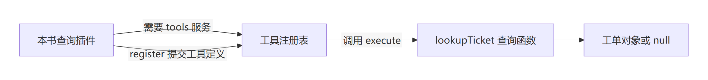
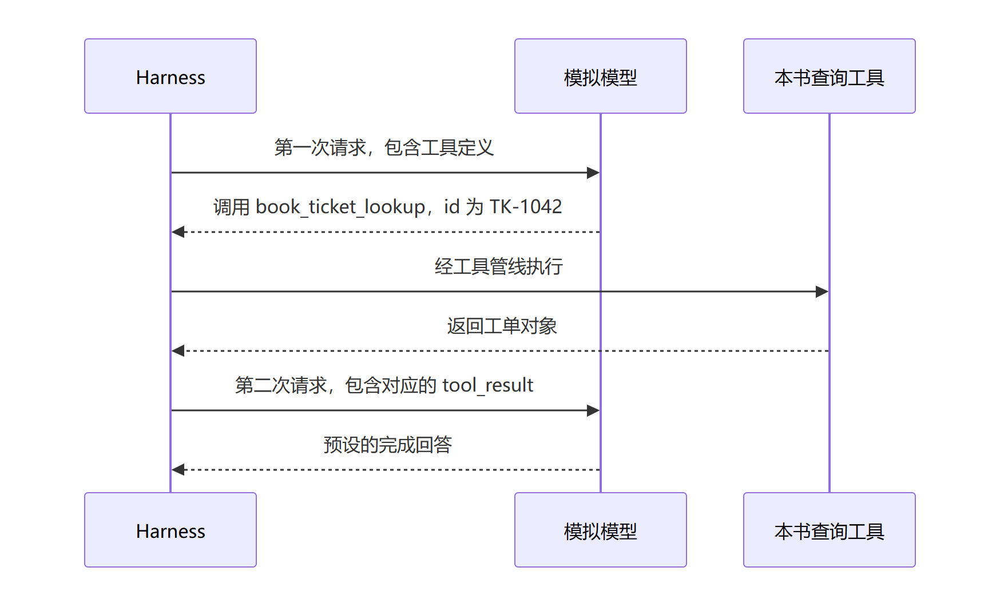

# 第一个业务工具：让查询函数进入一次任务

本页是样章首段试写，覆盖“查询函数怎样接入真实运行”的三个相邻小节。完整样章还需补齐逐步操作、故障实验和读者试读；本页不代表整章已验收。前一章正文尚未写出，本页暂时提供函数文件作为实验输入。配套工程见[实验说明](../labs/first-tool/README.md)。

## 1. 我们已经会查询，为什么还需要工具

有人问：“工单 TK-1042 处理到哪一步了？”你写了一个查询函数。给它工单编号，它就返回编号、状态和标题。这个函数很小，甚至不需要联网：本次只查一份固定的虚构数据。

```javascript
lookupTicket('TK-1042')
// { id: 'TK-1042', status: 'open', title: 'Invoice export failed' }
```

现在先停一下。假如你把这个函数放在电脑的某个文件里，然后启动 Harness，让模型查询这张工单，会发生什么？模型会自动找到它吗？

不会。写好函数，只说明程序中有这段能力。模型还需要知道能力叫什么、接受什么参数；Harness 需要知道收到调用时应当执行哪段代码。我们要完成的，就是把这些信息明确地接起来。

打开 [tickets.mjs](../labs/first-tool/tickets.mjs)。它没有导入 Harness，也没有注册工具。它只负责一件事：按编号查记录，存在就返回副本，不存在就返回 `null`。保留这份独立性有实际用处：将来接入真实工单系统时，业务查询可以单独检查，工具接入也可以单独检查。

先预测：把返回对象中的 `status` 改成 `closed`，再次查询会得到什么？本例仍会得到 `open`，因为每次返回的是副本。这一约定只适用于本例固定数据，不意味着真实数据库天然隔离。对应断言已经放进运行器；读者的独立复现仍待记录。

## 2. 给函数一个模型能使用的入口

打开 [plugin.mjs](../labs/first-tool/plugin.mjs)。先看三个地方：`inject = ['tools']`、`apply(ctx)` 和 `ctx.tools.register(...)`。依次对应“这个插件需要工具服务”“插件加载时从这里开始”和“向工具注册表提交定义”。Cordis 会在所需服务可用后调用插件的 `apply`。

这就是“一切皆插件”在第一个业务需求中的具体做法。我们添加一个插件，使用已有工具服务，把查询能力注册进去。后面的章节会继续追问：提供工具服务的插件怎样工作？加载顺序怎样决定？插件卸载时，注册怎样撤销？现在先记住本例实际使用的关系。



[可编辑 Mermaid 图源](../diagrams/CH-TOOL-01.mmd)

图 CH-TOOL-01：本书根据本例代码自行绘制。只画查询插件与工具服务的关系，省略启动、策略检查、事件和持久化；箭头标签说明关系，不表示完整的运行顺序。运行时注册与注销的源码入口见 [Tools.register，第 128 行](https://github.com/goodtang/deepseek-harness-local/blob/fcc0ad462172522aaf5c93a7b2e01f6b9f0b0159/packages/core/tools/src/index.ts#L128)，本轮实验尚未单独验证插件卸载。

工具名称是 `book_ticket_lookup`。输入只有一个必填字符串 `id`。`execute` 收到参数后先检查取消信号，再调用 `lookupTicket(args.id)`，返回对象或 `null`。这份结果受 `output.schema` 检查；`render` 再把结果转成模型请求中能传递的文字块。因此，函数的返回值、工具的结构化结果和发给模型的文字内容各有明确位置。

先预测：模型即使发来了正确名称，参数类型写错了，是否仍应直接进入查询函数？工具定义使用 `defineTool` 声明参数，校验机制在它与注册表的实现中。源码入口是 [defineTool，第 555 行](https://github.com/goodtang/deepseek-harness-local/blob/fcc0ad462172522aaf5c93a7b2e01f6b9f0b0159/packages/core/tools/src/schema.ts#L555)。本轮只实测正确参数，不把这段源码说明记成非法参数实验通过；完整样章需要补一组拒绝实验。

## 3. 怎样知道这次真的接上了

我们让模拟模型先发出一次工具调用，名称为 `book_ticket_lookup`，参数为 `{"id":"TK-1042"}`。模拟模型随后会给一句预先设好的回答。仅看这句回答，没有办法知道查询函数是否执行成功。

所以，我们检查下一次模型请求。它里面应当已经包含这张工单的工具结果，而且结果应对应刚才那次工具调用。



[可编辑 Mermaid 图源](../diagrams/CH-TOOL-02.mmd)

图 CH-TOOL-02：本书根据本次正常路径自行绘制。省略事件存储、审批、重试与取消；“模型”在本实验中是脚本化模拟服务，不表示真实模型的推理表现。

按[运行说明](../labs/first-tool/README.md#运行)启动后，将自己的证据与[作者实测原件](../labs/first-tool/evidence/normal-20261110.json)对照。我们期待的结果如下。

| 先作预测 | 作者实测 | 你来复现 |
| --- | --- | --- |
| 首次请求列出了这个工具 | tools 数组包含工具名称和 id 参数定义 | 待填写 |
| 查询结果进入下一次请求 | tool_result 关联同一个调用编号，三个字段与固定数据逐项相同 | 待填写 |
| 一次工具调用后继续回答 | 两次请求按预定顺序完成，无脚本耗尽 | 待填写 |
| 实验能完整收尾 | 退出码为 0；服务关闭、直接子进程退出、临时目录删除分别检查通过 | 待填写 |

如果你的请求数不同，先对照配置。本实验显式关闭了自动标题生成；保留其他会请求模型的插件，就可能需要编排更多模拟行为。一次用户任务不保证只有一次模型请求。

这次实验支持的结论是：普通查询函数通过插件注册为真实工具，其结果已经进入后续模型请求。它没有验证真实模型会不会选对工具，也没有验证断流、取消、访问权限和真实工单系统。本实验不需要真实 key，但尚未进行断网复跑。

你现在可以带着一个更具体的问题进入下一章：查询已经返回，Harness 在什么时候、用哪些消息拼出第二次请求？下一章将沿用这份函数、工单、工具名和证据继续观察；正文尚未写出，不能把这里的交接当作已经讲解完成。
