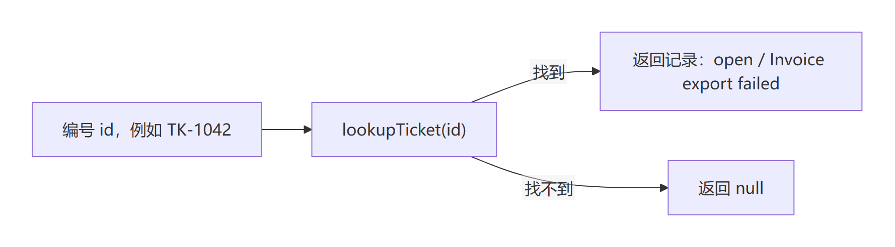

# 第三章 写出并验证工单查询函数

第二章里，你已经练习了定位两份仓库、运行观察命令，以及根据错误信息寻找该修正的位置。现在轮到你写一点代码了。仍然是那张工单 TK-1042：前两章看到了它的查询结果，这一章要让自己写的函数把它查出来。

本章的函数是本书编写的虚构业务示例，不是 DeepSeek Harness 内置的工单查询功能。先把查询本身写对，下一步再通过插件接入 Harness；这样遇到问题时，才有办法分清是业务函数错了，还是工具没有接好。本章只需要第二章准备的 Node.js，不启动 Harness，也不需要模型密钥。

## 3.1 先认识这张工单的数据

第一章的工具结果里有这样一段（分行与空格只为便于阅读）：

```json
{ "id": "TK-1042", "status": "open", "title": "Invoice export failed" }
```

它由三个“名称—值”组成：`id` 是编号，`status` 是状态，`title` 是标题。在 JavaScript 里，这份记录可以写成一个对象（object）：

```js
const ticket = { id: 'TK-1042', status: 'open', title: 'Invoice export failed' };
```

`const ticket = ...` 给右边的值取一个名字，后面用 `ticket` 就能引用它。这里的 `=` 是赋值，不是在提问两边是否相等。引号中的文字叫字符串；`'open'` 是状态值，`ticket` 则是保存记录的变量名。

花括号 `{ }` 把几个字段包在一起，每个字段写成“名称 : 值”，字段之间用逗号分开。读取时，在对象名后加一个点和字段名：`ticket.id` 是编号，`ticket.status` 是状态，`ticket.title` 是标题。

这里还有一个容易混淆的地方：`const` 不允许给变量重新赋值，却不会自动冻结对象。声明后不能再用 `ticket = ...` 把它改成另一个值，但仍可以用 `ticket.status = 'closed'` 修改这个对象的字段。3.3 会用这样的修改来检查查询函数返回的是否为副本。

为什么放进一个对象，而不是三个分开的变量？因为编号、状态、标题属于同一条工单；放在一起，函数就能一次返回完整记录。

先作一个小预测：`ticket.status` 的值是什么？它是“状态”这个名称，还是 `'open'` 这段文字？写下答案。这里取到的是字段的值 `'open'`；下一节会按同样的方法取出整条记录。

## 3.2 写一个按编号查找的函数

函数接收输入，完成一项操作，再把结果交给调用它的代码。我们把查询函数叫作 `lookupTicket`，让它接收一个编号：找到就返回记录，找不到就返回 `null`，表示“没有这条”。

在书稿仓库中，用文本编辑器打开 `labs/func/starter.mjs`。它现在只有一个带 `export` 的函数，函数体只返回 `null`。先不修改，在书稿根目录运行：

```powershell
node labs/func/check.mjs labs/func/starter.mjs
$LASTEXITCODE
```

检查程序会查询已知工单、查询不存在的工单，再检查返回结果能否独立修改。作者实测：第一项和第三项失败，第二项通过，退出码为 `1`。这次失败很有用：只会返回 `null` 的函数，确实不能完成查询。

现在编辑 `starter.mjs`：保留文件开头的许可与说明注释，在函数前面添加数据表，再补上函数体。**保留函数声明前的 `export`。**它表示这个函数可以供另一个文件使用；稍后的检查文件就需要它。模块的更多规则留到实际需要时再展开。

除开头注释外，保存后的完整代码如下。原来的占位函数要改成下面这一份，不要再保留第二个同名函数。

```js
const tickets = {
  'TK-1042': { id: 'TK-1042', status: 'open', title: 'Invoice export failed' },
};

export function lookupTicket(id) {
  const ticket = tickets[id];
  return ticket ? { ...ticket } : null;
}
```

这里用对象 `tickets` 当查询表：键（key）是工单编号，值是这张工单的记录。`tickets['TK-1042']` 取出已知记录；`tickets[id]` 则用变量 `id` 中的编号查找。调用 `lookupTicket('TK-1042')` 时，括号里的编号传给函数的参数 `id`，函数就用它查表。

`return` 把结果交回调用方。最后一行中的 `?` 和 `:` 表示选择：本例中，`ticket` 是查到的对象，就返回 `{ ...ticket }`；查询普通的不存在编号、得到 `undefined` 时，就返回 `null`。`undefined` 在这里表示没有取到对应的属性值，`null` 是函数主动给出的“没找到”结果。

`{ ...ticket }` 把这条记录的字段复制到一个新对象。为什么不直接返回 `ticket`？假设调用方把结果的状态改成 `closed`，我们不希望查询表也跟着变。本例的三个字段都是字符串，复制后可以分别改动；以后遇到字段里还装着对象的数据，不能据此推断里面的对象也都被复制了。

现在沿着代码走两遍：一次查 `TK-1042`，一次查表里没有的普通编号 `missing`。先遮住表格最后一行，试着说出函数会返回什么，再核对。

| 执行到哪里 | 查询 `TK-1042` | 查询 `missing` |
| --- | --- | --- |
| 调用时把编号传给参数 `id` | `id` 的值为 `'TK-1042'` | `id` 的值为 `'missing'` |
| 执行 `const ticket = tickets[id]` | `ticket` 是表中的工单对象，状态为 `'open'` | `ticket` 的值为 `undefined` |
| 执行 `return` 中的选择 | 查到对象，执行 `{ ...ticket }` | 没有查到，选择 `null` |
| 把结果交回调用方 | 包含相同编号、状态和标题的新对象 | `null` |

注意右边的两个值：查表时得到的是 `undefined`，函数交回调用方的是 `null`。把这两步分开，你就能解释“没找到”这个结果是怎样产生的，而不必只记住最后的答案。



图 CH-FUNC-01：本书自行绘制。编号进入 `lookupTicket`，找到就返回工单记录的副本，找不到就返回 `null`。本图只表示普通工单编号下的函数分支，不含 Harness、模型或工具管线；可编辑[图源](../diagrams/CH-FUNC-01.mmd)随书提供。

本节先处理 `TK-1042` 和普通的不存在编号。`__proto__`、`constructor` 等名字在 JavaScript 对象中还有特殊含义，这个简化写法不能正确处理所有这类查询。后续工具示例中的 [tickets.mjs](../labs/first-tool/tickets.mjs) 用 `Object.hasOwn` 判断记录是否属于数据表自身，并冻结固定数据；接入工具时会解释这些差异。本章的完成快照是 [completed.mjs](../labs/func/completed.mjs)，与上面的代码一致，仍是教学示例。

保存后，再运行刚才的两行命令。作者对本章完成快照的三项检查全部通过，退出码为 `0`；你的结果应来自自己保存的 `starter.mjs`。如果提示“没有找到导出的 lookupTicket”，先检查 `export` 是否保留；如果只有副本检查失败，回看是否误写成了直接返回 `ticket`。详细输出见[本章配套记录](../labs/func/README.md)。

## 3.3 自己写第一条断言

现成检查能告诉你是否过关；接下来，我们自己写一条检查，弄清这个判断是怎样作出的。

打开配套文件 `labs/func/check-one.mjs`。它的许可与说明注释之后只有下面几行：

```js
import assert from 'node:assert/strict';
import { lookupTicket } from './starter.mjs';

const ticket = lookupTicket('TK-1042');
assert.equal(ticket.status, 'open');
console.log('状态检查通过');
```

第一行从 Node.js 自带的模块取得检查工具 `assert`，无需另装依赖。第二行从同目录的 `starter.mjs` 取得你导出的函数；这里的 `./` 相对于这个检查文件的位置，不是终端当前目录。第三行调用函数，把返回记录保存为 `ticket`。

第四行才是断言：`assert.equal(实际值, 预期值)` 比较两者。相同就继续，不同就报错。在这里，实际值是查询结果的状态，预期值是 `'open'`。最后一行 `console.log` 才负责向终端输出文字。**函数返回结果与终端显示结果是两件事**：`return` 把值交给代码，`console.log` 才把它写到屏幕上。

保存好上一节的函数，在书稿根目录运行：

```powershell
node labs/func/check-one.mjs
$LASTEXITCODE
```

作者按正文补全函数后，实际看到 `状态检查通过`，退出码为 `0`。现在先预测：只把断言中的预期值 `'open'` 改成 `'closed'`，其他地方不动，会怎样？

作者实测退出码为 `1`，错误信息包含 `'open' !== 'closed'`，而且没有打印“状态检查通过”。断言发现了实际与预期不相同，后面的输出便没有执行。这次练习故意写错的是预期值；核对后把它改回 `'open'`，再运行，应重新通过。遇到真实失败时，则要同时检查业务数据、查询代码和预期，不能为了通过而随意改掉预期。

只比较状态还不够。如果标题查错了，状态仍然可能是 `open`。在检查文件的最后一行输出之前，加入下面两条断言：

```js
assert.deepEqual(ticket, {
  id: 'TK-1042', status: 'open', title: 'Invoice export failed',
});
assert.equal(lookupTicket('missing'), null);
```

`assert.deepEqual` 用来比较对象里的字段和值，因此这里能检查完整记录；第二条检查找不到普通编号时是否返回 `null`。这和配套 `check.mjs` 的前两项判断相对应。若要检查返回副本，再在输出前加入：

```js
ticket.status = 'closed';
assert.equal(lookupTicket('TK-1042').status, 'open');
```

第一行只修改本次返回对象的状态；第二行重新查询，检查数据表是否仍保留 `open`。先预测，再运行：如果函数返回的是原对象，这条断言就会发现它已经变成 `closed`。作者确实用这种错误实现试过，副本检查失败；本章完成版通过。这样，你就知道这项检查能发现什么，而不只是知道它“变绿了”。

将自己的结果与作者实测分开记录。输出不同时，先定位是哪项判断不同，再回到对应的数据、函数或断言处检查。

| 要核对的事 | 先写你的预测 | 作者实测 | 你的实际结果与差异原因 |
| --- | --- | --- | --- |
| 起始函数只返回 null | 三项检查中哪些失败 | 找到/副本失败，missing 通过，退出 1 | 待填写 |
| 正文完成版运行三项检查 | 是否全过 | 三项通过，退出 0 | 待填写 |
| 第一条自写断言 | 会输出什么 | 状态检查通过，退出 0 | 待填写 |
| 把预期状态改成 closed | 会不会继续输出成功 | 报错且无成功输出，退出 1 | 待填写 |
| 故意直接返回原对象 | 哪一项能发现问题 | 副本检查失败，退出 1 | 待填写 |

现在合上提示，做一次小扩展：在自己的 `starter.mjs` 数据表里再加一张工单 `TK-1043`，状态 `closed`、标题自拟。新建 `labs/func/my-check.mjs`，沿用刚学会的两行导入，自己写断言检查新工单的三个字段，并确认 `TK-1042` 仍是 `open`。最后加一句自己的成功输出，在书稿根目录运行 `node labs/func/my-check.mjs`，紧接着查看 `$LASTEXITCODE`。

如果卡住了：不知道怎样加记录，回到 3.2 的数据表；提示没有导出函数，检查 `export` 和导入路径；不知道如何比较完整记录，回看本节的 `assert.deepEqual`。不要改配套 `check.mjs` 去迁就结果。扩展后再运行原来的三项检查，确认旧工单仍能正确查询。作者已验证这组扩展和回归，但只有你自己的操作与结果，才能算作你完成了练习。

完成本章后，你应当能写出并检查一个独立的查询函数，解释“函数返回了什么”和“终端打印了什么”，还能用一条故意失败的断言说明检查确实有效。下一章《第一个业务工具》要解决新的问题：函数已经能查对了，Harness 怎样通过插件使用它？仍然是同一份业务数据和查询约定；接入前，我们会先核对本章简化版与工具示例完整版本的差异。
