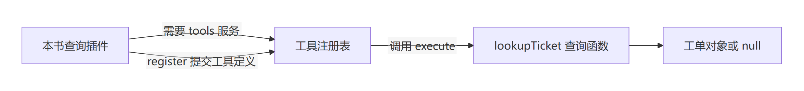
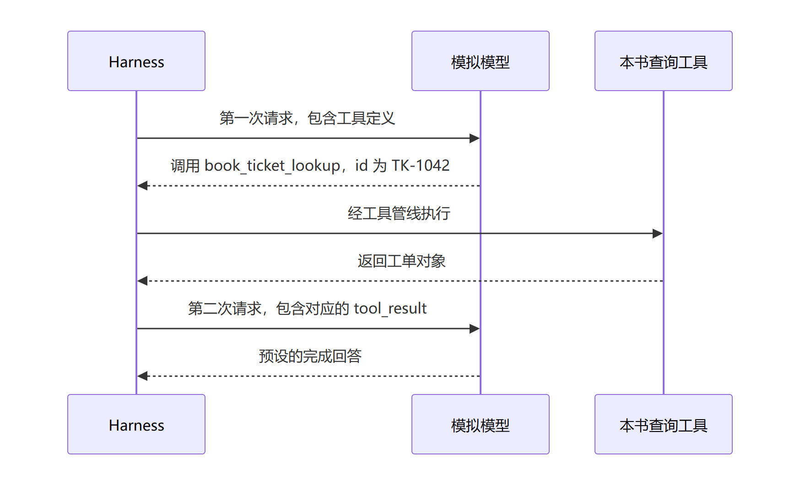

# 第四章 第一个业务工具：让查询函数进入一次任务

第三章结束时，你已经能独立查询工单，也能用断言发现查错记录、返回原对象等问题。现在有人提出了新的要求：“我不想自己调用函数，我想让助手帮我查。”

这看起来只是换了一种问法，程序要做的事却多了一步：让 Harness 知道你提供了什么能力，以及收到调用时该执行哪段代码。这一章沿用 TK-1042，从已有函数走到通过插件提供的真实工具。

## 4.1 函数写好了，为什么还需要插件

先回到第三章，想一想 `lookupTicket('TK-1042')` 能成功的条件：某段代码导入函数，再调用它。文件放在磁盘上，并不会自动让它成为模型请求中的工具定义。

工具除了业务实现，还要说明名称、输入和输出。查询函数负责“按编号查记录”；工具定义负责告诉系统“这项能力叫什么、接受什么参数、怎样执行和表示结果”。插件则在加载时把这份定义提交给现有工具服务。

| 已有内容 | 还缺什么 | 本章在哪里补 |
| --- | --- | --- |
| 查询函数能返回记录 | 系统不知道这项工具的名字和参数 | 插件中的工具定义 |
| 函数能被本地代码调用 | 需要把工具定义交给 Harness | 向 tools 服务注册 |
| 本地断言已经通过 | 需要证明真实任务确实调用了它 | 本章正常路径实验 |

先不要改第三章的文件。打开本书配套的 [tickets.mjs](../labs/first-tool/tickets.mjs)，它是工具示例使用的完整教学版本。函数名、工单数据和返回副本的约定都没变，多了两项处理。

第一项是 `Object.hasOwn(tickets, id)`：检查这个编号是否为数据表自身的属性。JavaScript 对象有些自动提供的属性名，例如 `constructor`，它们不等于表里的业务记录。第三章的简化写法暂不处理这类编号；接成工具之后，输入来自外部调用，需要把“表里确实有这条记录”判断清楚。

第二项是 `Object.freeze`：冻结表和其中的固定记录，防止它们被直接改动。记得第三章讲过 `const` 不会自动冻结对象吗？这里调用 freeze 才限制字段修改。本例仍返回一份新对象，所以调用方能改返回结果，却不应影响表中记录。这里没有连接数据库，也没有声称任意嵌套数据都会被冻结。

先预测：在这份完整版本上，查询 `__proto__` 应得到自动提供的对象，还是 `null`？本轮本地断言得到 `null`。但这只是函数检查；尚不能据此断言“模型通过工具查询这个编号的路径已经验证”。我们接着检查真正的工具入口。

## 4.2 把查询能力注册成工具

这次自己编辑插件，不覆盖第三章或原工具示例。沿用第二章校验过的 BookRoot/HarnessRoot；换了终端先重新填写。先在书稿根目录的 PowerShell 中复制可运行起点：

```powershell
$MyPlugin = Join-Path $BookRoot 'labs/tool-cases/.lab-runtime/my-plugin.mjs'
if (Test-Path -LiteralPath $MyPlugin) { throw '练习文件已存在，请保留并继续编辑。' }
New-Item -ItemType Directory -Force (Split-Path -Parent $MyPlugin) | Out-Null
Copy-Item -LiteralPath (Join-Path $BookRoot 'labs/tool-cases/start/plugin.mjs') -Destination $MyPlugin
```

`New-Item` 创建目录，`Copy-Item` 复制文件，`Out-Null` 不显示创建目录的普通输出；存在性检查避免重复操作覆盖你的代码。这时直接打开已有文件继续即可。用编辑器打开 MyPlugin 指向的文件，它已经导入 defineTool 和查询函数，声明 inject，并有一个函数体为空的 apply。

第一行从本书的 [support.mjs](../labs/tool-cases/support.mjs) 取得 defineTool；这个准备文件负责根据源码位置加载目标工程。第二行导入上一节核对过的查询函数。你要写的是工具定义和注册。不要移动工作文件到不同层级，因为相对导入从文件所在目录计算。

先预测：空 apply 会让应用启动失败，还是只让业务工具缺席？运行起点：

```powershell
$StartEvidence = Join-Path $BookRoot 'labs/tool-cases/.lab-runtime/start-01'
Set-Location -LiteralPath $HarnessRoot
node --import tsx/esm (Join-Path $BookRoot 'labs/tool-cases/run.mjs') $HarnessRoot start $StartEvidence $MyPlugin
$LASTEXITCODE
Set-Location -LiteralPath $BookRoot
```

证据目录已有时改用 start-02，保留原记录。profile 是准备好的插件组合，本例使用 headless；加载器 tsx/esm 负责加载目标工程的 TypeScript 源码。start 场景让本机模拟模型直接回答，不要求调用未提供的工具。作者实测应用退出 0，报告中 toolSchema 为 null：应用可以启动，但查询工具没有进入请求。未注册时强行调用会怎样，留到对照小节验证。

接下来只补 apply 的函数体。先认识三个位置：`inject`、`apply` 和 `register`。

```js
export const inject = ['tools'];
```

方括号表示数组，这里列出一个名字 `tools`。`inject` 声明插件依赖工具服务。它不是告诉模型“去调用 tools”，而是告诉插件系统“加载我之前，需要这项服务”。

插件的 `apply(ctx)` 是加载时的入口，`ctx` 是框架交给它的上下文对象。插件通过 `ctx.tools` 使用工具服务，调用 `register` 提交工具定义；`defineTool` 帮助构造这份定义。这里的关系如下。



图 CH-TOOL-01：本书自行绘制。箭头表示依赖、注册和执行关系，不是完整启动顺序；省略策略、事件与存储。[可编辑图源](../diagrams/CH-TOOL-01.mmd)。PNG 沿用既有导出，本轮未改图像。

这就是本项目“一切皆插件”在第一个业务需求里的具体做法：我们添加查询插件，使用现有工具服务注册业务能力。查询函数本身仍是普通函数；插件负责把它接进系统。后面的框架章节再解释提供 tools 服务的插件如何加载、依赖如何生效，以及卸载时如何撤销注册。

现在按用途读工具定义，不必先记下所有写法：

| 文件中的位置 | 本例声明 | 它解决的问题 |
| --- | --- | --- |
| `name` | `book_ticket_lookup` | 用什么名字提出工具调用 |
| `parameters.id` | 必填字符串 | 输入编号应该是什么类型 |
| `execute(args, exec)` | 调用 `lookupTicket(args.id)` | 真正运行哪段业务代码 |
| `output.schema` | 工单对象或 null | 结构化结果允许哪些字段和值 |
| `output.render` | 将结果变成文字内容 | 后续模型请求怎样携带结果 |

`args` 保存实际调用参数，所以 `args.id` 仍是在读取对象字段。`schema` 在这里是结果的字段与类型声明；`oneOf` 表示允许列出的某一种结果，本例为工单对象或 null。`required` 表示必须提供，`additionalProperties: false` 表示对象不允许多出未声明的字段。

`async` 声明异步函数，调用它会得到一个 Promise，用来取得操作最终完成的结果；`await` 可以等待它完成。本例查询函数仍立即返回固定记录，execute 把这个值交给异步执行流程，不表示查询了数据库。加载准备文件中的 `await import(...)` 则等待源码模块加载。先区分“业务返回什么”和“调用方怎样取得完成结果”，并发、等待与取消在后文进一步实验。

`exec.signal.throwIfAborted()` 是执行前检查取消信号，本轮没有实测取消。`render` 中的 `JSON.stringify(value)` 则把对象或 null 转成 JSON 文字，放入文字内容块；`=>` 定义一个函数，后面给出的数组是它的返回结果。下划线开头的 `_args` 在这个函数里没有使用。

因此，别把三件事混在一起：业务函数返回记录；工具得到结构化结果；render 生成模型请求能够携带的文字。第三章的函数不用知道模型消息怎样组织，业务逻辑也不必写入 agent-loop。

现在补好工作文件。按顺序填写 name/description 和 parameters，再填写结果声明与 render，最后把 execute 接到 lookupTicket。完成后，除开头注释外，整个文件应如下；不要保留第二个 apply。中途未写完的片段不能当作可运行插件。

```js
import { defineTool } from '../support.mjs';
import { lookupTicket } from '../../first-tool/tickets.mjs';

export const name = 'book-ticket-tool';
export const inject = ['tools'];

export function apply(ctx) {
  ctx.tools.register(defineTool({
    name: 'book_ticket_lookup',
    description: 'Look up a fictional ticket by its exact ID; does not modify records.',
    parameters: { id: { type: 'string', required: true, description: 'Ticket ID, for example TK-1042' } },
    output: {
      schema: { oneOf: [
        { type: 'object', additionalProperties: false, properties: {
          id: { type: 'string', required: true },
          status: { type: 'string', required: true },
          title: { type: 'string', required: true },
        } },
        { type: 'null' },
      ] },
      render: (_args, value) => [{ type: 'text', text: JSON.stringify(value) }],
    },
    async execute(args, exec) {
      exec.signal.throwIfAborted();
      return lookupTicket(args.id);
    },
  }));
}
```

完成快照为 [stages/plugin.mjs](../labs/tool-cases/stages/plugin.mjs)。核对后仍运行自己的 MyPlugin，让本次工具调用实际使用你写的文件：

```powershell
$NormalEvidence = Join-Path $BookRoot 'labs/tool-cases/.lab-runtime/normal-01'
Set-Location -LiteralPath $HarnessRoot
node --import tsx/esm (Join-Path $BookRoot 'labs/tool-cases/run.mjs') $HarnessRoot normal $NormalEvidence $MyPlugin
$LASTEXITCODE
Set-Location -LiteralPath $BookRoot
```

作者实测退出 0，两次请求完成，返回 TK-1042 的三个字段，且结果对应同一次调用。若漏掉注册却选择 normal 场景，检查器会拒绝结果。对照 [a-start](../labs/tool-cases/evidence/a-start/report.json)、[a-normal](../labs/tool-cases/evidence/a-normal/report.json) 和[拒绝错误版本的记录](../labs/tool-cases/evidence/a-negative/report.json)，不要把任何应用退出 0 都当成工具接入成功。

加载路径在哪里？打开 NormalEvidence 下的 overlay.yml。overlay 是局部补充配置，运行器保存了本次实际使用的原件：第一项关闭 session-title-llm，避免自动标题请求；第二项 insert 加入 book-ticket-tool，name 是你的工作文件绝对路径。命令最后的 MyPlugin 决定加载谁。headless 的插件组合提供 tools 服务，inject 声明依赖，apply 再使用它完成注册。

现在只把 description 改成 `查询教学工单的当前状态，只读。`，另用 normal-02 证据目录运行同一命令，检查 report.json 的 toolSchema.description 是否变化，再改回原值并用 normal-03 回归。改说明不该改掉工具名、参数和查询结果。作者的[修改说明记录](../labs/tool-cases/evidence/a-description/report.json)已验证说明进入首次请求且查询仍正确；你的操作与结果仍须自己记录。

找不到模块时，先查工作文件层级和源码路径；没有工具定义时，查你编辑的文件是否为 overlay 实际加载的文件，以及 apply 是否注册；结果不对时回查 lookupTicket。配套文件与精确操作见[实验说明](../labs/tool-cases/README.md)。

本例的源码导入位置由 BOOK_DSH_SOURCE 指向目标检出，加载设施由 support 和运行器准备；独立发布插件包的依赖与安装另行展开。上游入口固定到研究基线：[Tools.register，第 128 行](https://github.com/goodtang/deepseek-harness-local/blob/fcc0ad462172522aaf5c93a7b2e01f6b9f0b0159/packages/core/tools/src/index.ts#L128)、[defineTool，第 555 行](https://github.com/goodtang/deepseek-harness-local/blob/fcc0ad462172522aaf5c93a7b2e01f6b9f0b0159/packages/core/tools/src/schema.ts#L555)。错误参数、真实查不到和执行计数仍未验证，不从本节正常路径推出它们已通过。

## 4.3 让真实任务调用一次，再检查证据

接入是否成功，不能由插件文件“看着没问题”来判断。我们要启动真实 Harness，让模拟模型发出指定调用，再查看实际执行结果。

先认识两个运行用词。profile 是准备好的插件组合，本例使用 `headless`，在命令行完成一项任务；overlay 是对组合配置作局部补充的文件，本例用它插入查询插件。配套运行器还关闭自动标题生成，便于只检查主任务的两次请求；这不是默认 profile 的请求总数承诺。

模拟模型是本机服务：它先按脚本提出工具调用，再给出预设回答。地址中的 `127.0.0.1` 指本机，端口用来找到本次监听的服务，由系统分配。本例没有请求真实模型，也不需要真实密钥；模拟服务只能帮助验证程序怎样处理指定消息，不能证明真实模型一定会选择正确工具。

沿用第二章中按本机位置填写的 `$BookRoot` 和 `$HarnessRoot`。若换了终端，先回到第二章重新填写并校验这两个变量。依赖与源码环境也须已按第二章准备好；本轮没有重新验证全新机器安装。

在 PowerShell 中运行下面的命令。第一行切到源码根目录，让 Node 从那里找到配套的 tsx 加载器；第三章的纯 JavaScript 函数不需要它，这次要加载目标工程中的 TypeScript 源码，所以需要增加 `--import tsx/esm`。

```powershell
Set-Location -LiteralPath $HarnessRoot
node --import tsx/esm (Join-Path $BookRoot 'labs/first-tool/run.mjs') $HarnessRoot
$LASTEXITCODE
Set-Location -LiteralPath $BookRoot
```

实验运行器内部仍通过受支持的 `dsh --profile headless --patch` 入口启动应用。它准备隔离的 home 和工作目录，临时配置及模拟服务，再收集结果并清理。你现在执行的是同一条真实工具管线，没有用直接调用 execute 冒充接入成功。完整准备细节见[实验说明](../labs/first-tool/README.md)。

先预测：看到终端回答 `Ticket lookup completed.`，是否足以证明查到了 TK-1042？不足以，因为回答内容是预设的。我们要查看运行器打印的 evidence 路径，那里保存的是本次结果。作者本轮原件为 [normal-ch04-start.json](../labs/first-tool/evidence/normal-ch04-start.json)，它不是读者自己的运行记录。



图 CH-TOOL-02：本书自行绘制。本轮使用脚本化模拟模型；图只覆盖正常查询，省略存储、审批、重试、取消。[可编辑图源](../diagrams/CH-TOOL-02.mmd)。

| 检查位置 | 你先预测什么 | 作者本轮实际结果 | 你的结果与差异 |
| --- | --- | --- | --- |
| `toolSchema` | 系统是否公开了这个工具 | 包含 book_ticket_lookup 与 id 参数声明 | 待填写 |
| `observedToolCall` | 实际调用名和编号是什么 | book_ticket_lookup，id 为 TK-1042 | 待填写 |
| `observedToolResult` | 是否对应同一次调用 | 调用编号相同，三个字段与固定工单一致 | 待填写 |
| `requests` | 是否有后续请求携带结果 | 两次请求，无脚本耗尽 | 待填写 |
| `exitCode` 与 `cleanup` | 能否正常退出并结束资源 | 退出 0；服务关闭、直接子进程退出、临时目录移除 | 待填写 |

本轮实测还捕获到终端 stdout 为 `Ticket lookup completed.` 加末尾换行。它与工具结果分开核查：前者是输出，后者才是工单查询的业务证据。运行器最后打印 `passed: true`，表示它列出的断言通过；这个标记不代替你理解每项检查。

合上表格，做三项判断：只有最终回答，能否证明业务正确？只有本地函数断言，能否证明注册成功？如果工具结果的调用编号与工具调用不一致，还能算作这次查询的结果吗？分别指出缺少或矛盾的是哪项证据；答不出来，回到上表按字段核对，不必重读所有框架源码。

这一步的成果，是你能解释普通函数怎样通过插件进入任务，并在记录里找到实际调用与结果。接着要改变一个条件看看：编号不存在时怎样返回？参数写错时，业务函数会不会执行？如果不注册，工具定义还会不会出现在请求中？后续小节会逐项建立这些对照，最后让你独立接入库存查询，区分“库存为 0”与“没有这个商品”。这些新增对照与迁移练习尚未在本轮完成，不能从正常路径通过推断它们也已通过。
