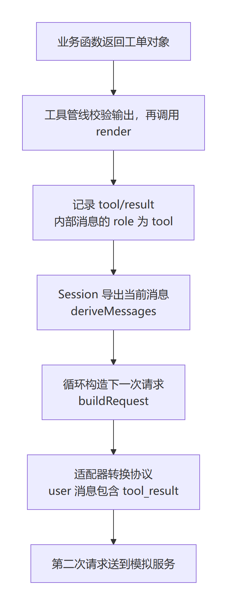

# 第五章 工具结果怎样进入下一次模型请求

第四章里，你把 lookupTicket 注册成了 book_ticket_lookup，也看到了真实工具管线返回的工单。现在把程序停在函数刚刚返回的那一刻：这条记录已经在本机内存里了，可模型还在另一个服务里。谁把结果交给它？

先别急着说“框架会处理”。如果以后你接入订单系统，函数查到了正确订单，助手却答非所问，你要能继续追查：结果有没有被记录？记录里的内容对不对？发给模型时，内容有没有变？这一章就沿着同一条 TK-1042，把这些位置逐一找出来。

## 5.1 第二次请求里，多出来的是什么

先在纸上写下预测。第一次请求已经告诉模型有一个查询工具，那么第二次请求还需要工具的调用记录吗？只发一段 `open`，模型能知道它属于哪张工单、哪次调用吗？

我们沿用第四章的函数、插件和数据，不增加新业务。这次使用配套的正常场景 S1：模拟服务先返回工具调用，再返回一句固定答复。它使两次请求可以稳定比较，真实 Harness 仍负责注册、执行和组装请求。这个实验不测试真实模型会不会主动选对工具。

沿用第二章校验过的 BookRoot/HarnessRoot，在 PowerShell 中执行。换了终端先恢复并检查这两个变量；证据目录必须是新的，重复实验把 S1-01 换成 S1-02。

```powershell
$Evidence = Join-Path $BookRoot 'labs/next-request/.lab-runtime/S1-01'
Set-Location -LiteralPath $HarnessRoot
node --import tsx/esm (Join-Path $BookRoot 'labs/m1/run.mjs') $HarnessRoot S1 $Evidence
$LASTEXITCODE
Set-Location -LiteralPath $BookRoot
node labs/next-request/inspect.mjs $Evidence (Join-Path $Evidence 'excerpt.json')
$LASTEXITCODE
```

第一条命令运行任务并保存请求与会话原件；第二条从原件中查找本章需要的字段，另存摘录，不修改原件。两条都应退出 0。作者在已有 Windows 环境实测，核对程序输出如下；运行环境与限制见[实验说明](../labs/next-request/README.md)。

```json
{"requestCount":2,"executeCount":1,"turnCount":1,"stepCount":2,"ticket":{"id":"TK-1042","status":"open","title":"Invoice export failed"},"passed":true}
```

requestCount 和 executeCount 你已经见过。先记住这次还有“一个 turn、两个 step”，稍后再解释。现在只看两次请求的差别。

| 观察位置 | 第一次请求 | 第二次请求 |
| --- | --- | --- |
| 工具定义 | 包含 book_ticket_lookup | 本实验继续提供该工具 |
| 已发生的工具调用 | 没有 | assistant 消息包含一个 tool_use |
| 这次调用的返回结果 | 没有 | 后续 user 消息包含一个 tool_result |

第一次请求当然还没有“这次查询已经完成”的结果。模拟服务读到这次请求后，才返回调用指令；Harness 执行查询，再把调用与结果一并带进后续请求。定义说明“能做什么”，历史说明“刚才做了什么”。这两种数据不能互相代替。

这里的 assistant、user 是请求中的角色字段，不是在说“人又手动输入了一次结果”。先看[作者实际摘录](../labs/next-request/evidence/2026-11-12/excerpt.json)中的两块内容。为便于阅读，只展示块本身及它所在消息的角色；此前的用户消息、其他上下文和请求字段省略。

```json
{
  "role": "assistant",
  "content": [{
    "type": "tool_use",
    "id": "mock-call-1",
    "name": "book_ticket_lookup",
    "input": {"id": "TK-1042"}
  }]
}
```

```json
{
  "role": "user",
  "content": [{
    "type": "tool_result",
    "tool_use_id": "mock-call-1",
    "content": [{
      "type": "text",
      "text": "{\"id\":\"TK-1042\",\"status\":\"open\",\"title\":\"Invoice export failed\"}"
    }],
    "is_error": false
  }]
}
```

调用里的 id 与结果里的 tool_use_id 都是 mock-call-1，它们回答“这是哪次调用”。input.id 才是工单编号 TK-1042，回答“要查哪条业务记录”。假如以后同一个工具连续查两张工单，工具名相同，单靠名字就分不清每份结果属于哪次调用。

再看 text 里的反斜杠。这不是工单标题多出了奇怪字符，而是 JSON 字符串中还装着一段 JSON 文字，内层引号需要转义。外层是请求消息，内层文字才是本例 render 生成的工单表示。检查程序用 JSON.parse 读出内层文字，再比较 id、status、title 三个字段；只搜索 TK-1042 这几个字符，查错状态也可能漏掉。

先合上上面的摘录，回答一个小问题：第二次请求有正确工单文字，但 tool_use_id 指向另一次调用，能算“已经把这次查询结果交给模型”吗？不能。内容正确和归属正确，需要同时成立。

## 5.2 从函数返回值，一直追到请求字段

现在打开第四章的[工具插件](../labs/tool-cases/stages/plugin.mjs)。你写的 execute 返回一个对象，output.render 把对象转成文字块。上节请求里出现的工单 JSON 文字，正是从这里开始形成的。模型服务不会直接访问这个 JavaScript 对象，也不会替我们调用 lookupTicket。



图 CH-LOOP-01：依据目标工程与本章正常实验自行绘制。只展开工具结果进入下一次请求的路径，省略工具参数校验、重试、额外上下文和其他插件；箭头表示处理先后，不表示每一步都在等待磁盘写完。[可编辑图源](../diagrams/CH-LOOP-01.mmd)。

我们分四站阅读源码。以下坐标都固定在目标工程 fcc0ad462172522aaf5c93a7b2e01f6b9f0b0159；行号是这份版本的导航，更新版本后需要重新定位符号。本节少量源码摘录来自 DeepSeek Harness，保留其 MIT 许可与[第三方署名](../THIRD_PARTY_NOTICES.md)。阅读时先抓住我们追踪的字段，不必一次解释函数内所有分支。

**第一站：管线接住返回值，再生成消息内容。**在 [pipeline.ts 的 dispatchToolBody，258 行](https://github.com/goodtang/deepseek-harness-local/blob/fcc0ad462172522aaf5c93a7b2e01f6b9f0b0159/packages/core/tools/src/pipeline.ts#L258)，找到两个相邻操作：

```typescript
const returned = await tool.execute(exec.arguments, exec)
const result = this.createSuccessResult(exec, tool, returned)
```

returned 是业务返回值；result 是工具管线整理后的执行结果，两者不是同一个对象。继续到同文件 [createSuccessResult，537 行](https://github.com/goodtang/deepseek-harness-local/blob/fcc0ad462172522aaf5c93a7b2e01f6b9f0b0159/packages/core/tools/src/pipeline.ts#L537)：先复制并检查返回值是否满足 output.schema，再调用 output.render，整理出 content。成功结果里保留 value 与 content，但后面发给模型的工具消息使用的是 content。

因此，函数查得对，仍不足以证明模型收到的字段齐全。例如业务对象有 status，render 却只输出 title，模型消息就不会因为 value 内有 status 而自动补上它。以后调试新工具，先分别检查“业务值”和“呈现给模型的内容”。本章沿用输出完整 JSON 的 render，不另改它。

**第二站：结果成为会话里的一条记录。**在 [batch.ts 的 BatchSettlement.commit，252 行](https://github.com/goodtang/deepseek-harness-local/blob/fcc0ad462172522aaf5c93a7b2e01f6b9f0b0159/packages/core/tools/src/batch.ts#L252)，执行器结算批次时，向所属 Session 追加 tool/result。Session 是这一任务的会话记录对象；本实验的持久化插件还会把它保存为 JSONL 文件，即每一行都是一条 JSON 数据。

这条结果记录包含内部工具消息，其 role 为 tool，toolCallId 指向调用 ID，content 来自刚才的工具结果。记录还带 surfaceOp=append 和 sourceEventSeqs；前者表示把这条消息加入当前有序消息视图，后者指出它来自哪条较早记录。作者这次的 tool/call 序号是 17，tool/result 是 18，sourceEventSeqs 为 [17]。重新运行时不要死记序号，应该检查关联关系。

这里需要新认识一个名字：surface。日志保存运行过程中接受的事件，surface 维护其中当前用于导出模型消息的有序视图。记一条日志，并不等于把它作为一句话发给模型。看这个对照：

| 事件 | 本章怎样使用它 | 是否直接贡献消息 |
| --- | --- | --- |
| tool/call | 记录调用名、参数和调用 ID | 不直接贡献；调用块来自 assistant/message |
| tool/result | 保存结果消息及其关联 | 本例以 append 加入 surface |
| step/start、step/end | 判断某一步从哪里开始、在哪里结束 | 不直接贡献 |
| turn/end | 判断任务回合为何结束 | 不直接贡献 |

这个区别可在 [surface.ts 的消息类型集合，50 行](https://github.com/goodtang/deepseek-harness-local/blob/fcc0ad462172522aaf5c93a7b2e01f6b9f0b0159/packages/core/session/src/surface.ts#L50)和同文件的 deriveEventMessage 找到。先理解“有序视图”即可；历史替换、压缩和插件投影以后再展开。现在不要把 surface 简化成“从头到尾把每条日志发出去”。

**第三站：循环从当前会话导出消息。**在 [Session.deriveMessages，999 行](https://github.com/goodtang/deepseek-harness-local/blob/fcc0ad462172522aaf5c93a7b2e01f6b9f0b0159/packages/core/session/src/index.ts#L999)，程序按 surface.nodes 的顺序找到对应事件，导出消息，并维护缓存。它读取的是当前视图，不是把所有事件原样塞进一个数组。

接着看 [ReactLoopAgent.buildRequest，656 行](https://github.com/goodtang/deepseek-harness-local/blob/fcc0ad462172522aaf5c93a7b2e01f6b9f0b0159/packages/core/agent-loop/src/agent.ts#L656)。在处理请求配置和记录后，它调用 session.deriveMessages()，把导出的消息放入内部请求的 messages。请求还包含模型选择、工具定义等信息。工具结果因此进入“接下来要发送的历史”，并不是业务函数自行发起第二次模型调用。

注意，这条路径不要求每一步都等待磁盘落盘。Session.append 接受并保存内存中的记录，持久化插件异步写文件；本章运行器在应用结束后读取真实持久文件核对。不能把“写日志再导出消息”讲成“每次请求前都重新读取磁盘上的 JSONL”。

**第四站：适配器把内部消息换成服务接受的格式。**在 [llm-deepseek 的 serialize，57 行](https://github.com/goodtang/deepseek-harness-local/blob/fcc0ad462172522aaf5c93a7b2e01f6b9f0b0159/packages/llm/llm-deepseek/src/serialize.ts#L57)，内部 role=tool 的消息转换为 role=user、含 tool_result 的协议消息，toolCallId 转成 tool_use_id。内部的 tool-call 内容块也转换为 tool_use。这就解释了上节摘录中的角色与拼写。

“适配器”在这里指把 Harness 内部数据转换为模型服务协议的实现。本书当前基线的这条路径使用 DeepSeek Messages 格式；不要根据其他项目里的 role=tool 请求，断定本工程也必须发送相同格式。工具协议和内部类型各有职责，具体转换应到对应提供方实现里找。

| 在哪里看 | 同一调用的 ID 字段 | 本例的结果角色 |
| --- | --- | --- |
| Session 的 tool/call | data.callId | 这条是调用记录，不是结果消息 |
| Session 的 tool/result | data.message.toolCallId | tool |
| 发给服务的 tool_result 块 | tool_use_id | 所在消息为 user |

现在回看“一切皆插件”。第四章的业务插件负责提供查询能力；本实验选中的 native-tool-executor 插件负责批次执行与结算，Session 的消息视图负责导出历史，llm-deepseek 负责协议转换。循环通过这些服务推进任务。接入一个订单查询工具时，应先在已有扩展点提供业务定义，而不是把查订单和拼接某家协议的代码一并写进 agent-loop。

## 5.3 让证据回答：为什么任务还没有结束

路径已经找到了，还差最后一问：收到第一次模型响应后，循环为什么继续请求？

看 [ReactLoopAgent.step，435 行](https://github.com/goodtang/deepseek-harness-local/blob/fcc0ad462172522aaf5c93a7b2e01f6b9f0b0159/packages/core/agent-loop/src/agent.ts#L435)的正常完成部分。程序把完整助手消息记入会话后，选出类型为 tool-call 的内容块；如果没有调用，就返回 completed。如果有调用，就委托 tools.execute；本例工具没有声明结束回合，因此该 step 返回 null，表示这里尚未给出回合结束原因。

外层 [turn，327 行](https://github.com/goodtang/deepseek-harness-local/blob/fcc0ad462172522aaf5c93a7b2e01f6b9f0b0159/packages/core/agent-loop/src/agent.ts#L327)检查这个返回值，再进入下一步。下一步重新构造请求，就带上了前一节追踪的结果。第二次响应只有固定答复，没有工具调用，本场景才正常结束。这里说的是本例；代码还允许工具主动结束回合，也有新输入、失败、取消等其他分支，不能推广成“任何工具之后必有第二次请求”。

这时再解释两个计数就容易了。turn 是这一轮处理输入的回合，step 是其中一次推进模型与工具处理的步骤；本例的一轮查询经过两步，工具只在第一步执行一次。请求次数也不永远等于步骤数：第四章附录中的断流恢复，可能在同一步内重试模型请求。以后看到两个请求，先查 step/start 和重试记录，再判断发生了什么。

这次作者的持久记录给出下列顺序。它是从[实际摘录](../labs/next-request/evidence/2026-11-12/excerpt.json)选出的事件，不是另造的 Harness 事件类型。

| seq | 事件 | 此时发生了什么 |
| --- | --- | --- |
| 4 | turn/start | 回合开始 |
| 6 | step/start，step=1 | 第一步开始 |
| 17 | tool/call | 记录 TK-1042 调用 |
| 18 | tool/result | 记录正确结果，关联 17 |
| 20 | step/start，step=2 | 进入下一步，构造后续请求 |
| 22 | assistant/message，step=2 | 接受本场景的最终助手消息 |
| 24 | turn/end | 以 completed 结束 |

请自己打开刚才保存的摘录，只打印相关部分，避免被整份系统提示淹没：

```powershell
$Observed = Get-Content -Raw -LiteralPath (Join-Path $Evidence 'excerpt.json') | ConvertFrom-Json
$Observed.secondRequest.toolResult | ConvertTo-Json -Depth 8
$Observed.persisted.result | ConvertTo-Json -Depth 8
$Observed.timeline | Format-Table seq, type, turn, step
```

先比较两个结果的 content，再比较调用 ID 的字段名。你应该看到“同一份结果用不同层次的数据表示”，而不是两次独立查询。我们的[核对程序](../labs/next-request/inspect.mjs)也逐项比较持久 content 与第二请求的 content，并检查真实 execute 记录恰好一次。

但一个只会说“通过”的程序，也可能检查得不够仔细。再运行：

```powershell
node labs/next-request/check.mjs $Evidence (Join-Path $Evidence 'checks.json')
$LASTEXITCODE
```

作者实测输出 `{"originalPassed":true,"rejectedAlteredCopies":5}`，退出 0。[五份对照](../labs/next-request/evidence/2026-11-12/checks-final.json)分别拿掉第二请求的结果、改错调用 ID、改错请求中的工单状态、改错持久结果内容、把应用退出状态改成失败，核对程序全部拒绝。它们只改内存副本，原始记录保持不变；这是验证证据检查是否有效，不是声称运行中的 Harness 自动修好了这五种故障。

接下来留一项自己完成的小修改。先看 check.mjs 的 cases：每项是“场景名 + 一个修改函数”，程序先复制证据，再调用这个函数改副本，最后期待 inspect 拒绝它。修改函数收到的第一个参数是报告副本，第二个是持久记录副本；find 用于从数组中找到第一条满足条件的记录，这里按 type 找到工具结果。

先预测：如果持久结果的 toolCallId 改成 wrong，即使 content 完全正确，应该通过还是失败？参照现有 cases 的写法，在自己的副本增加这一项，再运行。副本放在原脚本同目录，保留 `./inspect.mjs` 导入；输出使用新的文件名。数组用逗号分隔每一项，回想第三章断言的用途：你在这里期待的是“错误被发现”。

先建立自己的文件，已有文件时停止，避免覆盖之前的练习：

```powershell
$MyCheck = Join-Path $BookRoot 'labs/next-request/my-check.mjs'
if (Test-Path -LiteralPath $MyCheck) { throw '练习文件已存在，请继续编辑原文件或另取名字' }
Copy-Item -LiteralPath (Join-Path $BookRoot 'labs/next-request/check.mjs') -Destination $MyCheck
```

用编辑器在 MyCheck 指向的文件中增加场景，然后运行：

```powershell
node $MyCheck $Evidence (Join-Path $Evidence 'my-checks.json')
$LASTEXITCODE
```

<details>
<summary>完成后再核对思路</summary>

新增项应定位 type 为 tool/result 的持久事件，修改其 data.message.toolCallId，不改调用记录和请求。inspect 已经检查该字段与请求调用 ID 对应，所以新副本应被拒绝，总拒绝数变为 6。如果仍是 5，先确认运行的是自己的副本；如果直接语法报错，先检查逗号与括号。

需要代码提示时，可在 cases 数组中增加这一项；开头的 _report 表示这次修改不用报告参数。

```javascript
['wrong-persisted-call-id', (_report, events) => {
  events.find(event => event.type === 'tool/result').data.message.toolCallId = 'wrong';
}],
```

作者也在副本上完成这项修改，得到正常原件通过、六项改错副本被拒绝，见[练习核对记录](../labs/next-request/evidence/2026-11-12/reader-exercise.json)。这项是证据检查练习，不是修改业务状态的集成实验；实际是否独立完成，由你另记。

</details>

最后，用下面三问检查自己能否离开示例继续排查，不必背源码行号。

1. 函数返回了正确对象，第二请求却少了 status，先检查哪个位置？
2. 会话有 tool/result，但无法在第二请求里找到对应内容，下一步沿哪两个位置查？
3. 终端输出 M1 query completed.，能证明真实模型已经理解工单状态吗？

<details>
<summary>对照解释</summary>

第一问先比较业务返回值与 render 生成的 content；第二问检查消息进入 surface 的记录和 deriveMessages，再追 buildRequest 与适配器序列化，不仅搜索日志文件中的字串；第三问不能。本场景的最终文字是模拟服务预设的，通过只证明我们断言的真实管线行为。真实模型的业务表现需要另外设计输入和评价。

</details>

本章没有让你记住一整套循环代码，而是让你能拿着一个结果，走到它的消息、日志、请求和结束条件。接入业务工具后，回答出错便有了具体的排查位置。

不过，刚才的程序顺利收到第二次响应。如果结果已经查完，模型却一直不返回，人按下“取消”时，系统应该停在哪里，又该怎样记录已经完成的查询？后续章节将沿用这次调用和第四章的故障证据，继续追踪等待与取消。
