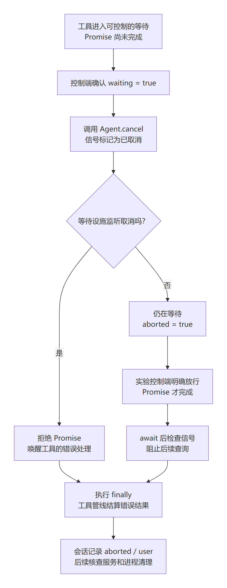

# 第六章 查询还在等待，怎样正确取消

第五章结束时，TK-1042 已经查到，结果也进入了第二次模型请求。顺利的情况下，助手很快就会回答。但如果屏幕迟迟没有新内容，你想停止这次任务，程序应该怎样做？

先别把“取消”当成一个瞬间。可能工具还没查完，也可能查询早已结束，只是模型还在回答。你需要知道程序停在哪一步，取消信号送到了哪里，以及什么时候才有依据说“这一回合结束了”。这一章仍用同一工单，把等待放在能控制的位置，再亲手改变等待函数对取消的反应。

## 6.1 等待的时候，程序还能接收取消吗

先预测两个问题：代码执行到 await 后，整个程序是不是都不工作了？工具函数已经开始执行，取消请求是不是一定能让它立即返回？先写下答案，我们用实际控制请求验证。

本章新增一个教学等待设施 gate。它在查询函数之前等待明确的放行或取消，而不是“睡两秒再猜应该到哪里了”。它不是上游自带的工单服务，也没有连接数据库。真实 Harness 仍负责工具注册、调用、信号和会话记录；这段设施只让等待位置可重复观察。

先看[工具起点](../labs/wait-cancel/start/plugin.mjs)中 execute 的主要部分。查询函数、工具名、输出 schema 和 render 沿用前章；新增的日志行只用于测量，完整可运行文件在上述链接中。

```javascript
await gate.wait(exec.signal, true);
exec.signal.throwIfAborted();
```

第一行等一个 Promise 完成。可以先把 Promise 理解成“一次尚未结束的操作及其最终结果”：操作完成时会兑现，失败时会拒绝。await 等它的结果，再继续当前异步函数；等待期间，程序仍能处理其他事件。第二行检查此时是否已经取消，取消后就抛出原因，阻止后面的 lookupTicket 执行。第四章的 async 函数，在这里有了真实用途。

先运行能够正常放行的情况。继续使用第二章已经校验的 PowerShell 变量，换终端先重新填写 BookRoot/HarnessRoot。每次使用新的证据目录。

```powershell
$ReleaseEvidence = Join-Path $BookRoot 'labs/wait-cancel/.lab-runtime/release-01'
Set-Location -LiteralPath $HarnessRoot
node --import tsx/esm (Join-Path $BookRoot 'labs/m1/run.mjs') $HarnessRoot gate-release $ReleaseEvidence
$LASTEXITCODE
Set-Location -LiteralPath $BookRoot
node labs/wait-cancel/inspect.mjs $ReleaseEvidence (Join-Path $ReleaseEvidence 'excerpt.json')
$LASTEXITCODE
```

这个运行器复用前章的真实 headless profile，等本地控制接口实际报告 waiting=true 后才放行。作者[实际结果](../labs/wait-cancel/evidence/2026-11-13/release.json)是：工具进入一次，查询函数执行一次，模型请求两次，回合 completed。headless 应用与核对程序都退出 0；这就是第五章正常路径中多了一段可控制的等待。

再预测：在相同位置请求取消，业务查询还应执行吗？运行合作取消场景：

```powershell
$CancelEvidence = Join-Path $BookRoot 'labs/wait-cancel/.lab-runtime/cancel-01'
Set-Location -LiteralPath $HarnessRoot
node --import tsx/esm (Join-Path $BookRoot 'labs/m1/run.mjs') $HarnessRoot gate-cancel $CancelEvidence
$LASTEXITCODE
Set-Location -LiteralPath $BookRoot
node labs/wait-cancel/inspect.mjs $CancelEvidence (Join-Path $CancelEvidence 'excerpt.json')
$LASTEXITCODE
```

[这次实测](../labs/wait-cancel/evidence/2026-11-13/cancel.json)中，工具 execute 确实进入一次，但 lookupTicket 没有执行，没有第二次模型请求；持久工具结果为错误，回合结束原因为 aborted/user。这里的业务次数专门在 lookupTicket 前测量，不能把“进入 execute 一次”解释成“已经查询一次”。

作者核对程序的实际输出为：

```json
{"scenario":"gate-cancel","requestCount":1,"businessLookupCount":0,"end":{"kind":"aborted","reason":{"kind":"user"}},"passed":true}
```

再打开自己的字段摘录，分别查看测量和回合记录，不用打印整份请求提示：

```powershell
$Cancelled = Get-Content -Raw -LiteralPath (Join-Path $CancelEvidence 'excerpt.json') | ConvertFrom-Json
$Cancelled.audit | Format-Table type, outcome, id
$Cancelled.turnEnd | ConvertTo-Json -Depth 5
```

注意两层退出状态：运行器核对这条取消路径符合预期，所以退出 0；它启动的 headless 应用以取消结束，在当前版本中退出 1。你应同时核对报告中的 applicationExitCode=1、watchdogExpired=false 和 turn/end 的用户取消原因。只看最外层的 0，仍然会把不同事情混在一起。

| 观察项 | 正常放行 | 等待中合作取消 |
| --- | --- | --- |
| execute 进入次数 | 1 | 1 |
| lookupTicket 执行次数 | 1 | 0 |
| 模型请求次数 | 2 | 1 |
| 回合结束原因 | completed | aborted / user |
| headless 应用退出码 | 0 | 1 |

等待中的程序能够接收取消控制请求，已经回答了第一道预测题。await 暂停的是当前异步函数的后续执行，不会让处理控制请求的所有代码都停下。第二道题还不能只凭这一次成功下结论：我们要看看“能够结束等待”的能力从哪里来。

## 6.2 谁通知等待结束，谁负责收尾

从控制端开始追踪。本章暂用本地 HTTP 控制接口发出取消请求；界面和 SDK 怎样调用取消入口，后续再展开。接口监听在本机回环地址，运行器通过本轮生成的端口文件找到它，不要求你事先占用某个固定端口。

[观察插件](../labs/m1/observer.mjs)找到本实验唯一的 Agent，记录取消发生的位置，然后执行：

```javascript
agent.cancel({ kind: 'user' });
```

之后它返回 accepted=true，表示已调用这个公开入口。这不是“所有工作已经结束”的回执。以下源码坐标都对应目标工程 fcc0ad462172522aaf5c93a7b2e01f6b9f0b0159；少量摘录沿用上游 MIT 许可，署名见[第三方声明](../THIRD_PARTY_NOTICES.md)。

**先看循环怎样发出信号。**在 [ReactLoopAgent.cancel，191 行](https://github.com/goodtang/deepseek-harness-local/blob/fcc0ad462172522aaf5c93a7b2e01f6b9f0b0159/packages/core/agent-loop/src/agent.ts#L191)，默认会清空待处理输入，并对当前非空闲活动执行：

```typescript
if (this.phase.kind !== 'idle') this.phase.abort.abort(cause)
```

this.phase 是当前活动状态，abort 字段持有 AbortController。控制器的 abort 方法把对应 AbortSignal 标为已取消，并通知监听者。名字看起来重复，是因为左边的 abort 是字段名，右边的 abort 是方法名。cause 在本例中是 `{ kind: 'user' }`，用来保留用户取消的原因；这个方法本身返回 void，不会等待整个任务收尾。清空输入队列也不会删除已经提交的会话历史或业务数据。

AbortController 负责发出取消，AbortSignal 供处理任务的代码读取和监听。signal.aborted 表示当前标记，signal.reason 保存原因，throwIfAborted() 则在已取消时抛出原因。它们不会自动删除一段正在执行的 JavaScript。

**再看信号怎样到达工具。**在 [工具管线 dispatchToolBody，258 行](https://github.com/goodtang/deepseek-harness-local/blob/fcc0ad462172522aaf5c93a7b2e01f6b9f0b0159/packages/core/tools/src/pipeline.ts#L258)，管线合并调用方和包装层的信号，把得到的信号交给 exec，再调用工具：

```typescript
exec.signal = signal
```

稍后的 `await tool.execute(exec.arguments, exec)` 仍会等待工具函数结束。此处没有一条“收到取消就抛下正在运行的函数”的捷径。执行批次需要结算已经开始的调用；这正是下一节不合作等待仍不能立即退出的原因。完整并发调度以后再读，本章只有一个调用。

**接着看自己的等待设施。**在[gate.mjs](../labs/wait-cancel/gate.mjs)中，wait 返回 new Promise，resolve 和 reject 是这个 Promise 提供的两个函数。正常放行执行 resolve；监听到取消则执行 reject。本章起点传入 true，所以会注册这一行监听：

```javascript
if (cooperate) signal.addEventListener('abort', onAbort, { once: true });
```

addEventListener 在这里登记“信号取消时执行 onAbort”，once 表示监听至多触发一次。onAbort 会让这次等待以 aborted 结算，随后拒绝 Promise。等待结算时也会 removeEventListener，避免已完成的等待继续保留监听。这里创建的 AbortError 是等待设施的错误表示；回合最终归因为 user，则由循环持有的取消原因决定。

Promise 被拒绝后，await 后面的正常语句不会继续执行，控制转入错误处理和 finally。本工具没有用 catch 接住这个错误，所以 finally 执行后，错误继续交给等待它的工具管线；finally 不会把失败改成成功。工具中的 finally 记录一次 execute-finally；管线再结算工具结果，循环停止依赖工作。finally 的含义是“这段 try 离开时执行”，并不是“外面一发取消，它就能越过尚未完成的 await 立即执行”。



图 CH-WAIT-01：按本章单工具实验和目标源码自行绘制，分别展示合作与不合作等待。图中取消标记与任务结束是不同节点；不包含新输入、并发调用和远端业务撤销。[可编辑图源](../diagrams/CH-WAIT-01.mmd)。

**最后核查记录与资源。**在 [turn 的取消处理，404 行](https://github.com/goodtang/deepseek-harness-local/blob/fcc0ad462172522aaf5c93a7b2e01f6b9f0b0159/packages/core/agent-loop/src/agent.ts#L404)，循环读取信号的取消原因，形成 `{ kind: 'aborted', reason: cause }`；方法的 finally 随后追加 turn/end。你在上一节看到的 aborted/user，来自这条实现路径。

再到同文件 [whenIdle，253 行](https://github.com/goodtang/deepseek-harness-local/blob/fcc0ad462172522aaf5c93a7b2e01f6b9f0b0159/packages/core/agent-loop/src/agent.ts#L253)，找 `await (activity = this.activityDone)`。这是等待活动结束，不是再次请求取消。[headless 的 run](https://github.com/goodtang/deepseek-harness-local/blob/fcc0ad462172522aaf5c93a7b2e01f6b9f0b0159/packages/bundle/headless/src/index.ts#L426)在任务处理阶段等待空闲，之后 flush 会话，再根据结果决定退出码。关闭进程、写完记录和发出取消，不能互相代替。

| 需要确认的事 | 本实验用什么核查 |
| --- | --- |
| 取消请求确实发出 | 唯一 Agent 的控制记录和 accepted=true |
| 等待与工具确实结算 | gate-settled、execute-finally、对应 tool/result |
| 回合为何结束 | 真实持久 turn/end 的 aborted/user |
| 实验资源是否清理 | gate-server-closed，子进程/模拟服务退出及临时目录删除 |

这些名字里，gate-settled 等是本书的测量记录，不是上游新增事件类型；tool/result 与 turn/end 才是实际产品会话事件。不要把两份记录混成同一种日志。

插件职责也能在这里看清：agent-loop 管当前活动与取消原因，tools 及选中的 tool-executor-native 负责实际调用和结算；本书插件在既有工具入口提供可控制等待。等待状态由每次 apply 创建的 gate 对象持有，监听服务由 ctx.effect 登记释放，未放到所有任务共享的模块变量中。一个插件实例只留一个等待位置，本实验也只有一个 Agent，不能直接把它当成多会话查询队列。本轮验证的是任务结束后的释放，不宣称已覆盖运行中任意卸载。没有为了加入慢查询去修改上游循环。

## 6.3 亲手让等待不响应取消，再恢复它

现在把第二道预测题做完整：工具已进入等待时，取消是否总能让它立即返回？先建立自己的插件文件，原起点保留。

```powershell
$WaitPlugin = Join-Path $BookRoot 'labs/wait-cancel/.lab-runtime/my-wait-plugin.mjs'
if (Test-Path -LiteralPath $WaitPlugin) { throw '练习文件已存在，请继续原文件或另取名字' }
New-Item -ItemType Directory -Force -Path (Split-Path $WaitPlugin) | Out-Null
Copy-Item -LiteralPath (Join-Path $BookRoot 'labs/wait-cancel/start/plugin.mjs') -Destination $WaitPlugin
```

复制后的层级与导入路径相符。用编辑器只把 `await gate.wait(exec.signal, true)` 的 true 改成 false；保留 await 后面的 throwIfAborted，也保留 finally。这次 false 只改变教学等待函数是否安装取消监听，不改变 Harness 的取消机制。

先预测：发出取消后，signal.aborted 会不会变成 true？execute-finally 会不会已经出现？lookupTicket 会不会继续执行？再运行：

```powershell
$IgnoreEvidence = Join-Path $BookRoot 'labs/wait-cancel/.lab-runtime/uncooperative-01'
Set-Location -LiteralPath $HarnessRoot
node --import tsx/esm (Join-Path $BookRoot 'labs/m1/run.mjs') $HarnessRoot gate-uncooperative $IgnoreEvidence $WaitPlugin
$LASTEXITCODE
Set-Location -LiteralPath $BookRoot
node labs/wait-cancel/inspect.mjs $IgnoreEvidence
$LASTEXITCODE
```

运行器先确认工具正在等，再调用同一个取消入口；收到 accepted 后，实际读取等待状态，而不是等固定时间后猜测。作者[此时取得的状态](../labs/wait-cancel/evidence/2026-11-13/uncooperative.json)是：

```json
{"waiting":true,"aborted":true,"cooperate":false}
```

同一时刻的测量记录尚无 business-lookup 和 execute-finally。取消标记已经到达，等待却没有结束。Promise 本身不会根据这个标记自动结束，需要等待函数把信号连接到自己的结束方式。随后运行器明确放行，Promise 才完成；工具来到 await 后的 throwIfAborted，在已取消状态下抛出原因。因此 lookupTicket 仍没有执行，finally 随后执行一次，回合才以 aborted/user 结束。这次也只有一次模型请求。

这个对照同时解释两种责任：等待操作要能被取消唤醒；等待返回之后，后续业务动作也要检查能否继续。若删除第二行检查，结果与副作用要重新设计和验证，不能凭本章结论推断。这里只做只读查询，写入确认、幂等与未知结果会在业务章节单独学习。

现在把 false 恢复为 true，再用新目录运行 gate-cancel，并传入同一 WaitPlugin：

```powershell
$RestoredEvidence = Join-Path $BookRoot 'labs/wait-cancel/.lab-runtime/restored-01'
Set-Location -LiteralPath $HarnessRoot
node --import tsx/esm (Join-Path $BookRoot 'labs/m1/run.mjs') $HarnessRoot gate-cancel $RestoredEvidence $WaitPlugin
$LASTEXITCODE
Set-Location -LiteralPath $BookRoot
node labs/wait-cancel/inspect.mjs $RestoredEvidence
$LASTEXITCODE
```

作者也完成了这个恢复，重新得到合作取消结果；[检查汇总](../labs/wait-cancel/evidence/2026-11-13/verification.json)核对了恢复后的插件字节及五组实际运行。自己的记录应区分独立完成、提示后完成和仍未完成，不能用作者答案替自己签收。

若恢复后的插件哈希仍不同，先检查是否额外改了空白、注释或换行；保留自己的修改副本后，可精确复制原起点，再用新证据目录重跑。不要修改报告中的哈希来凑相同结果。

最后回到第五章留下的另一种等待：查询结果已经提交，只是模型没有继续回答。用新的 Evidence 路径运行配套运行器的 S3，再用本章 inspect 核对即可；完整命令在[实验说明](../labs/wait-cancel/README.md)。本轮[实际记录](../labs/wait-cancel/evidence/2026-11-13/after-result.json)仍保留正确的非错误工单结果，第二次请求进入 stalled 后才取消，回合为 aborted/user。取消停止后续工作，没有把已经发生的只读查询改成“没有发生”。

| 取消发生在哪里 | 查询状态 | 本章实际结束方式 |
| --- | --- | --- |
| 工具合作等待中 | 业务查询尚未执行 | 等待被拒绝，随后收尾 |
| 工具不合作等待中 | 业务查询尚未执行 | 接受取消后仍等；明确放行后由检查阻止查询 |
| 结果已提交，模型继续回答中 | 正确结果已经记录 | 保留已有结果，回合用户取消 |

本章[检查器反例](../labs/wait-cancel/evidence/2026-11-13/verification.json)还拒绝了错误的结束原因、未接受取消、伪装成用户取消的看门狗超时，以及取消后仍执行查询等证据副本。反例检查和真实修改实验各有用途，不把改一份报告当作修改过真实行为。

合上代码，先回答：

1. accepted=true 时，为什么还不能显示“全部工作已结束”？你会继续查哪三类证据？
2. 取消前后工具都进入一次，为什么两次业务查询计数可能不同？
3. 第五章有第二次请求，本章工具等待中取消只有一次；缺少第二次请求是否一定是故障？

<details>
<summary>完成后再核对</summary>

第一问查工具结算、回合结束和资源清理，不能只查控制回执。第二问区分进入 execute 与真正执行 lookupTicket；await 和之后的检查都可能阻止业务继续。第三问依据任务的结束原因判断，工具等待中按预期取消就不应继续下一步。

再自己到上游 dispatchToolBody 找到等待工具结束的那行，说明取消标记为什么不会跳过它；到自己的 gate 找到删除监听的位置。这两处已经给出文件入口，本次不再逐行带读，能否独立指出并解释，请如实记录。

</details>

本轮只在已有 Windows 环境验证本地模拟模型、真实 profile 和上述单工具控制路径。它不等于外网隔离、真实业务服务撤销、所有取消时机或其他平台都已通过。原偶发启动超时仍保留待查；watchdogExpired=true 的记录不能当作主动取消成功。

到这里，你能沿一次等待说明取消如何传递，并用记录判断何时结束。可进程关掉以后，这些判断依据还在不在？下章从已经保存的会话文件出发，研究记录怎样读回，以及“保存了一条结果”和“业务系统当前是什么状态”为什么要分别核实。
