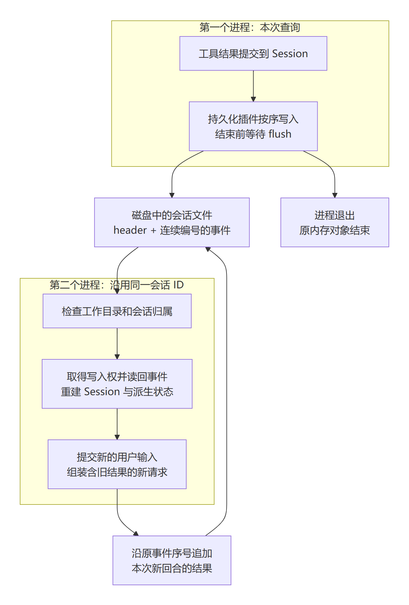

# 第7章 程序关掉以后，任务记录还在吗

上一章，你按下取消之前，先确认工具确实在等待；按下以后，再核对工具结算、回合结束和资源清理。你已经不容易被一句“取消成功”说服了。

现在把终端关掉。过一会儿重新启动，再问：“刚才那张工单是什么状态？”

问题变了。原来的程序已经结束，原来放在内存里的 Session 也结束了。新程序凭什么知道“刚才”指什么？磁盘里找到一份日志，就一定能继续吗？如果会话还记得 `open`，是否说明业务系统里的工单此刻仍然是 `open`？

这一章，我们继续使用 `lookupTicket(id)`、`book_ticket_lookup` 和 TK-1042，沿目标工程的真实保存、读回和续接路径回答这些问题。读完以后，你应当能为这个项目实现一个可核查的“继续会话”入口，而不是仅仅显示一份旧聊天记录。

## 7.1 先让原来的程序真正结束

先回忆第三章的函数。`lookupTicket('TK-1042')` 返回一个对象，其中有 `id`、`status` 和 `title`。第四章把它接入工具，第五章看到结果变成消息，进入下一次模型请求。那时，程序还在运行。

**内存**是运行中的程序存放对象的地方。进程退出以后，不能再去调用它原来的 Session 对象、Promise 或取消控制器。**文件**则可以留在磁盘中，由后来的程序重新打开。把需要保留的数据写入这种存储，就是这里说的**持久化**。不过，留在磁盘上的数据需要被正确读懂，才有机会参与后续执行。

先不要运行，写下预测：

| 你看到的现象 | 能据此认定“接上了原会话”吗？还缺什么？ |
| --- | --- |
| 目录里有一份 JSONL |  |
| 第二次运行退出码为 0 |  |
| 第二次回答里出现 TK-1042 |  |
| 第二个进程的新请求里有原工具结果，且旧日志未改 |  |

JSONL 是一种按行组织数据的文本格式，每一行都是一份完整的 JSON。本书第三章已经用过 JSON 对象：`{"status":"open"}` 表示一个含 `status` 字段的对象。JSONL 把多份对象分别放在各行，程序可以按顺序读取，而不必先把整个文件解释成一个大数组。

本章配置持久化插件使用 `compression: none`，方便直接观察文本。目标工程默认使用压缩存储；选文本是教学配置，不是要求你把所有部署改成文本。

实际实验分成两次启动。第一个 headless 查询 TK-1042，完成工具调用并自然退出；第二个 headless 在**同一工作目录**中，带上第一个会话的 ID，提交一句新问题。两个启动之间保留同一 home 和日志根，不能把第一轮的临时目录删掉以后还宣称“从原位置继续”。配套脚本在所有检查结束后才清理本次临时根，并保留两阶段的证据副本。

先按[本章实验说明](../labs/session-reentry/README.md)中的路径定位步骤取得你实际的 `$BookRoot`、`$HarnessRoot`。沿用第二章已经准备的源码和依赖；如果尚未准备，回到[环境说明](../labs/run-basics/SETUP.md)。下面在 PowerShell、`$HarnessRoot` 目录启动一次实验，每次生成新证据目录；如果已经在实验说明中运行过，直接查看那次记录也可以：

```powershell
$Evidence = Join-Path $BookRoot ('labs/session-reentry/.lab-runtime/resume-' + [guid]::NewGuid())
node --import tsx/esm (Join-Path $BookRoot 'labs/session-reentry/run.mjs') $HarnessRoot resume $Evidence
if ($LASTEXITCODE -ne 0) { throw "实验未通过，原件在：$Evidence" }
$Result = Get-Content -LiteralPath (Join-Path $Evidence 'report.json') -Raw | ConvertFrom-Json
$Result.phases | Select-Object name,pid,exitCode,executionCount,watchdogExpired
$Result.verification
$Result.cleanup
```

这里增加的 PowerShell 写法并不多：`Get-Content -Raw` 把整个文件读成文字，`ConvertFrom-Json` 把文字解析为对象，`$Result.phases` 取出每次启动的记录，`Select-Object` 选择要显示的字段。它们是我们读证据的工具，不是 Harness 的恢复实现。

作者本轮[实际记录](../labs/session-reentry/evidence/2026-11-18/verification.json)中的关键结果如下。`pid` 是操作系统给运行进程的编号；它与 Session ID 是两种身份。

| 启动 | PID | 模型请求数 | 工具执行数 | 退出码 |
| --- | --- | --- | --- | --- |
| 第一次查询 | 45052 | 2 | 1 | 0 |
| 第二个进程续接 | 42952 | 1 | 0 | 0 |
| 换目录请求续接 | 19336 | 0 | 0 | 1 |
| 使用不存在的 ID | 27220 | 0 | 0 | 1 |

你的 PID 和随机 Session ID 应该不同，不要照抄作者的数值。先核对首两次是不同的进程，再核对它们是否沿用同一个 Session ID。退出码只说明此次命令如何结束，不能独自说明恢复正确。

第一份持久记录含一个 header 和 25 个事件，事件序号 `seq` 从 0 到 24；第二份含同一个 header 和 36 个事件，序号从 0 到 35。`header` 是会话头信息，记录会话身份、创建时间和工作目录等；事件则记录后续发生的事情。本轮头信息实际显示版本 4，不能按旧文档中的示意文件名猜当前版本，也不要手工改版本号来让读取通过。

不必现在看完整提示。先仅显示头信息和事件的类型：

```powershell
$Rows = @(Get-Content -LiteralPath (Join-Path $Evidence 'second-durable.jsonl') |
  ForEach-Object { $_ | ConvertFrom-Json })
$Rows[0] | Select-Object type,version,id,cwd
$Rows | Select-Object type,seq
```

`ForEach-Object` 对每一行做一次解析，`@(...)` 把解析结果收集为数组，`[0]` 取第一项。header 没有事件序号，因此显示 `seq` 时第一行为空是正常的，不是丢了第 0 个事件。

检查器比较了原文件的完整字节与续接文件的对应前缀，SHA-256 相同；同时逐项核对了旧事件。在这次正常续接中，旧记录没有被重写，新的事件接在后面。前缀是“开头原有的这一段”，不是“新文件总长度也没变”。第二个文件当然会变长。

回头修正预测表：找到文件只证明有数据；退出 0 只证明命令按其规则正常结束；回答出现工单号也可能只是新问题里已有这个编号。还需要证明**新进程读到了正确会话，并把需要的历史用于新请求**。接下来就检查这条路径。

## 7.2 保存、读回、再发问，各是谁负责的

先把五个动作分开读：提交事件，写入存储，退出进程，读回会话，提交新问题。前三个动作发生过，并不能让后两个自动发生。



图 CH-STORE-01 为本书依据所研究源码自行绘制，图源见[可编辑文件](../diagrams/CH-STORE-01.mmd)。它只画本章的正常续接；不展开压缩、格式迁移、崩溃修复和并发争用。返回文件的箭头表示追加新记录，不表示回到过去重新执行旧查询。

这仍然是“一切皆插件”的设计。你不需要在 `lookupTicket` 里加一行“保存聊天”。业务工具负责查询，Session 保存逻辑事件，持久化服务规定读写方法，JSONL 提供者完成磁盘操作，Agent 循环负责恢复可执行状态，headless 负责驱动这次命令。

| 角色 | 本项目中的位置 | 本章观察到的职责 |
| --- | --- | --- |
| 会话服务 | `packages/core/session` | 维护 Session 和事件，派发 flush 请求 |
| 持久化服务定义 | `packages/session/session-persistence` | 规定 create/open、读写句柄及失败语义 |
| 持久化提供者 | `packages/session/session-persistence-jsonl` | 按 ID 路由事件，读写并同步磁盘，管理句柄 |
| 查询服务 | `packages/session-query/session-query` | 为 headless 提供原会话的观察结果 |
| 默认循环插件 | `packages/core/agent-loop` | 取得写入权、读回、恢复 Session 和运行状态 |
| 本次命令驱动 | `packages/bundle/headless` | 检查能否采用会话、提交新问题、等结束并退出 |

表里的路径是**目标源码仓库**中的路径，不在书稿仓库内。下面的链接均固定到 `fcc0ad462172522aaf5c93a7b2e01f6b9f0b0159`。上游短摘录版权归 DeepSeek 及相关贡献者，适用 [MIT 署名说明](../THIRD_PARTY_NOTICES.md)；解释与图由本书独立组织。

**先找写入在哪里接上。** 在 [base 的插件配置](https://github.com/goodtang/deepseek-harness-local/blob/fcc0ad462172522aaf5c93a7b2e01f6b9f0b0159/packages/bundle/base/cordis.patch.yml#L138)中，JSONL 插件通过配置取得 `root`；本章 overlay 改成临时根，并把压缩设为 `none`。`root` 不是业务工单目录，而是部署为会话日志选定的位置。

进入 [JsonlBackendTracker.install，storage.ts:535](https://github.com/goodtang/deepseek-harness-local/blob/fcc0ad462172522aaf5c93a7b2e01f6b9f0b0159/packages/session/session-persistence-jsonl/src/storage.ts#L535)，先只读 549–560 行。`ctx.on('session/event', ...)` 接收实时事件，按 `session.id` 找到活跃写句柄，再进入缓冲；`ctx.on('session/flush', ...)` 中的核心语句是：

```typescript
await writer.drainLive()
await writer.flush()
```

这两句顺序有意义：先等实时缓冲排空，再等句柄的刷新完成。**flush** 在这里不是“清空历史”，而是让待写入的数据完成规定的持久化步骤，并把写入失败交给等待它的调用者。Session 已经提交事件，不等于那一刻磁盘也已完成写入。

第五章见过 `ctx`，第六章见过 `await`；这次新增的是“谁在等待谁”。[SessionService.flush，index.ts:1342](https://github.com/goodtang/deepseek-harness-local/blob/fcc0ad462172522aaf5c93a7b2e01f6b9f0b0159/packages/core/session/src/index.ts#L1342)收集会话的 flush 回调，等待它们结束，有失败便抛出。[headless.run 的 435 行](https://github.com/goodtang/deepseek-harness-local/blob/fcc0ad462172522aaf5c93a7b2e01f6b9f0b0159/packages/bundle/headless/src/index.ts#L435)在生成最终输出前执行：

```typescript
await sessions.flush(agent.session)
```

于是这次命令有机会知道“保存失败”，而不是只看到模型已经回答，就报告整次任务成功。要看落到磁盘的最后一段，进入 [JSONL 的 appendLines，index.ts:1413](https://github.com/goodtang/deepseek-harness-local/blob/fcc0ad462172522aaf5c93a7b2e01f6b9f0b0159/packages/session/session-persistence-jsonl/src/index.ts#L1413)：它写入编码后的事件，然后等待文件句柄的 `sync()`。`sync` 请求把文件更新同步到存储；不能把 JavaScript 对象已经改变、缓冲已接收和这个步骤完成混为同一件事。

还要留意 `writers.get(session.id)`：这个路由需要当前会话已有活跃写句柄。只有一个内存 Session，甚至有人调用了 flush，都不能据此断言一定有文件写出。[持久化服务说明](https://github.com/goodtang/deepseek-harness-local/blob/fcc0ad462172522aaf5c93a7b2e01f6b9f0b0159/packages/session/session-persistence/README.md)对此有明确限制。工程的恢复能力来自完整插件组合；单独给某个函数起名“save”补不上缺失的提供者。

**再找新进程怎样找到旧会话。** 实际启动参数的关键差异只有这一项：

```text
第一次：dsh --profile headless --patch <本次配置> "查询工单"
第二次：dsh --profile headless --patch <同一配置> --session-id <原ID> "新的问题"
```

这是参数次序示意，不是可直接复制的命令；完整可运行命令已交给实验脚本。`--profile` 和 `--patch` 由启动器处理，`--session-id` 是 headless 应用自己的选项，见 [startup.ts:59](https://github.com/goodtang/deepseek-harness-local/blob/fcc0ad462172522aaf5c93a7b2e01f6b9f0b0159/packages/bundle/headless/src/startup.ts#L59)。你选的是原会话身份，不是把进程 PID 填进去。

打开 [resolveAgent，headless/index.ts:257](https://github.com/goodtang/deepseek-harness-local/blob/fcc0ad462172522aaf5c93a7b2e01f6b9f0b0159/packages/bundle/headless/src/index.ts#L257)。它先要求持久化和查询服务存在，再观察原会话，检查 cwd、归属及 preset，之后调用：

```typescript
const { agent } = await agents.resume({ resumeSessionId: sessionId, agentOptions, setup })
```

`{ agent }` 是从返回对象中取出名为 `agent` 的字段；右侧 `{ resumeSessionId: sessionId, ... }` 把本次要恢复的 ID 作为参数。对象里只写 `agentOptions`，是 `agentOptions: agentOptions` 的简写。重点是 **resume 取得另一个可运行的 Agent，不是复活原进程的对象**。

为什么观察以后还要再检查？观察是一份当时的快照，在真正取得写入权以前，别的写入者可能改变了记录。因此 `resolveAgent` 在 `resume` 之后又检查实际采用的 Session。这个顺序提醒你：展示历史、检查历史和拥有写入资格并不相同。

真正读回位于 [agent-loop 的 resumeWith，index.ts:761](https://github.com/goodtang/deepseek-harness-local/blob/fcc0ad462172522aaf5c93a7b2e01f6b9f0b0159/packages/core/agent-loop/src/index.ts#L761)。第一次阅读，只追 787–807 行：

1. 以 `write` 方式打开原 Session，先取得写入权。
2. 从句柄读出已有事件，检查是否需要为中断回合补结束记录。
3. 把读回的事件、必要的补记录和头信息交给 `sessions.prepare`。
4. 随后初始化 Agent，重新建立它需要的派生状态与生命周期。

其中三句原文摘录分别来自797、799、800行：

```typescript
const coldRead = await handle.read(0, undefined, { signal: fused })
const persisted = coldRead.events
const closers = interruptedTurnClosers(persisted)
```

`coldRead.events` 是这次读回的逻辑事件；`closers` 是根据已有事件判断出的必要结束记录。它们不是“把所有旧工具再执行一遍”。本章首回合已正常结束，实际只观察正常续接；对强杀、断电后的修复只定位实现，不声称已实测。

你可能注意到，新文件在 `seq: 25` 还有 `session/end-seed`。源码用读回事件作为恢复时的 seed，即用于初始化的一段历史；这个标记记录该段历史结束，不表示系统又执行了一遍 TK-1042 查询。真正的新回合在本轮记录的 `seq: 27` 开始，`seq: 35` 以 `turn: 2`、`completed` 结束。细读投影和格式协议时再展开这个标记，现在先会据此区分旧历史和新执行。

**最后，接回第五章。** 恢复出 Session 后，headless 仍要提交这次的新输入；[index.ts:420](https://github.com/goodtang/deepseek-harness-local/blob/fcc0ad462172522aaf5c93a7b2e01f6b9f0b0159/packages/bundle/headless/src/index.ts#L420)调用 `agent.followup(...)`。循环再经 `buildRequest`、`deriveMessages` 和提供者序列化组装请求。`deriveMessages` 仍按当前 surface 派生消息，不是把磁盘每一行原封不动发给模型，见 [Session.deriveMessages，index.ts:999](https://github.com/goodtang/deepseek-harness-local/blob/fcc0ad462172522aaf5c93a7b2e01f6b9f0b0159/packages/core/session/src/index.ts#L999)。

因此，本轮第二个进程的一次真实模型请求中，依次可辨认出：原用户输入、原工具调用、原工具结果、原模拟回答、这次新输入。协议角色仍是第五章讲过的 `user / assistant / user / assistant / user`；旧结果处于 `user` 消息中的 `tool_result` 块，不是内部事件类型突然变成了 user。

检查器具体核对了工具调用与结果的关联 ID、三个工单字段、新问题文字，以及第二次没有再次进入 `execute`。这一组证据才支持“旧查询结果进入了新进程的后续请求”。它不支持“模型重新查过业务系统”，也不支持“真实模型一定能正确理解所有历史”。

## 7.3 让你的“继续”入口经得起对照

到这里，最有用的下一步是主动制造一个很像成功的对照：保留日志和工作目录，第二次启动时**不传原 Session ID**。先预测：程序会报错、自动找到上一张工单，还是开启另一个会话？

按实验说明运行 `fresh`，给它一个新的 `$FreshEvidence`，不要覆盖刚才的目录。配套脚本确实改变第二个 headless 的参数，不会先改报告再让检查器接受。

作者本轮的[对照记录](../labs/session-reentry/evidence/2026-11-18/verification.json)如下：

| 检查项 | 带原 ID：resume | 不带 ID：fresh |
| --- | --- | --- |
| 第二次进程正常结束 | 是 | 是 |
| 第二次模拟回答 | `Book reentry mock response.` | `Book reentry mock response.` |
| 第二次与第一次的 Session ID | 相同 | 不同 |
| 原日志的已有字节 | 不变，并追加 | 不变，另建日志 |
| 第二次请求中的原工具调用和结果 | 有，关联 ID 相符 | 没有 |
| 第二次重新执行查询 | 没有 | 没有 |
| 第二份日志的 completed 回合数 | 累计 2 个 | 本会话 1 个 |

两次都退出 0，模拟回答也一模一样，却只有一组续接原会话。这正好回答7.1的预测：模拟答复只是固定脚本输出，不能据它验收记忆、推理或恢复。我们核验的是工程送出了什么请求、保存了什么事件。

再看两次拒绝。带原 ID，却改成另一个工作目录，实际诊断含 `was recorded in`，指出目录不符；带一个不存在的 ID，实际诊断含 `does not exist`。本轮两者均退出 1、零模型请求、零工具执行，原日志没有改变。**未知 ID 不自动变成新会话**，否则用户打错一个字符就可能在不知情中失去上下文。

这些检查并不等于多租户权限系统。Session ID 用于定位记录，不能直接当作任何用户都可以读写它的授权证明。未来接入企业账号，还要在应用服务中核实使用者与会话的访问关系；本章只研究现有 headless 的采用规则，不能用“ID 很长”代替权限设计。

现在自己改一次新问题，要求沿用旧结果中的标题：

```powershell
$OwnEvidence = Join-Path $BookRoot ('labs/session-reentry/.lab-runtime/own-' + [guid]::NewGuid())
$Question = 'Without calling a tool, recall the title from our previous ticket lookup.'
node --import tsx/esm (Join-Path $BookRoot 'labs/session-reentry/run.mjs') $HarnessRoot resume $OwnEvidence $Question
if ($LASTEXITCODE -ne 0) { throw "这次改动未通过：$OwnEvidence" }
$OwnResult = Get-Content -LiteralPath (Join-Path $OwnEvidence 'report.json') -Raw | ConvertFrom-Json
$OwnResult.verification
```

先不看答案，找出运行器中构造第二次启动参数的位置，说明 `resume` 和 `fresh` 究竟差在哪里；再到目标源码中找到把新问题交给 Agent 的那一行。前者是本书控制实验的代码，后者才是项目真实执行路径，不能互相替代。

作者也实际改变了这句新问题并重新运行；检查器确认新文本进入请求、旧结果仍在、第二次工具执行为零。固定模拟回答没有随新问题变化，所以这仍然是**输入与历史传递**验证，不是语义问答质量验证。若要核验真实模型是否答对标题，需要另行接入真实模型，并独立比较它的回答与业务证据。

检查器也可能写错。配套 `inspect.test.mjs` 用真实通过报告做输入，再分别构造六种错误副本：把两个 PID 改成相同、删请求、破坏 seq、改原前缀哈希、虚增第二次工具执行、缺失临时目录清理。作者本轮六项均被拒绝，命令见[实验说明](../labs/session-reentry/README.md)。这说明检查器能发现这些错误，不表示真实运行被故意制造过六次故障。

自己复现时，按下面的表记录，不要拿作者的“通过”填自己的最后一列：

| 自检问题 | 应找到的证据 | 我的结果与差异 |
| --- | --- | --- |
| 两次是不是不同进程？ | 两个非空且不同的 PID，首进程已退出 |  |
| 是原会话，还是新会话？ | Session ID、实际第二次启动参数 |  |
| 旧记录有没有被换掉？ | 原文件字节前缀哈希与旧事件逐项相同 |  |
| 历史是否真正用于新请求？ | 真实请求中的 tool_use/tool_result、关联 ID 与字段 |  |
| 是不是又查询了一遍才答上来？ | 第二次 execute 计数、新增事件和请求内容 |  |
| 新问题有没有传进去？ | 新请求中的确切文本，而不是配置字符串 |  |
| 拒绝与清理是否符合预期？ | 零请求/执行、退出码、未改日志、进程/服务/目录清理 |  |

若 `watchdogExpired` 为 true，先保留整份原件和启动探针，按实验说明排查；不要把它算成目录拒绝、用户取消或成功恢复。已知的偶发启动问题尚未定位，本轮通过没有把它自动关闭。若路径不对，回到第二章核实两个根目录；若只有 stdout 正常却核对失败，先看失败断言及实际请求，不要手工改报告来匹配作者数字。

还有一项关系到今后的业务开发。请把下面三种数据各自交给正确的负责人：

| 数据 | 本章例子 | 应当向谁求证 |
| --- | --- | --- |
| 业务当前状态 | 工单此刻是否仍为 open | 业务系统的权威数据或一次新的查询 |
| 已提交的任务历史 | 上次查询返回了 open | 原 Session 的持久事件 |
| 本次运行中的控制状态 | 某个 Promise 是否还在等、信号是否已取消 | 当前进程中的执行对象与控制设施 |

日志记住了“上次看到 open”，不保证工单现在仍 open；恢复历史也不会让原来挂起的 Promise 回到新进程继续等。将来增加写操作时，还要记录业务请求身份并查询未知结果，不能看到中断就盲目重做。本章没有测试写入重试，不把一次只读续接提升为业务恰好执行一次的保证。

<details>
<summary>完成自检后再核对</summary>

只把文件显示出来，完成的是历史查看；读回逻辑事件并重建 Session，完成的是恢复状态；带着恢复出的历史提交新问题并进入新回合，才是本章验证的继续执行。三者依次有更多要求。

本轮正常续接的首段旧事件仍是0–24，追加段是25–35，新回合号为2。多出来的事件不全是模型消息；新的 `turn/start` 和 `turn/end`、消息 surface 以及本轮请求要分别看。不要用“事件多了11个”推算模型请求多了11次。

源码的独立定位答案是 headless 的 `agent.followup(...)`；运行器则在第二次启动时有条件地传 `--session-id`。如果你只能指出本书脚本，回到7.2最后一段再追一次真实路径；如果两处都能解释，再尝试不看本章，在 `resolveAgent` 中找出“未知 ID 不创建新会话”的处理。

</details>

本章作者验到的是现有 Windows 环境、固定源码、本地模拟模型、正常退出后的单会话续接与上述拒绝/新会话对照。应用进程、模拟服务和临时根均已清理，证据副本保留。没有实测强杀、断电、文件损坏、迁移、并发写入或真实业务表现；读者、外网隔离、GitHub 页面与 PDF 验收仍按各自状态记录。

现在，你可以从“内存里的事件”追到“磁盘里的记录”，再追到“新进程发出的请求”，并判断一个继续会话的实现是否只是看起来成功。下章回到已经使用过的这些插件：谁规定服务，谁提供服务，谁消费服务？为什么业务工具不用知道日志文件名，续接驱动却必须要求持久化和查询服务存在？理解这套组合方式，才有依据为自己的业务替换能力、组织依赖，而不把新需求全塞进循环。
