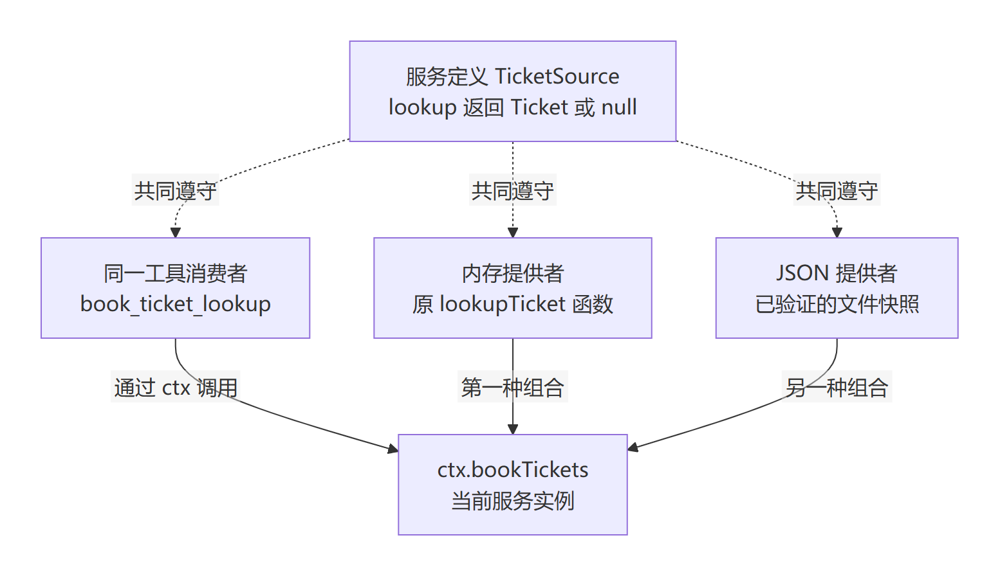
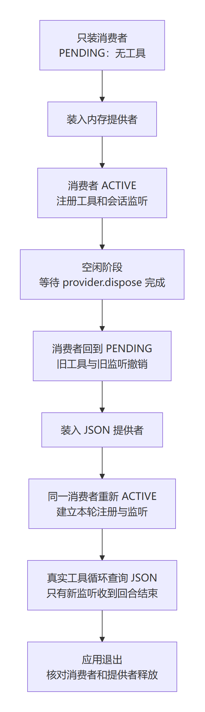

# 第8章 换一个数据来源，为什么工具不用重写

到第七章为止，TK-1042 已经可以查出来，也可以在原进程退出以后进入后续会话。现在有人把另一份资料交给你：“工单请从这个 JSON 文件读取。工具名字别变，原来的调用方还要继续用。”

你会从哪里改起？把读文件的代码放进 `execute`，当然可能完成这一次修改。可下一次改成业务接口呢？测试想换成内存数据呢？如果每个工具都自己决定数据来自哪里，同一项选择就会散落到很多地方。

这一章沿用原工单，实际完成一次职责调整：工具负责把模型请求接入业务能力，数据提供者负责查询，组合代码负责选用哪个提供者。随后卸载一个提供者，观察依赖它的工具究竟发生什么。你将第一次从“会挂接一个插件”，走到“会组织和替换一组互相依赖的插件”。

## 8.1 工具没变，变的是谁替它查询

第四章的工具直接调用普通函数：

```javascript
return lookupTicket(args.id);
```

那个函数仍然有价值。我们把它放到内存提供者中，并把工具里的调用改成：

```javascript
return ctx.bookTickets.lookup(args.id, exec.signal);
```

先只读这句：从当前 `ctx` 找到名为 `bookTickets` 的服务，调用它的 `lookup`，传入工单编号与本次取消信号。模型看见的仍是 `book_ticket_lookup`，参数仍是 `id`，结果仍是工单对象或 `null`。本章的改变发生在工具内部的业务调用处。

**服务（Service）**是通过名称提供给其他插件使用的一项能力。`bookTickets` 是本书新写的业务扩展，目标工程没有一个可以直接拿来用的同名工单服务。我们使用的是目标工程实际采用的 Cordis 机制。

先预测，再运行：

| 改动或现象 | 你的预测与依据 |
| --- | --- |
| 从内存提供者换成 JSON 提供者 | 模型调用的工具名要改吗？ |
| 只装工具消费者，没有工单服务 | 工具应该已经可用，还是应该等？ |
| 程序能输出同样的回答 | 能证明它真的读过文件吗？ |
| 提供者卸载，但工具还在注册表里 | 这个工具接下来能可靠工作吗？ |

按照[实验说明](../labs/plugin-services/README.md)先取得你实际的 `$BookRoot`、`$HarnessRoot`，在 PowerShell 中切到 `$HarnessRoot`。沿用第二章准备的源码与依赖。先运行内存组合，再运行 JSON 组合；每次都使用新的证据目录：

```powershell
$MemoryEvidence = Join-Path $BookRoot ('labs/plugin-services/.lab-runtime/memory-' + [guid]::NewGuid())
node --import tsx/esm (Join-Path $BookRoot 'labs/m1/run.mjs') $HarnessRoot S1 $MemoryEvidence (Join-Path $BookRoot 'labs/plugin-services/memory-entry.mjs')
if ($LASTEXITCODE -ne 0) { throw "内存组合未通过：$MemoryEvidence" }
$FileEvidence = Join-Path $BookRoot ('labs/plugin-services/.lab-runtime/file-' + [guid]::NewGuid())
node --import tsx/esm (Join-Path $BookRoot 'labs/m1/run.mjs') $HarnessRoot S1 $FileEvidence (Join-Path $BookRoot 'labs/plugin-services/file-entry.mjs')
if ($LASTEXITCODE -ne 0) { throw "JSON组合未通过：$FileEvidence" }
```

这里复用第四章的真实 profile 运行器，只把它挂入的业务插件入口换成了本章的组合。没有在脚本里直接调用 `execute` 来模拟工具成功；模型脚本产生调用后，仍由真实注册表、执行器和工具管线处理。

作者本轮[核对结果](../labs/plugin-services/evidence/2026-11-18-revision/verification.json)如下：

| 检查项 | 内存组合 | JSON组合 |
| --- | --- | --- |
| 使用的消费者文件 | consumer.mjs | 同一个 consumer.mjs |
| 模型调用的工具 | book_ticket_lookup | book_ticket_lookup |
| 主工具对应的提供者查询 | memory，TK-1042 | file，TK-1042 |
| 工具执行 / 主任务请求 | 1 / 2 | 1 / 2 |
| 持久工具结果及后续请求内容 | 原工单三个字段正确 | 同样三个字段正确 |
| 应用退出 / 临时资源清理 | 0 / 通过 | 0 / 通过 |

两组数据特意相同。单看 `open`，甚至单看两份相同的模拟答复，都分不清数据来源。来源的依据是实际提供者方法中的测量记录，以及入口选定的提供者；结果是否正确，则继续用第四、五章的方法核对持久结果与后续请求。两种证据各回答一个问题。修订后的组合会先直接检查服务的四项行为，再执行主任务，因此原始 `provider-query` 中还有检查调用。`service-check-start` 到 `service-check-passed` 之间属于前置检查；其外的查询才与主工具对应。真实工具执行仍为1次，不能把服务自检次数当成模型调用工具的次数。

自己先取出这几项，不急着看作者汇总：

```powershell
$FileResult = Get-Content -LiteralPath (Join-Path $FileEvidence 'report.json') -Raw | ConvertFrom-Json
$FileResult.executionAudit | Where-Object { $_.type -in @('provider-loaded','provider-query','composition-state','service-check-start','service-check-case','service-check-passed') }
$FileResult.sessionChecks
```

`Where-Object` 保留满足条件的记录，`-in` 检查某个值是否在给出的数组里。`provider-query` 是本书为这次实验添加的本地测量名称，不是上游 Session 事件，也不是模型自己报告“我读了文件”。完整原件保留在本机，公开资料只取必要的虚构业务字段。

还有两份文件要分清。`tickets.json` 是查询提供者读入的业务样例，内容是工单数组；第七章的 Session JSONL 保存的是任务发生过什么。更换前者的数据来源，不等于更换后者的持久化后端。上次查到什么与现在向哪里查询，仍是两个问题。

### 让文件内容真的改变一次结果

两份相同数据便于先理解替换结构，现在再做一个能区分来源的实验：只修改自己JSON副本中TK-1042的标题，让真实工具结果变成 `Invoice export failed [JSON source changed]`，然后恢复原文件。工单编号和消费者不改。

[实验说明](../labs/plugin-services/README.md)提供完整三阶段命令与异常恢复步骤。准备脚本只修改它新建的练习目录，在同一个 `tickets.json` 路径上依次写入原数据、改变后的数据、原始字节；每阶段保存独立输入与入口快照。每次启动新的headless，使提供者重新装入文件，没有模拟文件自动更新。

先预测，再对照本轮[实际记录](../labs/plugin-services/evidence/2026-11-18-revision/variation.json)：

| 阶段 | 文件标题 | 持久结果与第二请求中的标题 | 消费者与工具定义 |
| --- | --- | --- | --- |
| baseline | 原标题 | 原标题 | 相同 |
| changed | 加上JSON source changed | 同样出现标记 | 相同 |
| restored | 恢复原标题及原始字节 | 恢复原标题 | 相同 |

改变标题后，旧S1运行器仍固定期待原标题，因此它的检查命令按预期退出1；这不是把“所有失败都算成功”。新增 [verify-variation](../labs/plugin-services/verify-variation.mjs) 直接比较真实持久文件、观察事件、工具调用/结果ID、非错误结果、第二请求、结束原因和清理，再与这个阶段**事先给出的预期**比较。三阶段均独立核验通过，不能靠修改旧报告的通过标记来完成实验。

作者还实际制造了“测量标签仍写file，却忽略文件、调用原内存函数”的提供者。面对改变后的标题，它在第一项结果检查就被拒绝，见[诊断记录](../labs/plugin-services/evidence/2026-11-18-revision/diagnostics.json)。这才把“标签说来自文件”和“输入数据确实影响结果”分开验证。

这一步也解释了文件快照的使用方式：本章提供者装入时读取一次，文件变化后需要新实例读取；是否增加实时更新应由业务需求另行设计。恢复完成后，自己的输入文件与baseline字节相同，原书稿的 `tickets.json` 始终未改。

## 8.2 把一项能力分成三个角色

现在打开本章代码。先不要按文件数量记结构，先回答三个问题：谁规定怎样调用，谁完成查询，谁使用查询？



图 CH-PLUGIN-01 为本书自行绘制，[图源](../diagrams/CH-PLUGIN-01.mmd)可编辑。两条提供者实线表示两种组合选择；本章在同一个服务可见范围内一次只装一个提供者，不表示同时挂两个同名实例。

| 角色 | 本章对应内容 | 负责的决定 |
| --- | --- | --- |
| 服务定义（Service Definition） | TicketSource、Ticket | 方法名、参数、结果与使用要求 |
| 服务提供者（Service Provider） | MemoryTickets、FileTickets | 数据从哪里来，怎样读、怎样查 |
| 消费者（Consumer） | 注册工具的 consumer.mjs | 何时查询，如何把结果交回工具管线 |

### 先规定双方都能遵守的调用方法

[definition.ts](../labs/plugin-services/definition.ts) 中的核心定义如下，省略了文件导入和注释：

```typescript
export interface Ticket {
  id: string
  status: string
  title: string
}

export abstract class TicketSource extends Service {
  constructor(ctx: Context) {
    super(ctx, 'bookTickets')
  }

  abstract lookup(id: string, signal: AbortSignal): Promise<Ticket | null>
}
```

这是第一次在自己的扩展中明确写 TypeScript 类型，先把新增写法拆开。`interface Ticket` 规定对象有哪几个字段，`: string` 说明字段值是字符串；它不会自动创建工单，也不会自动验证文件。`Promise<Ticket | null>` 表示异步得到一个工单或 `null`，竖线表示这两种可能。

`class` 定义一种对象，`new` 才创建一个实例。`extends Service` 表示继承 Cordis 的服务基础行为；`constructor` 在实例创建时执行，`super(ctx, 'bookTickets')` 调用父类构造器，把实例登记为当前上下文的工单服务。`abstract` 表示这个类规定要求，具体查询由子类实现；我们不会直接创建一个没有查询实现的 TicketSource。

除了字段，服务定义还写清语义：按精确编号查询，找到返回副本，找不到返回 `null`，已取消时按本例的 `signal.throwIfAborted()` 约定拒绝并保留取消原因。仅仅把两种返回值都写成字符串类型，不足以保证两个提供者可以互换；返回值的含义也要一致。

同文件还有这一小段：

```typescript
declare module '@deepseek-ai/cordis' {
  interface Context {
    bookTickets: TicketSource
  }
}
```

它把 `bookTickets` 加入 TypeScript 所认识的 Context 类型。这叫**声明合并**：扩展已有接口，帮助编译器检查 `ctx.bookTickets.lookup(...)`。它不产生服务实例。只有类型声明、没有运行时提供者，不能让查询运行。

| 内容 | 什么时候起作用 | 能否单独让服务可用 |
| --- | --- | --- |
| Ticket、Context 的类型声明 | TypeScript 检查代码时 | 不能 |
| 创建具体服务实例、执行 super | 程序运行、插件装入时 | 完成运行时登记 |
| 消费者声明 inject | 框架判断是否能激活该消费者时 | 还需要相应服务就绪 |

本书的独立目录使用 `runtime.ts` 适配目标源码路径，并用 `package.json` 明确 ESM；这部分处理的是“从哪份源码导入框架”，不代替 `super`、`inject` 或 Cordis 本身。实际项目中的工作区包通常直接从 `@deepseek-ai/cordis` 导入。不要为这份书稿额外创建一个全局服务容器。

本轮对定义及适配器做了 strict 消费端类型检查，并让返回 `Promise<string>` 的错误提供者触发编译错误。检查使用本机已有的框架构建声明，不代表重新构建全部上游，也不代表所有 JavaScript 文件已经做过静态检查。运行时的 JSON 文件仍要在读入处验证。

### 再让两个提供者分别完成查询

[内存提供者](../labs/plugin-services/memory-provider.mjs)的查询方法很短：

```javascript
async lookup(id, signal) {
  signal.throwIfAborted();
  mark('provider-query', { source: 'memory', id });
  return lookupTicket(id);
}
```

它复用了第三章的普通函数。`mark` 只记录实验测量；真正的查询仍是原 `lookupTicket`。取消检查承接第六章，在进入查询前执行。提供者的 `apply` 执行 `new MemoryTickets(ctx)` 时，会沿用父类构造器完成服务登记。JSON类另外接收 `records`，因此它的构造器先 `super(ctx)`，再把数据放入 `this.records`。这两种写法都只在插件装入时创建本次服务实例。

[JSON提供者](../labs/plugin-services/file-provider.mjs)先在 `apply` 中读取配置指定的文件，验证后才创建服务：

```javascript
export async function apply(ctx, config) {
  const records = await readTickets(config.path);
  new FileTickets(ctx, records);
  observeProvider(ctx, 'file');
}
```

本例在装入时读一次文件，得到供这个提供者实例使用的快照，没有文件监听器。编辑文件以后，不会自动更新一个仍然存活的实例；需要重新装入提供者。`records` 属于这个实例，没有放到模块顶层的可变共享数组中。

读取的数据经过[解析函数](../labs/plugin-services/file-data.mjs)：根必须是数组，每条记录必须恰好包含三个字符串字段，工单编号不能重复。数据不合法就报告错误，不会悄悄改用内存数据。因为“文件坏了却仍返回看起来正确的旧数据”会掩盖组合故障。

查询方法按编号找到记录，再返回副本：

```javascript
async lookup(id, signal) {
  signal.throwIfAborted();
  mark('provider-query', { source: 'file', id });
  const ticket = this.records.find(row => row.id === id);
  return ticket === undefined ? null : { ...ticket };
}
```

`this.records` 是这个服务实例保存的快照。`find` 找到第一项符合条件的记录；没找到得到 `undefined`，这里把它转成服务规定的 `null`。`{ ...ticket }` 创建一个含相同字段的新对象，避免调用方直接改到提供者内部记录。这也延续了第三章的副本约定。

### 最后看消费者到底依赖谁

[消费者](../labs/plugin-services/consumer.mjs)保留原工具定义，重要变化集中在两处：

```javascript
export const inject = ['tools', 'bookTickets'];
```

以及 `execute` 中的服务调用：

```javascript
async execute(args, exec) {
  return ctx.bookTickets.lookup(args.id, exec.signal);
}
```

消费者没有导入 MemoryTickets 或 FileTickets，也没有读取 `tickets.json`。它要求一项可查询工单的能力，由组合代码选择具体实现。这里 `return` 交回 Promise，工具管线仍会等待它完成；第六章的异步执行规则没有改变。

不要把几个名字混在一起：

| 名称 | 谁使用它 |
| --- | --- |
| book_ticket_lookup | 模型与工具注册表 |
| bookTickets | Context 服务查找与消费者 inject |
| book-ticket-file | 插件诊断信息中的插件名 |
| TicketSource | TypeScript 类型及类定义 |

`inject` 要填服务名称，不能因为文件叫 `file-provider.mjs` 就把这个文件名填进去。

这里的 **Context** 是框架传给插件的上下文。它让插件取得当前可见的服务、订阅事件、建立子插件和登记释放动作。它的服务读取由 Cordis 的代理与解析机制处理，并带有作用域关系；本章只在同一可见范围中选择一个提供者，更深的隔离方式以后再展开。

### 把定义、提供者和消费者真正装到一起

现在把最容易藏进帮助函数的装配过程展开。[file-entry.mjs](../labs/plugin-services/file-entry.mjs) 是可运行入口，完整代码除许可头外如下：

```javascript
import { fileURLToPath } from 'node:url';
import * as Provider from './file-provider.mjs';
import { mount } from './composition.mjs';
export const name = 'book-file-composition';
export const inject = ['tools'];
export async function apply(ctx) {
  await mount(ctx, Provider, { path: fileURLToPath(new URL('./tickets.json', import.meta.url)) });
}
```

`import * as Provider` 把这个模块导出的 `apply`、`name`、`Config` 等成员作为一个对象导入；它是交给 `ctx.plugin` 的插件描述，不是已经运行的服务实例。入口自己的 `inject` 只有 tools，工单服务由它接下来装配。

这里调用的 [mount](../labs/plugin-services/composition.mjs) 也不神秘。下面是当前完整函数；它用到同文件已准备的 Consumer、基准工单、状态记录函数和服务检查函数。常规组合传前三个参数，后两个默认参数供教材的错误消费者和预期数据变化使用：

```javascript
export async function mount(ctx, providerPlugin, config, consumerPlugin = Consumer, expectedTicket = baseTicket) {
  const consumer = ctx.plugin(consumerPlugin);
  await consumer.await();
  assert.deepEqual(state(ctx, consumer, 'before-provider'), { phase: 'before-provider', state: 'PENDING', service: false, tool: false });
  const provider = ctx.plugin(providerPlugin, config);
  await provider.await(); await consumer.await();
  assert.deepEqual(state(ctx, consumer, 'provider-ready'), { phase: 'provider-ready', state: 'ACTIVE', service: true, tool: true });
  await checkMountedService(ctx, expectedTicket);
  return { consumer, provider };
}
```

先找两次 `ctx.plugin`：第一次挂消费者，第二次挂提供者。`config` 被交给提供者的 `apply`，消费者不因此知道文件位置。两个返回句柄分别拥有自己的生命周期，`provider` 可卸载，并不等于整个应用或消费者句柄一起消失。状态断言说明每次等待之后应当看到什么，第8.3节再逐步观察其变化。

入口里较长的路径表达式可以从内向外读：`import.meta.url` 是当前模块文件的URL；`new URL('./tickets.json', import.meta.url)` 根据**这个模块的位置**定位旁边的数据文件；`fileURLToPath` 把文件URL转成当前系统的文件路径。最终 `config.path` 是提供者收到的路径字符串。它不依赖启动终端恰好位于哪个目录，也不要求读者复制作者盘符。

### 服务约定要怎样验收

能查对一次 TK-1042，还不足以证明自己的提供者可以替换别人。评审时曾把学生实现改成 `return this.records[0]`，不匹配编号、不处理取消、也不返回副本，原来的正常查询仍然通过。现在把这四项检查接在真实服务装入之后：

| 检查 | 实际操作 | 必须观察到什么 |
| --- | --- | --- |
| 已知编号 | 查询 TK-1042 | 三个字段与本次预期相同 |
| 未知编号 | 查询已知不在本章样例中的 TK-NOT-PRESENT | 返回 null，而不是第一条工单 |
| 独立副本 | 改动第一次返回对象的status，再查一次 | 后一次仍是原状态；两个返回对象不同 |
| 已取消调用 | 先取消控制器，再调用lookup | Promise拒绝，并保留给定取消原因 |

`TK-NOT-PRESENT` 是本章固定数据中的测试用例，不是所有业务数据源都必须保留的特殊编号。返回副本的检查也会拒绝直接返回内部冻结对象的实现；本服务承诺给调用方一个可独立使用的副本。

[checkService](../labs/plugin-services/service-checks.mjs) 的检查通过一个真实挂载、声明了 `inject: ['bookTickets']` 的临时消费者执行。装配入口只声明 tools，不能越过自身依赖直接用 `ctx.bookTickets` 调方法；检查插件也遵守同一规则，完成以后等待其卸载。这里检查的是实际服务，不是手造一个对象代替提供者。

先看副本与取消的核心语句，再回到完整文件自己定位未知编号检查：

```javascript
first.status = 'only-this-returned-copy';
const second = await service.lookup(expected.id, signal);
assert.deepEqual(second, expected);
assert.notStrictEqual(first, second);

const controller = new AbortController();
const reason = new Error('Book service caller cancelled before lookup.');
controller.abort(reason);
await assert.rejects(() => service.lookup(expected.id, controller.signal), error => error === reason);
```

`first` 是前面第一次查询的返回对象，`expected` 是这次检查明确给出的预期工单。`notStrictEqual` 在这里要求两个对象不是同一个引用；`assert.rejects` 要求异步调用拒绝，后面的函数核对拒绝原因。仅检查“信号的 aborted 为 true”，不能代替检查方法真的拒绝了调用。

本轮分别实测了“始终返回首条”“直接返回内部对象”“忽略取消”三个错误提供者，均被新检查拒绝，详见[真实反例](../labs/plugin-services/evidence/2026-11-18-revision/contract-failures.json)。旧版曾接受的完整报告也被当前检查器拒绝。正常内存、JSON和学生完成版通过；主工具仍另外经真实执行管线验证。两层检查各自保留，不能以服务方法检查替代工具集成。

**回到目标工程的真实源码。** 第七章用过的 `sessionPersistence` 同样有三个角色：[服务定义](https://github.com/goodtang/deepseek-harness-local/blob/fcc0ad462172522aaf5c93a7b2e01f6b9f0b0159/packages/session/session-persistence/src/index.ts#L144)规定 create/open 等方法，[JSONL提供者](https://github.com/goodtang/deepseek-harness-local/blob/fcc0ad462172522aaf5c93a7b2e01f6b9f0b0159/packages/session/session-persistence-jsonl/src/index.ts#L291)完成存储，[agent-loop.resumeWith](https://github.com/goodtang/deepseek-harness-local/blob/fcc0ad462172522aaf5c93a7b2e01f6b9f0b0159/packages/core/agent-loop/src/index.ts#L761)使用服务读回历史。我们的小例子借用了相同的职责组织方式，没有替换这些核心模块。

服务实例的运行时登记则可以追到 vendored Cordis 的 [Service 构造器](https://github.com/goodtang/deepseek-harness-local/blob/fcc0ad462172522aaf5c93a7b2e01f6b9f0b0159/vendor/cordis/src/service.ts#L42)，它交给反射层的 [provide](https://github.com/goodtang/deepseek-harness-local/blob/fcc0ad462172522aaf5c93a7b2e01f6b9f0b0159/vendor/cordis/src/reflect.ts#L291)登记，并把撤销动作交给所属 fiber 的 effect。先追“服务名称、实例、所属上下文”这三项即可，暂时不用读完整个代理实现。

本章源码坐标固定到 `fcc0ad462172522aaf5c93a7b2e01f6b9f0b0159`。Harness 代码归 DeepSeek 及相关贡献者；vendored Cordis 保留 Shigma 等作者的独立 MIT 许可，见[第三方说明](../THIRD_PARTY_NOTICES.md)。本章图和教学示例自行组织，不以仓库根许可覆盖 vendor 的署名。

## 8.3 提供者走了，谁来撤销留下的工具

现在预测一个更具体的问题：消费者已经注册了工具。如果只卸载内存提供者，工具是否还留在注册表中？若仍然留着，下一次模型调用要使用哪个服务？

本章[生命周期入口](../labs/plugin-services/lifecycle-entry.mjs)在主任务开始前设置一个空闲检查点，实际依次完成：装消费者、装内存提供者、卸载内存提供者、装 JSON 提供者，再让 headless 执行原查询。这是对真实框架生命周期的控制实验，不是在查询执行途中拔掉一个远程连接。



图 CH-PLUGIN-02 自行绘制，[图源](../diagrams/CH-PLUGIN-02.mmd)可编辑。它省略瞬间的加载/卸载过渡状态，展示每次等待稳定以后实际核对的状态。箭头不是固定睡眠时间。

运行[实验说明](../labs/plugin-services/README.md)中的 lifecycle 命令，得到自己的 `$LifecycleEvidence`，再读 `executionAudit`。作者的稳定状态如下：

| 检查点 | 消费者状态 | bookTickets可见吗 | 工具已注册吗 |
| --- | --- | --- | --- |
| before-provider | PENDING | 否 | 否 |
| provider-ready | ACTIVE | 是 | 是 |
| provider-removed | PENDING | 否 | 否 |
| replacement-ready | ACTIVE | 是 | 是 |

`PENDING` 表示尚未满足必需依赖；`ACTIVE` 表示这个插件已激活。只装消费者时，Cordis 会等 `tools` 和 `bookTickets` 都可用再调用它的 `apply`。因此你在文件里先写消费者，后写提供者，也能正确启动；不是靠凑加载延时才碰巧成功。

`ctx.plugin(...)` 返回本次插件的运行句柄，框架称为 **fiber**。它与第六章的 Agent、任务回合不是同一个对象。配套代码先 `await consumer.await()`，再检查状态。这个 `await()` 等待当前生命周期工作稳定，稳定结果仍可能是 PENDING；不能仅凭它返回就宣称依赖齐全。

换提供者的关键几行是：

```javascript
await provider.dispose(); await consumer.await();
const replacement = ctx.plugin(File, { path: fileURLToPath(new URL('./tickets.json', import.meta.url)) });
await replacement.await(); await consumer.await();
```

先等旧提供者卸载完成，检查服务与工具已经撤销，再装新提供者。这次重新激活沿用了原消费者的插件句柄，消费者的 `apply` 又执行了一次，建立新的注册与监听。每次 apply 内的对象和局部变量也重新建立，不能靠模块顶层的可变单例保留它们。

消费者中有两种实际贡献：

```javascript
ctx.tools.register(defineTool({ /* 原工具定义 */ }));
ctx.on('session/event', (_session, event) => {
  if (event.type === 'turn/end') mark('consumer-turn-end', { owner, turn: event.data.turn });
});
```

上面是说明贡献位置的片段，不是可以独立运行的完整插件。`owner` 是本次 apply 创建的本地测量标记，用来辨认哪一轮监听收到了事件，不是用户身份或 Session ID。

工具注册和 `ctx.on` 订阅都已经是所属消费者上下文中的**效果（effect）**：它们有建立动作，也有撤销动作。消费者因依赖丢失而卸载时，旧工具与旧监听一起撤销。本轮只有新 owner 收到最终回合结束；若旧 owner 也收到，就说明不能只凭“服务换了”判定生命周期正确。

自己沿源码核对两处：[ToolsService.register 的128行](https://github.com/goodtang/deepseek-harness-local/blob/fcc0ad462172522aaf5c93a7b2e01f6b9f0b0159/packages/core/tools/src/index.ts#L128)返回注册的 disposer，并通过调用上下文登记效果；[Fiber._unload 的712行](https://github.com/goodtang/deepseek-harness-local/blob/fcc0ad462172522aaf5c93a7b2e01f6b9f0b0159/vendor/cordis/src/fiber.ts#L712)先等待依赖它的消费者卸载，再释放本提供者的效果。本轮测量中，消费者卸载标记确实早于相应提供者的释放标记，工具消失与旧监听不再触发也分别核验。

释放外部资源时，仍要为它登记自己的 `ctx.effect` disposer，并等待实际关闭完成。框架已经管理的注册不必再手工维护一份全局撤销列表。另一个细节也别漏掉：多个异步 disposer 可以并发运行，不能根据登记顺序猜它们逐个完成；有顺序要求的清理应放在同一异步释放函数里明确 `await`。

本章 JSON 提供者使用一次性 `readFile`，没有长期持有文件句柄或数据库连接。这里验证的是服务、工具注册和事件订阅的生命周期；第六章讲过的“取消标记不等于工作结束”仍然适用于真实长任务。将来加入连接池或正在进行的远端查询，还要明确谁停止接收新请求、谁等待已有工作、谁最后关闭连接。

### 自己补出第三个提供者

现在保持消费者原样，写一个自己的文件提供者。[起点模板](../labs/plugin-services/reader-start.mjs)已经准备好读取、配置和服务登记，你只补 `lookup`。先创建独立目录：

```powershell
$ReaderDirectory = Join-Path $BookRoot ('labs/plugin-services/.lab-runtime/my-provider-' + [guid]::NewGuid())
node (Join-Path $BookRoot 'labs/plugin-services/prepare-reader.mjs') $ReaderDirectory
if ($LASTEXITCODE -ne 0) { throw '练习目录创建失败' }
```

打开生成的 `provider.mjs`。准备脚本只处理实际路径、复制你的数据及组合入口，没有填查询逻辑。按顺序完成：先检查取消信号，再找编号完全相同的工单，找不到返回 `null`，找到返回副本。完成后运行：

```powershell
$ReaderEvidence = Join-Path $BookRoot ('labs/plugin-services/.lab-runtime/reader-' + [guid]::NewGuid())
node --import tsx/esm (Join-Path $BookRoot 'labs/m1/run.mjs') $HarnessRoot S1 $ReaderEvidence (Join-Path $ReaderDirectory 'entry.mjs')
if ($LASTEXITCODE -ne 0) { throw "自己的提供者未通过：$ReaderEvidence" }
$Reader = Get-Content -LiteralPath (Join-Path $ReaderEvidence 'report.json') -Raw | ConvertFrom-Json
$Reader.executionAudit | Where-Object { $_.type -eq 'provider-query' }
$Reader.sessionChecks
```

<details>
<summary>自己实现后，再核对 lookup 的核心几行</summary>

保留模板中的测量语句，把 TODO 与主动报错替换为：

```javascript
signal.throwIfAborted();
const ticket = this.records.find(row => row.id === id);
return ticket === undefined ? null : { ...ticket };
```

作者实际填写并经真实工具管线运行，查询测量为 reader，原工单三个字段与后续请求正确，消费者没有改。把“自己写成”“看过提示后写成”“复制答案后运行”分别记录，不能用作者的通过替自己签收。

</details>

再问一个无需运行就应该能答的问题：如果提供者直接返回可变的内部对象，调用方改了 `status`，为什么会影响后续查询？如果内部对象被冻结，这次赋值又会怎样？本章的错误实现因冻结对象不能赋值而被拒绝，并未实际改坏内部数据；返回可独立使用的副本才满足这里的服务约定。回到第三章解释两者的区别，再核对本章三个实现各在哪里返回副本。

### 看见正常退出，也要能识别错误组合

本轮还实际制造了两组错误，完整[验证说明](../labs/plugin-services/evidence/2026-11-18-revision/README.md)保留各自适用范围：

| 错误 | 实际观察 | 应当拒绝的原因 |
| --- | --- | --- |
| 消费者漏写 bookTickets 的 inject | 无服务时提前ACTIVE、工具提前注册；组合检查报错 | 依赖声明没有保护消费者 |
| JSON字段不合法 | 提供者装入报错，没有提供工单服务 | 不能拿坏数据或静默备用数据继续查询 |

两组都出现“entry did not activate”警告，但本轮 headless 仍请求了模拟模型并退出0。固定模拟答复不能修复失效的组合，业务验收仍失败。这不是让你接受错误启动，而是要求你把必需能力的激活与行为纳入自己的启动核对，不能把进程退出0作为唯一门槛。

正确消费者缺少提供者时是 PENDING，提供者 `apply` 抛错则会导致它本次加载失败；二者的原因不同。排查时先找插件有没有激活、缺哪个服务、哪个文件或配置报错，再看任务输出，不要靠多等几秒“修复”错误数据。

本轮[解析与验收测试](../labs/plugin-services/evidence/2026-11-18-revision/tests.txt)共17项、无跳过。它保留旧生命周期反例，增加服务检查未完成/漏检查一项的拒绝，以及旧错误报告的回归拒绝。错误证据副本、真实错误提供者和真实错误配置分别记录，不混算成同一种工程故障。

最后整理自己的学习记录：

| 能力 | 自己要给出的依据 |
| --- | --- |
| 解释三角色 | 指出定义、两个提供者、消费者，说明各自改什么 |
| 确认真的换了来源 | 入口选择、主工具的provider-query、同一消费者文件；改变JSON后实际结果变化、恢复后结果恢复 |
| 确认业务行为保持 | 原工具名/参数、正确持久结果和后续请求 |
| 解释缺依赖时为何等待 | inject中的服务键、PENDING、尚未执行的apply |
| 确认旧能力撤销 | provider-removed时无工具，旧owner不再收到结束事件 |
| 自己扩展 | 写出第三提供者并通过真实profile，而非仅调用其普通方法 |

“一切皆插件”在这里有了具体含义：可独立装配的能力通过插件进入应用，服务规定协作方法，依赖和效果把装入、运行与释放连起来。普通查询函数和纯解析函数仍可作为插件内部的实现。这样的拆分增加了定义、组合和排查工作；当数据来源需要独立替换、测试或管理生命周期时，这些工作才产生实际收益。

本轮范围是单应用、单工单查询、本地文件快照、空闲检查点替换和退出清理。没有验证运行中热替换、数据库连接排空、全部事件模式或生产部署；原偶发启动问题、读者、外网隔离/M1、页面/PDF与其他平台继续单独记录。两张图均提供本机导出的 PNG，页面/PDF 视觉验收尚未完成。

第七章的问题是“记录怎样跨进程留下来”，本章的问题是“这些能力由谁提供、怎样替换和撤销”。[第九章](第09章-插件怎样组成应用，读懂启动与配置.md)再回到已经反复使用的 profile、bundle 和 patch：应用到底把哪些插件装在一起，配置怎样到达提供者，缺依赖或装入失败应该从哪里查起？带着本章的真实组合去读应用启动树，才不只是面对一长串陌生包名。
