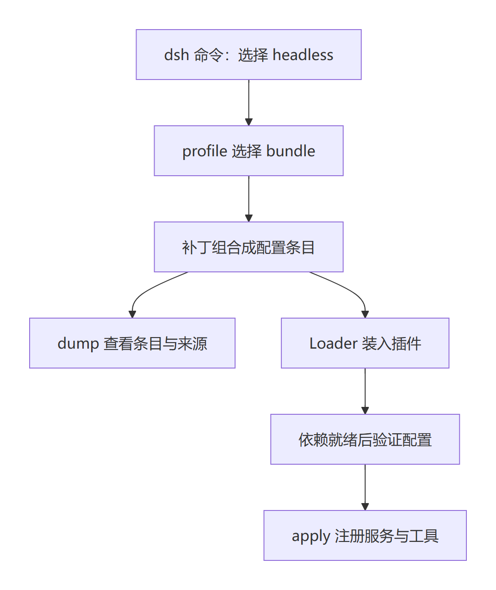
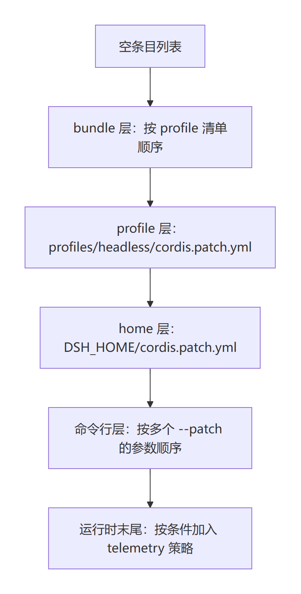

# 第9章 插件怎样组成应用：读懂启动与配置

上一章结束时，我们已经能替换工单数据源了。工具消费者不变，内存与 JSON 提供者各做各的查询，Cordis 管理它们的依赖与释放。

但还有一件事没有讲透：你一直运行的命令里，没有出现 `new MemoryTickets(...)`，也没有逐个写出所有插件。程序为什么知道该装哪些能力？如果你交给同事一个补丁文件，他改了它，结果却一点没变，应该从哪里找原因？

这一章把第八章的组合入口接到真实配置上。仍然查询 TK-1042，仍然使用 `book_ticket_lookup`；先看应用怎样选出插件，再只改配置换数据源，最后故意制造几次“改了却没生效”。读完以后，你应当能沿着启动配置找到业务插件，并用证据说明修改到底生效在哪里。

## 9.1 命令里没有写出的那些插件

先把已经用过的命令写出来：

```powershell
corepack pnpm dsh --profile headless "查询 TK-1042"
```

这行只用来辨认参数；不要直接把它当成本章无密钥实验。普通运行还需要模型服务和业务插件，后面继续由实验设施准备。`--profile headless` 选择的是应用配置，不是模型，也不是某个 Agent 的名字。

**profile** 是一套应用组合的配置。所选 profile 的 `package.json` 通过 `dsh.profile.bundles` 列出使用的 **bundle**。bundle 是声明一组补丁文件的包；补丁说明要加入哪些插件条目、怎样修改已有条目。真正提供运行能力的，仍是装入后的插件。一个包可以同时包含补丁和插件实现，这些职责不能仅凭包名判断。

本章实测的新建 headless profile，选出的清单是：

```json
{
  "dsh": {
    "profile": {
      "bundles": [
        "@deepseek-ai/dsh-base",
        "@deepseek-ai/dsh-headless"
      ]
    }
  }
}
```

这里只摘出了相关字段，不是完整的 `package.json`。base 提供基础组合，headless 在其后加入单次任务的启动与运行能力。顺序是清单中的顺序，不是按文件名排序。对于不存在的内置 profile，启动代码可以按内置模板初始化；任意拼一个自定义 profile 名称，并不会自动得到同样的配置。

沿用第八章的理解，配置中的一个插件条目最终还是要进入 Cordis。不同的是，第八章手写 `ctx.plugin(...)`，这里由启动设施和 Loader 根据配置装入。**“一切皆插件”没有取消应用入口；入口负责组织插件，具体能力由插件提供。**



图 CH-CONFIG-01 为本书自行绘制，[图源](../diagrams/CH-CONFIG-01.mmd)可编辑。左侧导出配置不执行右侧的插件装入；注册完成后，工具还要经过真实调用才能证明业务可用。此图省略模块解析和关闭流程，重点是两种检查分别能回答什么。

### 先看组合，不必先运行模型

按照[本章实验说明](../labs/profile-config/README.md)确认实际的 `$BookRoot`、`$HarnessRoot`，并准备 `$Exercise`。然后运行配置对照：

```powershell
$LayerEvidence = Join-Path $BookRoot ('labs/profile-config/.lab-runtime/layers-' + [guid]::NewGuid())
node (Join-Path $BookRoot 'labs/profile-config/dump-layers.mjs') $HarnessRoot $LayerEvidence
if ($LASTEXITCODE -ne 0) { throw "配置对照未通过：$LayerEvidence" }
$Layers = Get-Content -LiteralPath (Join-Path $LayerEvidence 'summary.json') -Raw | ConvertFrom-Json
$Layers.bundles
$Layers.stages | Select-Object name, businessRow
```

这个脚本使用自己的临时 `DSH_HOME`，实际调用支持的 `dsh --profile headless --dump-config` 和 `--dump-default-config`。它创建 profile、写入实验补丁、保存导出原件，结束后删除自己的临时 home。不会编辑你的日常 profile；导出也不是完全不写磁盘的操作，因为首次使用需要初始化 profile。

`--dump-config` 展示 bundle、profile、home 和命令行补丁组合后的配置，并保留来源提示。`--dump-default-config` 只看 bundle 层，适合与用户修改对照。它不接受 `--patch`；不能一边要求“只看默认”，一边给它额外补丁。

先预测两个问题：导出里出现一个插件条目，能证明模块成功导入了吗？导出里出现 `!!js`，能证明表达式已经求值了吗？

本章的实际答案都是不能。导出不装入业务插件，也不执行 `!!js` 表达式。本轮特意放入了一个求值就会抛错的表达式，导出仍成功保留了它。另一个对照故意写坏 profile 的 YAML：有效配置导出失败，只看默认组合仍能成功。两者分别帮助你判断“默认组合是什么”和“用户修改在哪里出错”，见[配置实测](../labs/profile-config/evidence/2026-11-18/layers.json)。

这些表达式来自可信本地配置，不要把外部业务文本拼成 `!!js`。需要一个普通文件路径时，写字符串就够了。本章也不把完整配置导出公开到书稿里；原件可能包含系统提示或本机地址，公开证据只摘本章自己的条目。

### 顺着真实源码走四步

现在打开目标工程，而不是寻找另一本通用框架教程。本章源码固定到 `fcc0ad462172522aaf5c93a7b2e01f6b9f0b0159`，每次只带一个问题去读：

| 想回答的问题 | 源码入口 | 先看哪一点 |
| --- | --- | --- |
| CLI怎样把选择交给启动器 | [runCli](https://github.com/goodtang/deepseek-harness-local/blob/fcc0ad462172522aaf5c93a7b2e01f6b9f0b0159/apps/cli/src/bin.ts#L32) | profile分支传入profile、patchFiles与应用参数 |
| profile怎样加载bundle | [loadProfileDirectory](https://github.com/goodtang/deepseek-harness-local/blob/fcc0ad462172522aaf5c93a7b2e01f6b9f0b0159/packages/boot/app-boot/src/profile.ts#L678) | 遍历bundles，收集每层的patches |
| 哪些层最后进入启动 | [readProfilePatches](https://github.com/goodtang/deepseek-harness-local/blob/fcc0ad462172522aaf5c93a7b2e01f6b9f0b0159/packages/boot/app-boot/src/profile-context.ts#L74) | bundle、profile、home、overlays的顺序 |
| 条目怎样真正装入 | [runProfile](https://github.com/goodtang/deepseek-harness-local/blob/fcc0ad462172522aaf5c93a7b2e01f6b9f0b0159/apps/cli/src/profile-boot.ts#L271)、[boot](https://github.com/goodtang/deepseek-harness-local/blob/fcc0ad462172522aaf5c93a7b2e01f6b9f0b0159/packages/boot/app-boot/src/index.ts#L1200) | 准备命令参数服务，挂根配置并等待Loader |

先不要钻进每个导入。`runCli` 中的 `invocation.profile` 是已经解析出的选择，`invocation.patches` 是命令行给出的补丁列表；它们作为字段传给 `runProfile`。后者整理配置并准备运行环境，再调用 `boot`。这说明“解析命令”“组合配置”“装入插件”各有负责的代码，不能把整件事都归给 Agent 循环。

内置 headless 清单可回访 [PROFILE_TEMPLATES](https://github.com/goodtang/deepseek-harness-local/blob/fcc0ad462172522aaf5c93a7b2e01f6b9f0b0159/packages/util/official-bundles/src/bundles.ts#L10)。再看 [headless包声明](https://github.com/goodtang/deepseek-harness-local/blob/fcc0ad462172522aaf5c93a7b2e01f6b9f0b0159/packages/bundle/headless/package.json)：`dsh.bundle.patch` 指向它自己的补丁文件。到这里，profile、bundle、patch已分别有一个真实落点，不必靠记三个英文词维持理解。

### 在真实组合里找回已经用过的能力

别急着读完base的所有条目。先在固定版本的 [base补丁](https://github.com/goodtang/deepseek-harness-local/blob/fcc0ad462172522aaf5c93a7b2e01f6b9f0b0159/packages/bundle/base/cordis.patch.yml#L511) 和 [headless补丁](https://github.com/goodtang/deepseek-harness-local/blob/fcc0ad462172522aaf5c93a7b2e01f6b9f0b0159/packages/bundle/headless/cordis.patch.yml#L17) 中找出这六项。下表是源码条目的摘录，不是足够启动应用的完整配置：

| 来自哪个bundle | 条目id | 模块name | 与前面知识的关系 |
| --- | --- | --- | --- |
| base | tools | @deepseek-ai/dsh-tools | 第四章消费者注册工具所需的服务 |
| base | tool-executor-native | @deepseek-ai/dsh-tool-executor-native | 注册之后还需要实际执行能力 |
| base | agent-loop | @deepseek-ai/dsh-agent-loop | 第五章追踪过的步骤与后续请求 |
| base | llm-deepseek | @deepseek-ai/dsh-llm-deepseek-api-key | 本章接到模拟服务的模型提供者 |
| headless | headless-startup | @deepseek-ai/dsh-headless/startup | 读取单次任务与启动选项 |
| headless | headless-runner | @deepseek-ai/dsh-headless | 使用上述选项运行任务 |

这就把“base提供基础能力”缩小成了可以在工程里核对的对象。启动顺序也不能只看它们写在文件的前后：配置按层组成条目，插件是否能激活仍受第八章讲过的依赖约束。后面再插入我们的业务入口，由它组合工单提供者与消费者；这不是用业务代码替代base里的工具服务或Agent循环。

## 9.2 只改配置，把工单查询换成文件

现在把视线缩回自己的工单。上一章的 `mount` 已会装消费者与提供者，本章不重写它。新增的[组合入口](../labs/profile-config/entry.mjs)接收配置，决定交给 `mount` 哪个提供者。

先分清一条配置里的三个名字：

```yaml
- insert:
    - id: book-ticket-tool
      name: /your/actual/book/labs/profile-config/entry.mjs
      config:
        source: memory
```

这段只说明结构，路径是示意；实际实验会自动生成你的绝对路径。YAML 的短横线表示列表项，缩进表示字段属于哪一层。`insert` 中又是一个列表，表示要加入的条目。三处含义不同：

| 字段或名称 | 用来做什么 | 本例 |
| --- | --- | --- |
| 条目的id | 供后续补丁定位这条配置 | book-ticket-tool |
| 条目的name | 告诉Loader从哪里加载插件模块 | entry.mjs的实际路径 |
| config | 交给该插件的业务配置 | source、path |
| 模型调用的工具名 | 由消费者注册，出现在工具调用里 | book_ticket_lookup |

`book-ticket-tool` 不是工具名，模块导出的 `name = 'book-configured-tickets'` 也不是补丁用来定位条目的 `id`。本例只有一个这样的业务条目；实际开发应为需要修改的条目明确安排稳定且不冲突的id。

基础实验补丁先插入这条入口，随后第二个 `--patch` 更新它：

```yaml
- id: book-ticket-tool
  config:
    source: file
    path: "/your/actual/exercise/tickets.json"
```

这里没有 `insert`，意思是修改已存在的条目。本章先用绝对路径排除工作目录带来的歧义；相对 `config.path` 是怎样解释的，要看消费这个字段的提供者。不能因为补丁文件在某个目录，就假定任意业务字段都会相对它解析。

### 配置怎样到达真正的查询

完整入口很短。下面省略导入和测量包装，只展示选择逻辑；可运行版本见对应文件。实际文件把File包为observedFile，以便核对后面讲到的失败阶段，里面仍调用原File.apply：

```javascript
export const inject = ['tools'];
export const Config = z.object({
  source: z.union(['memory', 'file']).default('memory'),
  path: z.string(),
});

export async function apply(ctx, config) {
  if (config.source === 'file' && config.path === undefined) {
    throw new Error('File tickets require config.path.');
  }
  await mount(ctx, config.source === 'file' ? File : Memory,
    config.source === 'file' ? { path: config.path } : undefined);
}
```

`Config` 使用目标工程的 Schemastery 来检查字段：`source` 只接受两种值，没提供时默认 `memory`。这里的 `path` 没有声明必填；因为内存来源不需要文件，入口在选中 `file` 后明确要求它存在。别把这个可选写法直接套到其他校验库。

`config` 是 Loader 交给当前插件的配置对象，不是查询参数 `args`。模型仍只提供 `id`。入口依赖 `tools`，随后沿用第八章的 `mount`；消费者仍声明 `tools` 与 `bookTickets`，文件提供者仍负责读文件和登记服务。配置选择不会替这些模块免除依赖和释放责任。

先预测：由 `memory` 改成 `file`，应该改变什么，又有哪些必须保持？然后运行三次：

```powershell
foreach ($Case in @('memory','file','restored')) {
  $Evidence = Join-Path $BookRoot ('labs/profile-config/.lab-runtime/' + $Case + '-' + [guid]::NewGuid())
  node (Join-Path $BookRoot 'labs/profile-config/run.mjs') $HarnessRoot $Case $Evidence $Exercise
  if ($LASTEXITCODE -ne 0) { throw "配置实验未通过：$Case，$Evidence" }
}
```

运行器只管理环境、模型脚本、第二个真实 `--patch`、记录和清理。它没有根据预测结果直接调用 `lookup` 或 `execute`。入口里的前置服务检查沿用第八章，主工具仍由模拟模型发起并经过真实工具管线。

作者本轮[实际对照](../labs/profile-config/evidence/2026-11-18-revision/verification.json)如下。`restored` 使用与 `memory` 字节相同的补丁；每组均是新应用进程，不是运行中热更新：

| 检查项 | memory | file | restored |
| --- | --- | --- | --- |
| 入口收到的source | memory | file | memory |
| 主工具实际使用的提供者 | memory | file | memory |
| 消费者文件、工具名与参数 | 相同 | 相同 | 相同 |
| 业务结果及下一请求 | 原工单三个字段 | 相同 | 相同 |
| 主任务请求 / 工具执行 | 2 / 1 | 2 / 1 | 2 / 1 |
| 应用退出 / 清理 | 0 / 通过 | 0 / 通过 | 0 / 通过 |

结果相同是有意安排的。这里验证“配置确实选中了另一个现有提供者”；文件内容是否真正影响结果，回访第八章已完成的JSON变化实验。不能仅凭相同的工单或最终文字判断来源，也不能把前置服务自检计成模型多调用了工具。

### 把教学脚本还原成真正的启动命令

刚才运行的是 `profile-config/run.mjs`，但它没有自己实现一个Harness。它准备参数后调用共享的 `m1/run.mjs`，后者启动目标工程的 `apps/cli/src/bin.ts`。新证据目录的 `runtime/launch.json` 保存**实际交给子进程的参数**，可以直接拿来对照。下面先运行一次并保存路径，避免依赖循环中最后一次的 `$Evidence`：

```powershell
$FileEvidence = Join-Path $BookRoot ('labs/profile-config/.lab-runtime/file-launch-' + [guid]::NewGuid())
node (Join-Path $BookRoot 'labs/profile-config/run.mjs') $HarnessRoot file $FileEvidence $Exercise
if ($LASTEXITCODE -ne 0) { throw "启动对照失败：$FileEvidence" }
$Launch = Get-Content -LiteralPath (Join-Path $FileEvidence 'runtime/launch.json') -Raw | ConvertFrom-Json
$Launch | Select-Object file, cwd, home, modelBaseURL
$Launch.args
```

`file` 是本次Node可执行文件，`args` 是传给它的参数数组。先略过用于源码加载的tsx和教学启动探针，找到 `apps/cli/src/bin.ts`，再顺着参数读 `--profile headless` 和两次 `--patch`。探针只记录启动进度，不提供工单能力。

用产品命令的写法表示，核心部分就是下面这一行。它用于对照上面的实际参数，**不是要求你在实验结束后原样重放**：

```text
corepack pnpm dsh --profile headless --patch <设施补丁> --patch <业务补丁> "Look up TK-1042 with book_ticket_lookup."
```

| 实际参数或环境 | 本章从哪里提供 | 你应该能说明什么 |
| --- | --- | --- |
| 第一个--patch | m1创建的临时patch.yml；副本在runtime/overlay.yml | 停用标题生成、准备模型重试/Session存储、插入工单入口与观察插件 |
| 第二个--patch | $Exercise下本次场景的补丁；副本在runtime/extra-overlay.yml | 定位已插入的book-ticket-tool，修改它的config |
| DSH_HOME | launch.home，由设施创建并传给子进程 | 实际profile位于这个home下的profiles/headless，不是任意工作目录 |
| 工作目录 | launch.cwd | 本次任务操作的位置，不负责选择profile |
| 模型地址 | launch.modelBaseURL，通过子进程环境传入 | 指向本轮仍在运行的本机模拟服务，不是业务数据文件 |

自己打开两份补丁副本：第一份应该能找到业务条目的 `insert` 和真正的 `entry.mjs` 路径；第二份应该只有针对该id的修改。再回到第八章：`entry.apply` 调用 `mount`，后者把消费者与所选提供者交给真实 `ctx.plugin`。至此，命令、条目、模块、服务与工具调用连起来了。

实验结束后，模型服务和临时home/工作目录已经清理，所以 `launch.json` 是运行记录，不是仍可用的环境。设施补丁副本也可能引用已删除的临时Session目录；不要把它直接复制成长期业务配置。迁移自己的应用时，要在自己的profile中安排业务入口、配置和相应服务；本章让你先能解释这些选择，不在这里展开包发布和生产部署。教学观察用的环境变量仍由设施管理，也不能只抄一行命令就认为观察记录会自动出现。

### 为什么后来的配置会让path消失

到这里，很容易形成一个错误印象：“后面的配置只覆盖我写的那几个小字段。”先看看真实规则，再决定怎样写补丁。



图 CH-CONFIG-02 自行绘制，[图源](../diagrams/CH-CONFIG-02.mmd)可编辑。不存在的可选用户层不贡献内容；图尾的telemetry是运行时按条件追加的策略，并非你必须填写的配置。普通配置导出用于查看文件层组合，不能假定它已经包含了这个运行时策略。

headless组合从空列表开始。profile里的 `cordis.yml` 是启动器管理的空根文件；不要把它当作自己的长期配置入口。自己的profile修改写在对应的 `cordis.patch.yml`，整个home的补丁在它后面，命令行补丁再按参数顺序应用。修改生效前，先问有没有更晚的一层。

本章的配置对照特意让同一个条目经过四次修改：

| 最后加入的层 | 该层写入的config | 导出中最终的config |
| --- | --- | --- |
| profile | source: memory；path: profile-only.json | 两个字段都有 |
| home | source: memory | 只剩source |
| 第一个命令行补丁 | source: file；path: cli-only.json | 两个字段都有 |
| 第二个命令行补丁 | source: memory | 再次只剩source |

这些示意文件名只用于静态导出，没有声称它们可以作为真实数据文件运行。关键在于：**补丁替换条目上的整个 `config` 字段，不会自动深层合并里面的属性。** 后一层只写 `source`，前一层的 `path` 就不在最终配置里了。

去 vendored Cordis 的 [applyPatches](https://github.com/goodtang/deepseek-harness-local/blob/fcc0ad462172522aaf5c93a7b2e01f6b9f0b0159/vendor/include/src/patch.ts#L47) 找这两行：

```javascript
for (const [key, value] of Object.entries(overrides)) {
  target[key] = value;
}
```

这是略去循环内无关分支的阅读摘录，不是完整函数。`Object.entries` 把字段拆成键和值，`target[key] = value` 替换该字段。当前键如果是 `config`，被替换的就是整个对象；它不会再递归遍历这个对象内部。下一次选 `file` 时，要在最终那一层一起保留所需的 `path`。插件自己的默认值和校验发生在之后，也不能凭空恢复原来的业务路径。

## 9.3 改了却没生效，先查哪一层

假设你想用文件查询，却仍得到原来的工单。你怀疑缓存，重新启动了三遍，结果相同。此时最有效的问题不是“再等多久”，而是“我改到的条目，到底是不是应用正在使用的那个”。

先对照本章四组真实错误配置。运行方法见[实验说明](../labs/profile-config/README.md)，作者结果见[验证记录](../labs/profile-config/evidence/2026-11-18-revision/verification.json)：

| 错误 | 本轮实际行为 | 应该核对什么 |
| --- | --- | --- |
| id写成book-ticket-tools | 主工具仍执行，实际来源memory，应用退出0 | 目标id有没有命中；不能据此说已切到file |
| 选file却没path | 入口报告缺配置，提供者未装入，工具执行0次 | 最终config是否完整，有没有被后一层替换 |
| path指向不存在的文件 | 文件提供者报ENOENT，工具执行0次 | 实际绝对路径与文件是否存在 |
| 禁用业务入口 | 本次补丁确认disabled，实际请求不含该工具定义，也没有入口执行记录 | 最终条目的disabled，而非只查模块文件 |

拼错id那一组，本次运行的stderr还是空的；另行导出相同的未知id补丁时，导出器明确提示目标不存在。不要把“运行时一定会打印某句警告”写进排错步骤。这里可靠的依据是：补丁目标、导出结果、入口收到的配置和实际提供者是否一致。

后三组中，本轮headless应用仍退出0，实验行为验收却拒绝。这承接第八章的观察：某个业务入口失效，并不会被固定模拟答复补救。反过来，本章的错误案例运行器会在确认“错误被正确识别、清理完成”后退出0；它表示反例实验完成，不表示业务配置合格。原应用退出码、共享S1验收、反例核查分别留在记录中。

### 失败也要发生在你预定的位置

“看到ENOENT就说明这个数据文件不存在”还少了一步：究竟是哪个文件？入口加载时也可能读取别的文件。复核时我们实际让入口因缺少一个无关设置文件而失败，旧检查仍把它算作本章数据路径反例通过。这说明错误码相同，不等于错误原因相同。

修订后的入口为原文件提供者增加了局部测量，仍将同一个提供者交给真实Cordis上下文，不改变第八章的查询实现。文件提供者失败后，保留原错误并重新抛出，记录错误实际给出的路径，不用预期路径倒填。当前[拒绝证据](../labs/profile-config/evidence/2026-11-18-revision/failures.json)逐项核对：

| 检查顺序 | 应当观察到什么 |
| --- | --- |
| 入口收到配置 | config-selected确实是file，path等于本次指定的missing.json |
| 文件提供者开始 | file-provider-start记录同一个路径 |
| 读取失败 | file-provider-failed记录实际ENOENT与实际失败路径 |
| 先后关系与收尾 | 上述顺序成立，无成功提供者记录；子进程、模拟服务和临时目录清理完成 |

缺少path则应在配置检查处明确拒绝，不能先进入文件读取。禁用入口则核对本次禁用补丁与实际模型请求中缺少该工具，不把“没有日志”单独当成业务行为的证明。之前那个真实无关文件故障，现在会被检查器拒绝；旧报告保留，未改写成修复后的结果。

### 用五个问题缩小范围

排查时，每回答一个问题，就少猜一部分：

| 问题 | 到哪里找依据 | 还不能因此推出什么 |
| --- | --- | --- |
| 启动了哪套组合 | 命令中的profile、实际DSH_HOME、该profile的bundle清单 | 不能推出你编辑的是同一home |
| 补丁是否命中 | 条目id、dump中的最终条目与来源 | 不能推出模块已经导入 |
| 配置是否完整 | 最终config、Config校验、入口的选择记录 | 不能推出提供者已成功准备 |
| 依赖是否可用 | 第八章的PENDING/ACTIVE、服务与工具注册检查 | 不能只因await返回就说已激活 |
| 业务是否真的完成 | 实际提供者查询、调用/结果ID、持久结果与后续请求、清理 | 不能只拿最终回答或exit0作证 |

`DSH_HOME` 是Harness状态根目录，工作目录是这次任务操作的位置，它们还与书稿目录、源码目录分别独立。第二章解决的是“命令在哪运行”，本章再问“应用从哪套home读取配置”。本章设施为每次运行创建独立home，因此不会偶然吃到作者平时的个人补丁。

`name` 也值得单独看。如果一条非insert补丁同时写了 `name`，真实算法会把它作为与已有模块名称的匹配条件；它不是任意换模块的快捷方式。当前例子用稳定id修改config。以后要换模块或改变组合，应先看相应扩展方式和完整定义，不把“改配置字段”推广成“随便改哪一个字段都能替换插件”。

### 轮到你写一次补丁

使用准备脚本**新建的**练习目录，先不要编辑 `reader.patch.yml`。我们按三个阶段来做，每次使用新证据目录；先预测，再对照：

| 阶段 | reader补丁选择 | 本章练习运行器预期退出码 | 基础查询应该怎样 |
| --- | --- | --- | --- |
| 起点 | memory | 1：尚未完成要求的file切换 | 查询本身通过 |
| 修改完成 | file与有效path | 0：要求的配置已生效 | 查询通过 |
| 恢复起点 | memory | 1：再次拒绝把它当成file | 查询本身仍通过 |

这里的1不是让你忽略任何失败。还必须在真实报告中确认基础查询通过，而且实际来源正是这一阶段的预期；超时、环境错误或不同原因的失败都不能抵扣。

**先观察起点。** 原样运行，接受预期的练习拒绝，再自己取出实际字段：

```powershell
$StartEvidence = Join-Path $BookRoot ('labs/profile-config/.lab-runtime/reader-start-' + [guid]::NewGuid())
node (Join-Path $BookRoot 'labs/profile-config/run.mjs') $HarnessRoot reader $StartEvidence $Exercise
if ($LASTEXITCODE -ne 1) { throw '起点应尚未通过file练习' }
$StartReport = Get-Content -LiteralPath (Join-Path $StartEvidence 'runtime/report.json') -Raw | ConvertFrom-Json
$StartSource = ($StartReport.executionAudit | Where-Object { $_.type -eq 'config-selected' }).source
if (-not $StartReport.functionalPassed -or $StartSource -ne 'memory') { throw '不是预期的内存起点，请查看原报告' }
```

`runtime/report.json` 由共享S1运行器保存，基础查询成功时 `functionalPassed` 为true；外层练习仍可因来源没有切到file而返回1。失败时未必生成外层 `summary.json`，所以这里直接读原报告，而不是寻找一份不存在的成功汇总。

**再自己修改。** 打开 `$Exercise` 中的 `reader.patch.yml`。写对目标id，选择file，并在同一个config中保留该目录 `tickets.json` 的实际绝对路径；消费者和查询函数都不改。先显示需要编辑的文件与数据位置：

```powershell
$ReaderPatch = Join-Path $Exercise 'reader.patch.yml'
$ReaderData = Join-Path $Exercise 'tickets.json'
$ReaderPatch
$ReaderData
```

路径采用生成补丁中的正斜线写法，保留双引号。修改完成后，运行并从原报告独立核对；不要只抄作者的成功汇总：

```powershell
$ReaderEvidence = Join-Path $BookRoot ('labs/profile-config/.lab-runtime/reader-completed-' + [guid]::NewGuid())
node (Join-Path $BookRoot 'labs/profile-config/run.mjs') $HarnessRoot reader $ReaderEvidence $Exercise
if ($LASTEXITCODE -ne 0) { throw "自己的补丁未通过：$ReaderEvidence" }
$ReaderReport = Get-Content -LiteralPath (Join-Path $ReaderEvidence 'runtime/report.json') -Raw | ConvertFrom-Json
$ReaderSource = ($ReaderReport.executionAudit | Where-Object { $_.type -eq 'config-selected' }).source
$LastQuerySource = ($ReaderReport.executionAudit | Where-Object { $_.type -eq 'provider-query' } | Select-Object -Last 1).source
if ($ReaderSource -ne 'file' -or $LastQuerySource -ne 'file' -or -not $ReaderReport.functionalPassed) { throw '配置、主工具查询和基础行为没有对应' }
if (-not $ReaderReport.sessionChecks.observedMatchesPersisted) { throw '持久记录与观察事件未通过核对' }
```

最后一条 `provider-query` 是本例前置服务检查结束后的主工具查询；这里没有把自检次数当工具执行次数。字段取值仍应与本章两请求、一次真实执行和原工单结果一起核对。

**最后恢复。** 先把自己的完成版另存到一个新名字，再恢复内存补丁，避免丢掉练习成果：

```powershell
$CompletedPatchBackup = Join-Path $Exercise ('reader-completed-' + [guid]::NewGuid() + '.patch.yml')
Copy-Item -LiteralPath $ReaderPatch -Destination $CompletedPatchBackup
Copy-Item -LiteralPath (Join-Path $Exercise 'memory.patch.yml') -Destination $ReaderPatch
$RestoreEvidence = Join-Path $BookRoot ('labs/profile-config/.lab-runtime/reader-restored-' + [guid]::NewGuid())
node (Join-Path $BookRoot 'labs/profile-config/run.mjs') $HarnessRoot reader $RestoreEvidence $Exercise
if ($LASTEXITCODE -ne 1) { throw '恢复后不应被当成file练习完成' }
$RestoreReport = Get-Content -LiteralPath (Join-Path $RestoreEvidence 'runtime/report.json') -Raw | ConvertFrom-Json
$RestoreSource = ($RestoreReport.executionAudit | Where-Object { $_.type -eq 'config-selected' }).source
if (-not $RestoreReport.functionalPassed -or $RestoreSource -ne 'memory') { throw '恢复结果不符合预期' }
```

作者本轮也按这个顺序实际运行，得到1/0/1，基础S1三次通过，补丁恢复为起点字节。把自己在修改前的预测与实际字段写在一起，记录独立完成、看提示后完成还是复制后通过；作者结果不替你签收。

<details>
<summary>自己写完后，再核对补丁要保留的三个字段</summary>

应定位 `book-ticket-tool`，在同一个最终 `config` 中保留 `source: file` 和有效的 `path`。准备脚本生成的 `file.patch.yml` 可核对路径写法；不要只补source就期待另一层替你保留path。恢复后应重新显示memory，基础任务通过而file练习拒绝。

</details>

把本章的结论放回最初的问题：同一份插件实现，怎样适应不同的业务来源？不是每次去改Agent循环，而是先让能力有明确职责，再用受支持的配置入口选择与组合。配置的价值来自“选择能被解释、结果能被核查”，不是来自配置文件越长越灵活。

本章通过了八类真实配置场景及练习的起点/完成/恢复对照、八阶段配置导出及相应拒绝检查，另复跑共享运行器原S1/S2/S2-exhaust/S3。具体数量与适用版本以[修订记录](../labs/profile-config/evidence/2026-11-18-revision/README.md)为准；读者、外网隔离/M1、其他平台、原偶发启动根因及GitHub/PDF视觉验收仍待完成。没有验证HMR或生产配置发布。图已导出PNG并本机检查。目标工程源码归DeepSeek及相关贡献者，vendored Include/Cordis保留独立MIT说明，见[第三方许可](../THIRD_PARTY_NOTICES.md)。

现在我们已经能把一个只读工单能力接入、追踪、保存、替换并配置。接下来，业务若要求“把工单关闭”，就不能只把查询换成一条写语句。是谁允许写、用户确认的是哪一次修改、重复请求是否写两次、网络断开后究竟改没改，这些问题都要有明确答案。[第十章](第10章-从查询到关闭，怎样控制一次业务修改.md)沿用本章已经能定位的组合与配置，继续追踪同一张工单。
