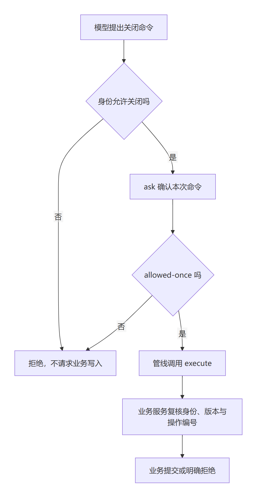
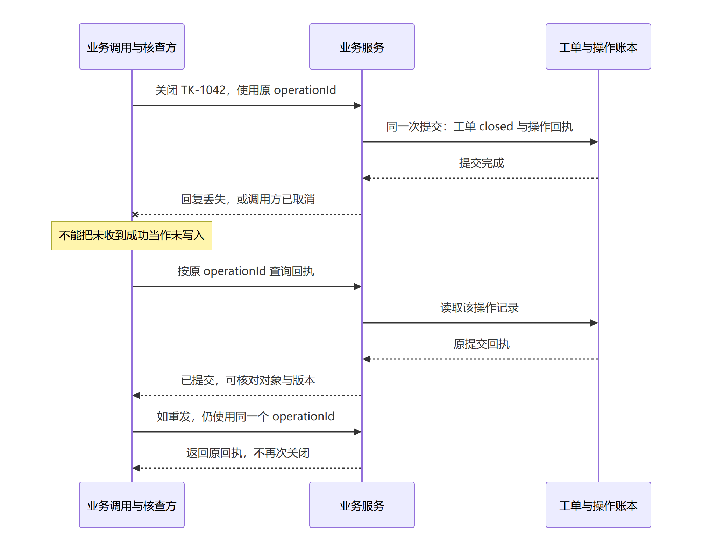

# 第10章 从查询到关闭，怎样控制一次业务修改

同事看过你做的工单查询，接着说：“既然已经能查，顺便把 TK-1042 关掉吧。”

你可能已经知道从哪里下手：增加一个工具，把 `open` 改成 `closed`。函数不长，却多出了以前没有的问题。谁允许关？用户同意的是哪张工单、哪一次修改？第一次请求没回消息，再发一遍，会不会改两次？用户点了取消，刚才的修改还算数吗？

前九章让我们能接入、追踪、保存和组合只读能力。这一章仍围绕同一张工单，新增 `book_ticket_close`，完成一次带权限、确认、去重和结果核查的修改。我们不改Agent循环；权限与业务规则由插件和业务服务负责，确认接入工程已有的approval服务。

## 10.1 关闭不是查到以后改一个字段

先把要修改的对象说清楚。本章从一份独立的虚构数据开始，没有改动前几章的只读样例：

```json
{
  "id": "TK-1042",
  "status": "open",
  "title": "Invoice export failed",
  "version": 1
}
```

新增的 `version` 是**工单的业务版本**。本例每次改变工单都会推进它，关闭请求必须说明自己依据哪个版本。它不是Session格式版本，也不是第七章日志的 `seq`。如果你确认时看到版本1，提交前别人已经改成版本2，就不能悄悄把旧确认用在新状态上。

模型调用的参数是：

```json
{
  "id": "TK-1042",
  "expectedVersion": 1,
  "operationId": "close-1042-01"
}
```

`expectedVersion` 是本次修改依据的版本；`operationId` 标识**这一项业务修改意图**，后面用于查询回执和重复请求识别。身份与租户不在模型参数里。模型不能传一句 `actorId: administrator` 就获得管理员权限。

本章的 `student-01`、`classroom-A` 和可否关闭，来自实验启动时的受控配置。HTTP业务服务还会用自己发出的测试令牌找到服务端身份，再检查一次权限。它们是为了观察流程的模拟身份，不是已经实现了真实登录、多租户鉴权或生产账号体系。

### 先运行一次真正的关闭

按照[本章实验说明](../labs/write-ticket/README.md)确认自己的 `$BookRoot` 和 `$HarnessRoot`。沿用第二章准备的源码和依赖，不要求书稿与源码放在相邻目录。然后运行：

```powershell
$AllowEvidence = Join-Path $BookRoot ('labs/write-ticket/.lab-runtime/allow-' + [guid]::NewGuid())
node (Join-Path $BookRoot 'labs/write-ticket/run.mjs') $HarnessRoot allow $AllowEvidence
if ($LASTEXITCODE -ne 0) { throw "关闭实验未通过：$AllowEvidence" }
$Allow = Get-Content -LiteralPath (Join-Path $AllowEvidence 'report.json') -Raw | ConvertFrom-Json
$Allow.finalBusiness.ticket
$Allow.finalBusiness.writeCount
```

先预测：需要几次模型请求？工具执行前是否应该出现确认？业务状态变成closed，能不能只由最后那句回答来证明？

作者本轮[实际记录](../labs/write-ticket/evidence/2026-11-27-revision/verification.json)是：主任务两次模型请求、一次工具执行；真实Session记录先问确认，再记录 `allowed-once`，然后调用业务服务。工单变为closed，版本为2，本工具关闭次数为1。独立HTTP回执查询与最终业务文件都核对到了同一次操作。

这里的 `writeCount` 只统计本工具成功关闭的次数，不是所有文件写入次数。实验为了制造版本冲突而做的外部变化，不计入这个计数。终端的固定模拟答复也不代表业务成功；即便关闭被拒绝，模拟模型仍可能输出同一句话。

### 为什么用户同意了，业务服务还要检查权限

**权限**回答“这个身份能不能做”，**确认**回答“这个人是否同意本次具体修改”。确认不会凭空增加身份权限。

先预测下面两组，再运行本章的 `read-only` 和 `server-denied` 场景：

| 场景 | 工具侧身份判断 | 确认 | 业务服务的最终判断 | 实际关闭次数 |
| --- | --- | --- | --- | --- |
| read-only | 只读，直接拒绝 | 不发起 | 未收到关闭请求 | 0 |
| server-denied | 工具侧认为可关闭 | 本次允许 | 服务端身份仍只读，拒绝 | 0 |

第二组故意让工具侧与服务端的权限判断不同。它不是推荐的配置，而是用来检验：前端或工具插件放行以后，业务服务是否还守住自己的规则。本例返回 `PERMISSION_DENIED`，工单保持open。

运行反例时，外层实验命令返回0表示“观察到了预期的拒绝并完成清理”，不是“工单已经关闭”。要继续读 `finalBusiness`、真实工具结果和回执。

### 这一章增加的代码各管什么

| 文件 | 职责 | 不替谁做决定 |
| --- | --- | --- |
| [domain.mjs](../labs/write-ticket/domain.mjs) | 命令字段、版本、操作编号与回执规则 | 不选择模型、不管理Agent |
| [business.mjs](../labs/write-ticket/business.mjs) | 本机HTTP业务服务，复核身份，提交工单与操作账本 | 不假装用户已经同意 |
| [plugin.mjs](../labs/write-ticket/plugin.mjs) | 工具注册、写入前策略、实际HTTP调用、实验应答器 | 不取代业务服务的权限与去重 |
| [driver.mjs](../labs/write-ticket/driver.mjs) | 启动真实profile、控制实验、独立查回执与清理 | 不直接调用execute来冒充集成成功 |

HTTP是这里让两个进程通信的方式：`POST /close` 请求修改，`GET /operations/close-1042-01` 查询操作回执；`fetch` 发出请求，`response.json()` 读取响应里的JSON。接到外部JSON以后，还要核对状态、操作编号和工单字段，不能只因HTTP响应到了就相信“已经关好”。

Harness里的能力仍通过插件装入。业务后台在应用进程外，可以是普通HTTP服务；“一切皆插件”不要求把所有外部系统都搬进Cordis。本章复用了真实的工具与确认能力，实验应答器只替代交互界面，业务服务则由运行器明确拥有并负责关闭。

## 10.2 确认的是这一次修改

如果对话框只写“是否继续”，你很难判断它准备改什么。本章要确认的是：哪个身份，在什么租户，关闭哪张工单，依据哪个版本，使用哪个操作编号。

[commandOf](../labs/write-ticket/domain.mjs)把模型给出的三个业务参数与可信身份组成命令，再计算这些字段的摘要：

```javascript
JSON.stringify([
  command.actorId, command.tenantId, command.id,
  command.status, command.expectedVersion, command.operationId,
])
```

上面是 `fingerprint` 中被计算摘要的输入。顺序固定，字段变了，摘要也变。摘要用来核对“是不是同一组内容”，不是授权凭据；真正放行仍依赖本次确认结果和服务端权限。关闭工具的动作固定为closed，不能把一次确认转用为别的动作。

### 写入前策略怎样接入框架

工具插件监听真实的 `tools/pre-execute`。与本工具无关时调用 `next()` 继续交给其他策略；遇到本工具，先检查身份，再为当前 `callId` 保存具体命令，并返回 `ask`：

```javascript
if (exec.name !== 'book_ticket_close') return next();
if (!config.principal.canClose) {
  return { kind: 'deny', reason: 'This identity is read-only.' };
}
const command = commandOf(exec.arguments, config.principal);
const digest = fingerprint(command);
plans.set(exec.callId, { command, digest });
return { kind: 'ask', reason: /* 描述该命令并带上摘要 */ };
```

这是省略测量代码和完整reason文字的阅读片段，不可独立运行。可运行入口在对应文件。`plans` 在本次插件 `apply` 内创建，工具结果出来后清除相应项，插件释放时清空；不是模块顶层的全局审批表。

这里并没有自己画一个假的“同意”结果。真实工具管线收到ask，调用工程的approval服务，服务写入审计、等待应答，再把结果交回工具管线。只对当前callId返回 `allowed-once` 后，才继续进入execute。拒绝、取消、无人应答都不能当成允许。



图 CH-WRITE-01 为本书自行绘制，[图源](../diagrams/CH-WRITE-01.mmd)可编辑。图中“业务提交或拒绝”发生在工具执行之后；它与前面确认是否放行是两次不同判断。图省略了原有循环、日志存储和界面细节。

### 跟进真实源码，不只记一个事件名

本章研究基线仍是 `fcc0ad462172522aaf5c93a7b2e01f6b9f0b0159`。按照下面顺序读，每次只核对一项：

| 问题 | 真实源码坐标 | 要找到的动作 |
| --- | --- | --- |
| ask从哪里进入确认 | [ToolExecutionPipeline.prepare](https://github.com/goodtang/deepseek-harness-local/blob/fcc0ad462172522aaf5c93a7b2e01f6b9f0b0159/packages/core/tools/src/pipeline.ts#L190) | pre-execute后遇ask，转到serviceAsk |
| 确认如何知道是哪次工具调用 | [serviceAsk](https://github.com/goodtang/deepseek-harness-local/blob/fcc0ad462172522aaf5c93a7b2e01f6b9f0b0159/packages/core/tools/src/pipeline.ts#L432) | 传agent、toolName、callId、reason和signal |
| 问题与决定怎样留下记录 | [ApprovalService.request](https://github.com/goodtang/deepseek-harness-local/blob/fcc0ad462172522aaf5c93a7b2e01f6b9f0b0159/packages/interaction/user-approval/src/index.ts#L242) | 在打开的turn内记录asked与decided |
| 无人应答或策略禁止会怎样 | [ApprovalService.decide](https://github.com/goodtang/deepseek-harness-local/blob/fcc0ad462172522aaf5c93a7b2e01f6b9f0b0159/packages/interaction/user-approval/src/index.ts#L293) | never先拒绝，缺应答器为unavailable，取消为cancelled |

`approval/asked` 有自己的请求id，同时通过callId关联工具调用；`approval/decided` 使用同一个请求id。它们是审计事件，不会因为保存到了Session里就变成模型上下文。模型会看到最终工具结果，策略说明也可能进入运行上下文，但这两个审计事件本身不是直接写入模型对话的用户答案。本例的确认描述与原工具参数可以沿日志相互核对。

### 在自己的记录里，把这次确认找出来

先不用运行器给出的“通过”结论。打开10.1刚生成的真正Session文件，取出这一次调用、确认和结果：

```powershell
$Events = @(Get-Content -LiteralPath (Join-Path $AllowEvidence 'phase-0/session.jsonl') | ForEach-Object { $_ | ConvertFrom-Json })
$Calls = @($Events | Where-Object type -eq 'tool/call')
$Questions = @($Events | Where-Object type -eq 'approval/asked')
$Decisions = @($Events | Where-Object type -eq 'approval/decided')
$Results = @($Events | Where-Object type -eq 'tool/result')
if ($Calls.Count -ne 1 -or $Questions.Count -ne 1 -or $Decisions.Count -ne 1 -or $Results.Count -ne 1) { throw '本组应有一项调用、确认、决定和结果' }
$Call = $Calls[0]; $Asked = $Questions[0]; $Decided = $Decisions[0]; $Result = $Results[0]
$Arguments = $Call.data.arguments | ConvertFrom-Json
$ToolValue = ($Result.data.message.content | Where-Object type -eq 'text' | Select-Object -First 1).text | ConvertFrom-Json
$Receipt = $Allow.phases[0].receipt
$DiskBusiness = Get-Content -LiteralPath (Join-Path $AllowEvidence 'business.json') -Raw | ConvertFrom-Json
[pscustomobject]@{
  callId = $Call.data.callId; askedCallId = $Asked.data.callId
  askedId = $Asked.data.id; decidedId = $Decided.data.id
  outcome = $Decided.data.outcome; resultCallId = $Result.data.message.toolCallId
  requestedOperation = $Arguments.operationId; receiptOperation = $Receipt.operationId
}
```

`@(...)` 把筛选结果保留为数组；`[0]` 取本组唯一的一项。JSONL头部不是工具事件，按type筛选便会跳过它。工具参数和工具文本各自还包了一层JSON字符串，所以需要再次转换。先自己比较输出：应该相等的是哪几对？确认问题的id应不应该等于callId？

作者本轮正常组的[实际字段摘录](../labs/write-ticket/evidence/2026-11-27-revision/trace.json)如下。保留编号是为了让你看见关联，不要求你的随机确认id与它一致：

| seq | 事件 | 关键字段 |
| --- | --- | --- |
| 17 | tool/call | callId=`mock-call-1`，operationId=`close-1042-01` |
| 18 | approval/asked | callId=`mock-call-1`，id=`a4be8e6d-b285-452c-909f-10ac65344713` |
| 19 | approval/decided | 同一个确认id，outcome=`allowed-once` |
| 20 | tool/result | toolCallId=`mock-call-1`，业务state=`committed` |

独立GET回执的operationId也为 `close-1042-01`，工单为TK-1042、closed、版本2；后台文件关闭次数为1。确认id连接“问与答”，callId连接“调用与工具结果”，operationId再把业务回执接进来。

现在补上几组断言。这里的编号全部来自你刚才的运行，不抄作者某次生成的id：

```powershell
if ($Asked.data.callId -ne $Call.data.callId -or $Decided.data.id -ne $Asked.data.id -or $Result.data.message.toolCallId -ne $Call.data.callId) { throw '调用与确认没有对应上' }
if (-not ($Call.seq -lt $Asked.seq -and $Asked.seq -lt $Decided.seq -and $Decided.seq -lt $Result.seq) -or $Decided.data.outcome -ne 'allowed-once') { throw '本次允许没有发生在工具结果之前' }
if ($Result.data.message.isError -or $ToolValue.state -ne 'committed' -or $Allow.phases[0].receiptHTTPStatus -ne 200 -or $Receipt.state -ne 'committed') { throw '工具值与独立业务回执不是成功结论' }
if ($ToolValue.operationId -ne $Arguments.operationId -or $Receipt.operationId -ne $Arguments.operationId) { throw '回执不是这项业务操作' }
if ($ToolValue.ticket.id -ne $Arguments.id -or $Receipt.ticket.id -ne $Arguments.id) { throw '修改目标不一致' }
if ($ToolValue.ticket.status -ne 'closed' -or $Receipt.ticket.status -ne 'closed' -or $ToolValue.ticket.version -ne ($Arguments.expectedVersion + 1) -or $Receipt.ticket.version -ne $ToolValue.ticket.version) { throw '状态或版本不一致' }
if ($DiskBusiness.ticket.id -ne $Receipt.ticket.id -or $DiskBusiness.ticket.status -ne $Receipt.ticket.status -or $DiskBusiness.ticket.version -ne $Receipt.ticket.version -or $DiskBusiness.writeCount -ne 1) { throw '业务文件与回执不一致' }
```

Session证明发生了哪次调用、确认和工具返回；报告里的receipt是独立GET取得的响应；business.json则是后台实际业务文件的留存副本。三者职责不同。若某一项不符，保留这组目录，先找到不相等的字段，不靠最后一句模型回答替它解释过去。

这也是第八章三角色的真实回访：approval服务规定请求、结果和记录方式；应答插件负责通过 `approval/request` 回答；工具管线是调用这项服务的消费者。approval服务本身不承诺弹出一个界面。实验中的本机控制通道是应答器的一种实现，不代表已经实现了生产GUI。

### 不要把ask与never读反

本章正常命令显式使用 `--approval-policy ask`。它的意思是“需要时交给配置的应答器”，不是“自动同意”。`never` 的意思是“不允许发起交互确认，所有ask都拒绝”，不是“以后都不必确认”。

实验应答器由驱动程序按真实待确认状态回答，目的只是验证虚构业务链路，不代表你的真实签收。控制通道核对当前callId，错的callId返回409。它一次只处理一个待确认请求，不是一个完整的多用户审批系统。

作者的[实测对照](../labs/write-ticket/evidence/2026-11-27-revision/verification.json)：

| 场景 | 确认结果或观察 | execute次数 | 本工具关闭次数 |
| --- | --- | --- | --- |
| allow | allowed-once | 1 | 1 |
| reject | rejected | 0 | 0 |
| unavailable | 没配置应答器，unavailable | 0 | 0 |
| never | 策略直接rejected | 0 | 0 |
| wrong-call | 错callId被拒绝，再对当前调用拒绝 | 0 | 0 |
| stale | 确认期间工单已变成版本2；允许后业务返回VERSION_CONFLICT | 1 | 0 |

版本变化组尤其值得自己跑一次。它没有偷偷修改已冻结的工具参数，而是在确认期间让外部业务状态真实变化。原请求依旧依据版本1，所以业务服务拒绝旧请求，要求调用方重新读取状态、形成新的修改意图。不能把“刚才点过同意”推广成“此后任何版本都可以改”。

## 10.3 没收到成功，先别再写一次

先看三种业务结果。它们描述的是这次修改，不只是函数有没有返回：

| state | 本章含义 | 下一步 |
| --- | --- | --- |
| committed | 这项操作已提交，回执与目标可核对 | 核对操作编号、工单、状态和版本 |
| not-written | 业务协议明确拒绝了本次修改，例如权限或版本不满足 | 修正前提，重新形成需要的修改与确认 |
| unknown | 发出后没有得到可用结论，不知道是否已提交 | 用原operationId查回执，不擅自宣布成功或失败 |

注意：本例业务服务明确拒绝时，工具函数仍可以正常返回一个 `not-written` 对象，工具消息的 `isError` 可以是false。反过来，已提交后取消可能让工具消息变成取消错误。**工具层是否报错与业务是否已经改变，必须分别核对。**

### 一项业务操作，不能每次重发都换编号

把几个编号放在一起比较，避免混用：

| 编号 | 标识什么 | 同一修改重发时 |
| --- | --- | --- |
| Session ID | 一段任务记录 | 可以是新Session |
| callId | 当前Session中的工具调用 | 关联新的调用；跨Session不能只凭这个字面值识别 |
| approval请求id | 当前确认问题 | 新问题重新产生 |
| operationId | 这一项业务修改意图 | 必须沿用原编号，才能让业务服务识别重复 |

生产中，稳定的operationId应由可信业务流程确定并沿重试保留。本实验的脚本固定给出 `close-1042-01` 供模型调用观察；不能假定模型每次自行编一个编号就能去重，更不能说Harness把callId自动变成了业务幂等键。

本例模拟模型在不同Session里会再次给出 `mock-call-1`。它们是不同的调用，必须连同所属Session核查；字面值相同不能证明是同一次调用，更不能作为业务去重依据。

**幂等**在本章的具体含义是：同一个身份与租户、同一个操作编号、同一组业务内容再次到达时，不再关闭第二次，而是返回原回执。编号相同但内容不同，返回 `IDEMPOTENCY_CONFLICT`。

[transition](../labs/write-ticket/domain.mjs)的核心顺序是：

```javascript
const prior = state.operations[key];
if (prior) {
  return prior.digest === digest
    ? { ...structuredClone(prior.receipt), deduplicated: true }
    : refuse('IDEMPOTENCY_CONFLICT');
}
```

这是函数中“处理已存在操作”的摘录。`key` 包含租户与operationId，摘要还绑定身份和具体修改。完整函数在此之前复核身份与权限，在此之后核对工单版本，再准备新的状态和回执。重复请求不能因为找到了旧记录就绕过当前身份权限。

本章把工单状态和操作回执放在同一个JSON快照中提交。否则可能出现“工单已经关闭，但回执没留下”的空隙，让下一次请求无法识别重复。业务服务在单进程内同步准备、写入新文件再rename；没有跨await交错提交。它演示的是这种组织要求，不是生产数据库事务、磁盘fsync或崩溃恢复已经得到验证。每组实验都从新状态初始化，这个后台不实现重启加载；文件在本章用来核验同组提交，不是可恢复数据库。实际业务需要相应的事务、重启加载与并发控制。

### 给关闭流程加一条自己的业务规则

业务同事又补了一句：“没有标题的工单先别关，至少要知道它处理的是什么问题。”这不是新的身份权限，也不是再弹一次确认。它是业务服务在写入前必须检查的数据条件。

这次由你修改真正参与实验的代码。复制[domain.mjs](../labs/write-ticket/domain.mjs)到自己的文件，不覆盖原件：

```powershell
$MyWriteRules = Join-Path $BookRoot ('labs/write-ticket/.lab-runtime/my-domain-' + [guid]::NewGuid() + '.mjs')
Copy-Item -LiteralPath (Join-Path $BookRoot 'labs/write-ticket/domain.mjs') -Destination $MyWriteRules
$RuleStartEvidence = Join-Path $BookRoot ('labs/write-ticket/.lab-runtime/rule-start-' + [guid]::NewGuid())
node (Join-Path $BookRoot 'labs/write-ticket/run.mjs') $HarnessRoot empty-title $RuleStartEvidence $MyWriteRules
if ($LASTEXITCODE -eq 0) { throw '还没增加规则，空标题不应已经通过练习验收' }
$RuleStart = Get-Content -LiteralPath (Join-Path $RuleStartEvidence 'report.json') -Raw | ConvertFrom-Json
if ($RuleStart.accepted -ne $false -or $RuleStart.phases[0].exitCode -ne 0 -or $RuleStart.phases[0].watchdogExpired -or $RuleStart.finalBusiness.writeCount -ne 1 -or $RuleStart.cleanup.rootRemoved -ne $true -or $RuleStart.cleanup.businessClosed -ne $true) { throw '这不是预期的规则缺失，请先排查本次失败' }
```

这组把后台标题设为三个空格。原实现会把它关掉，所以**应用完成了任务，练习验收却拒绝通过**；这正是我们要观察的起点。启动失败或超时不能代替这个结果。最后一个参数指定你自己的领域模块，运行器把它的transition交给HTTP业务服务，记录模块hash并留存当时的副本；工具仍通过真实profile、注册表、确认和执行管线调用，没有绕过Harness。

打开自己的文件，先只读 `transition`，把顺序写成六步：身份和权限 → 原操作账本 → 当前对象和版本 → 新业务条件 → 准备新状态 → 同时留下回执。身份与版本不通过时不能写；相同操作重发时应先返回原回执，不能因为工单已经closed而误报版本冲突。这里也解释了为什么幂等检查放在版本检查之前。

请在版本检查之后、修改 `state.ticket` 之前加入规则：标题去掉首尾空白后为空，就返回 `not-written`，code为 `TITLE_REQUIRED`，operationId沿用当前命令。不能改writeCount，不能留下操作账本，也不要改工具参数、确认插件或Agent循环。`trim()` 返回去掉首尾空白的新字符串，不修改原标题。

修改后运行三个真实场景：

```powershell
$RuleEvidence = @{}
foreach ($Case in @('allow','empty-title','duplicate')) {
  $Out = Join-Path $BookRoot ('labs/write-ticket/.lab-runtime/my-rule-' + $Case + '-' + [guid]::NewGuid())
  node (Join-Path $BookRoot 'labs/write-ticket/run.mjs') $HarnessRoot $Case $Out $MyWriteRules
  if ($LASTEXITCODE -ne 0) { throw "业务规则未通过：$Case，证据：$Out" }
  $RuleEvidence[$Case] = $Out
}
$Refusal = Get-Content -LiteralPath (Join-Path $RuleEvidence['empty-title'] 'report.json') -Raw | ConvertFrom-Json
$Refusal.phases[0].events | Where-Object type -eq 'tool/result' | ForEach-Object { $_.data.message.content }
$Refusal.finalBusiness
```

先预测再对照：正常标题应关闭一次；空标题虽得到本次确认，业务仍拒绝，工单open、版本1、关闭次数0、账本为空；重复组启动两个新Session，第二次得到原回执，关闭次数仍为1。空标题是后台数据，模型无权在参数里声称“它有标题”来绕过这条规则。

最后做恢复对照，证明拒绝确实来自你加的代码。不要直接覆盖辛苦写好的版本，先备份；恢复后换一个新目录复跑：

```powershell
$CompletedRulesBackup = $MyWriteRules + '.completed'
Copy-Item -LiteralPath $MyWriteRules -Destination $CompletedRulesBackup
Copy-Item -LiteralPath (Join-Path $BookRoot 'labs/write-ticket/domain.mjs') -Destination $MyWriteRules -Force
try {
  $RuleRestoredEvidence = Join-Path $BookRoot ('labs/write-ticket/.lab-runtime/rule-restored-' + [guid]::NewGuid())
  node (Join-Path $BookRoot 'labs/write-ticket/run.mjs') $HarnessRoot empty-title $RuleRestoredEvidence $MyWriteRules
  if ($LASTEXITCODE -eq 0) { throw '恢复原代码后不应通过空标题练习' }
  $Restored = Get-Content -LiteralPath (Join-Path $RuleRestoredEvidence 'report.json') -Raw | ConvertFrom-Json
  if ($Restored.phases[0].exitCode -ne 0 -or $Restored.phases[0].watchdogExpired -or $Restored.finalBusiness.writeCount -ne 1 -or $Restored.cleanup.rootRemoved -ne $true -or $Restored.cleanup.businessClosed -ne $true) { throw '恢复组不是预期的规则缺失' }
} finally {
  Copy-Item -LiteralPath $CompletedRulesBackup -Destination $MyWriteRules -Force
}
```

<details>
<summary>独立修改以后，再核对最小改动</summary>

在版本检查与赋值 `state.ticket = ...` 之间加入：

```javascript
if (!state.ticket.title.trim()) return refuse('TITLE_REQUIRED');
```

复用函数已有的refuse，才能沿用当前operationId。规则不应放进模型提示或只放在界面中；即使有人允许了这次操作，后台也必须拒绝不满足业务条件的数据。这里复用了领域模块的其余实现，练习目标是定位并修改业务写入规则，不声称你已经独立重写整套系统。

</details>

作者本轮实际完成了起点拒绝、三组修改后通过和恢复后再次拒绝；每组都核对真实调用、确认、工具结果、HTTP回执与业务文件，见[修订证据](../labs/write-ticket/evidence/2026-11-27-revision/README.md)。你需要保留自己的五组目录，并说明是否看过提示。这里新增的是后台领域规则，没有增加新的Harness扩展点；接入的仍是前面那个工具插件。

### 回复丢了，工单却可能已经关了



图 CH-WRITE-02 为本书自行绘制，[图源](../diagrams/CH-WRITE-02.mmd)可编辑。图中的“调用与核查方”是业务流程角色；具体实验中POST由工具发出，后续GET由独立驱动程序核查，不是让已取消的工具悄悄继续执行。

运行两种相反的丢回复实验：

```powershell
$LostAfterEvidence = Join-Path $BookRoot ('labs/write-ticket/.lab-runtime/lost-after-' + [guid]::NewGuid())
node (Join-Path $BookRoot 'labs/write-ticket/run.mjs') $HarnessRoot lost-after $LostAfterEvidence
if ($LASTEXITCODE -ne 0) { throw '提交后丢回复实验失败' }
$LostBeforeEvidence = Join-Path $BookRoot ('labs/write-ticket/.lab-runtime/lost-before-' + [guid]::NewGuid())
node (Join-Path $BookRoot 'labs/write-ticket/run.mjs') $HarnessRoot lost-before $LostBeforeEvidence
if ($LASTEXITCODE -ne 0) { throw '提交前丢回复实验失败' }
```

两组首次工具结果都是unknown。随后驱动程序带着同一个业务身份，真正用HTTP查询该operationId，而不是只读模型输出：

| 实验 | 实际故障点 | 首次工具值 | 独立查回执 | 最终核查 |
| --- | --- | --- | --- | --- |
| lost-after | 状态与回执提交后断开回复 | unknown | 取得原提交回执，目标与版本吻合 | 可以确认已提交 |
| lost-before | 请求到业务端，但提交前断开 | unknown | 未查到操作回执 | 对调用方仍保持unknown |

第二组的实验后台文件实际还是open，但这不意味着调用方可以仅凭“暂时查不到”就断言永远没有写入。现实里原请求可能仍在执行。这里把**实验为核验而知道的事实**与**调用方手里的证据**分开了；缺记录不是自动生成一条“明确失败”的回执。

lost-after还有第二次真实headless运行，换了Session，但沿用原operationId。它再次提出同一关闭请求，得到本次允许后，业务服务返回原回执，`deduplicated=true`，关闭次数仍是1。duplicate场景也验证了这一点。不是Session去重，也不是模型记住“不要再做”，而是业务服务明确识别了原操作。

查回执也不能只看 `state: committed`。本章核查函数还比较操作编号、工单id、closed状态与最终版本；另一个工单的成功回执，不能用来证明这张工单已关闭。

### 取消发生在提交前，还是提交后

第六章已经说明“接受取消”不等于工作全部结束。到写入这里，还要加上：取消本身不等于业务回滚。

| 场景 | 触发依据 | 任务结果 | 外部状态与回执 |
| --- | --- | --- | --- |
| cancel-before | 已出现真实待确认问题，再调用公开Agent.cancel | aborted/user，execute为0 | open，无本操作回执 |
| cancel-after | 业务服务已提交并暂不回复，再调用Agent.cancel | aborted/user，execute为1 | closed，独立回执可确认提交 |

这里按待确认状态或业务“已提交且正在保持回复”的状态触发，不用固定sleep猜哪一刻写完。提交后取消时，工具管线会把结果规范为取消，模型不会获得一个普通成功步骤；独立业务核查仍必须继续由拥有该流程的调用方负责。

回到目标源码的 [dispatchToolBody](https://github.com/goodtang/deepseek-harness-local/blob/fcc0ad462172522aaf5c93a7b2e01f6b9f0b0159/packages/core/tools/src/pipeline.ts#L258)：它等待工具体结束，随后检查信号并决定工具结果。这段处理没有向工单业务服务发送“撤销关闭”的命令。若实际业务要补偿，需要单独设计、授权和确认相反的业务操作，不能把取消按钮当成事务回滚。

下面亲手核对这组看似矛盾的结果，同时留下后面测试要用的路径：

```powershell
$CancelAfterEvidence = Join-Path $BookRoot ('labs/write-ticket/.lab-runtime/cancel-after-' + [guid]::NewGuid())
node (Join-Path $BookRoot 'labs/write-ticket/run.mjs') $HarnessRoot cancel-after $CancelAfterEvidence
if ($LASTEXITCODE -ne 0) { throw '提交后取消实验验收失败' }
$Cancelled = Get-Content -LiteralPath (Join-Path $CancelAfterEvidence 'report.json') -Raw | ConvertFrom-Json
$CancelEvents = @(Get-Content -LiteralPath (Join-Path $CancelAfterEvidence 'phase-0/session.jsonl') | ForEach-Object { $_ | ConvertFrom-Json })
$End = @($CancelEvents | Where-Object type -eq 'turn/end')[0]
$CancelCall = @($CancelEvents | Where-Object type -eq 'tool/call')[0]
$CancelResult = @($CancelEvents | Where-Object type -eq 'tool/result')[0]
$CancelArgs = $CancelCall.data.arguments | ConvertFrom-Json
$CancelReceipt = $Cancelled.phases[0].receipt
$CancelDisk = Get-Content -LiteralPath (Join-Path $CancelAfterEvidence 'business.json') -Raw | ConvertFrom-Json
$End.data.reason
$CancelReceipt
if ($End.data.reason.kind -ne 'aborted' -or $End.data.reason.reason.kind -ne 'user' -or $CancelResult.data.message.isError -ne $true -or $CancelResult.data.message.toolCallId -ne $CancelCall.data.callId) { throw '没有找到本次用户取消对应的工具结果' }
if ($Cancelled.phases[0].receiptHTTPStatus -ne 200 -or $CancelReceipt.state -ne 'committed' -or $CancelReceipt.operationId -ne $CancelArgs.operationId) { throw '没有本操作的独立提交回执' }
if ($CancelReceipt.ticket.id -ne $CancelArgs.id -or $CancelReceipt.ticket.status -ne 'closed' -or $CancelReceipt.ticket.version -ne ($CancelArgs.expectedVersion + 1)) { throw '回执目标、状态或版本不一致' }
if ($CancelDisk.ticket.id -ne $CancelArgs.id -or $CancelDisk.ticket.status -ne 'closed' -or $CancelDisk.ticket.version -ne $CancelReceipt.ticket.version -or $CancelDisk.writeCount -ne 1) { throw '取消后的业务文件与回执不一致' }
```

外层命令的0表示“预期的取消及核查通过”；原应用的退出码保存在 `$Cancelled.phases[0].exitCode`，本组为1。你看到的应是任务aborted/user、工具错误，而独立回执和业务文件仍证明同一项修改已提交。不要把两层退出码或者两种结果混成一个“失败”。

### 自己写出回执核查

现在把一小段判断交给你。先复制起点到自己的新文件：

```powershell
$MyReceiptModule = Join-Path $BookRoot ('labs/write-ticket/.lab-runtime/my-receipt-' + [guid]::NewGuid() + '.mjs')
Copy-Item -LiteralPath (Join-Path $BookRoot 'labs/write-ticket/reader-start.mjs') -Destination $MyReceiptModule
```

补完 `inspectReceipt(receipt, expected)`。只有state、operationId、工单id、closed状态和预期最终版本都对应，才返回committed；其他情况返回unknown。不能因为工单看起来已closed，就忽略这是不是你这项操作的回执。

运行自己刚才两组实验产生的原报告：

```powershell
node (Join-Path $BookRoot 'labs/write-ticket/check-reader.mjs') $MyReceiptModule (Join-Path $LostAfterEvidence 'report.json') (Join-Path $LostBeforeEvidence 'report.json')
if ($LASTEXITCODE -ne 0) { throw '回执核查还没有完成或存在误判' }
```

检查器会取实际HTTP回执，另做四份错误字段副本，总共六项。两份实际回执来自刚才的服务；错误副本只检验你的判断，不冒称后台真的发生了另四次故障。起点主动报错是未完成，不是环境坏了。作者实际完成版通过六项；你仍需记录是独立完成还是看过提示。

<details>
<summary>自己实现以后，再核对一种完成方式</summary>

```javascript
export function inspectReceipt(receipt, expected) {
  const valid = receipt?.state === 'committed'
    && receipt.operationId === expected.operationId
    && receipt.ticket?.id === expected.id
    && receipt.ticket?.status === expected.status
    && receipt.ticket?.version === expected.expectedVersion + 1;
  return valid
    ? { state: 'committed', operationId: expected.operationId }
    : { state: 'unknown', operationId: expected.operationId };
}
```

`?.` 在对象不存在时得到undefined，避免未查到回执就访问ticket时报错。比较字段失败时保留unknown，并没有凭空制造“确定未写入”的结论。

</details>

本章原十三类场景已在修订实现上全部复跑，另完成业务规则起点/修改/恢复与正文命令自验，核对了真实工具/确认审计、持久记录与观察事件、后续模型请求、独立HTTP回执和实际业务JSON文件，详见[证据与限制](../labs/write-ticket/evidence/2026-11-27-revision/README.md)。实验只修改自有目录中的虚构工单，模型和业务服务都在本机回环；无真实key不等于已阻断外网。新图已导出PNG并本机检查，页面/PDF、读者、新机/其他平台、外网隔离/M1和此前偶发启动问题仍待验。真实生产鉴权、多实例并发与崩溃事务也不是本章已验范围。

目标工程源码归DeepSeek及相关贡献者，本章链接固定版本并保留[第三方许可](../THIRD_PARTY_NOTICES.md)；工单规则、实验与图自行组织。我们已经让一项修改能被明确提出、受控放行、核查结果和识别重复。接下来把能力接到外部使用入口时，仍要带着这些身份、操作编号与核查责任，不能只接一条“收到文本就执行”的捷径。
